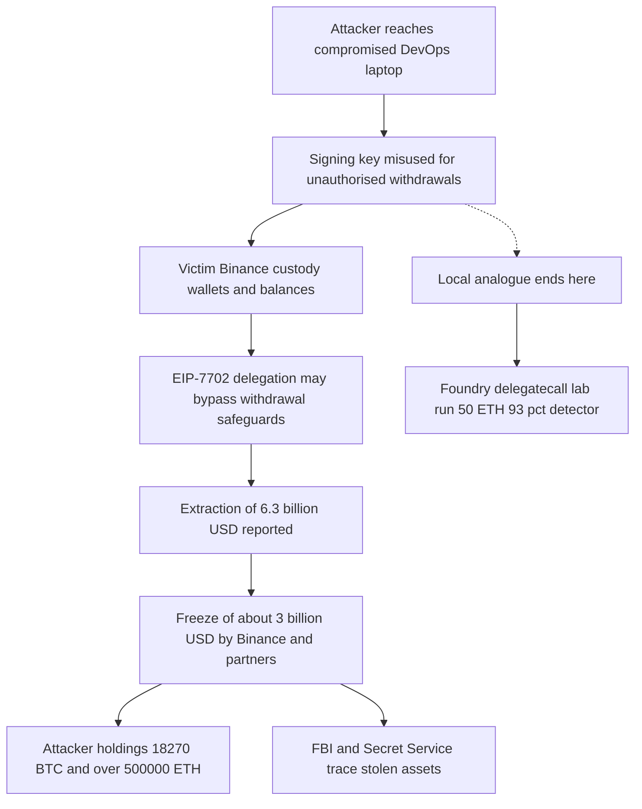
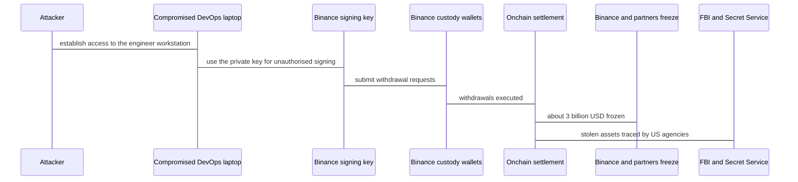

# The Binance $6.3B Breach — Mayall Forensic Report

## 1. Case header

| Field | Value |
| --- | --- |
| Incident | The Binance $6.3B breach (case ID `binance-7702`) |
| Chain | Ethereum |
| First signalled | 2026-10-29 |
| Publicly disclosed | 2026-10-30 |
| Record last updated | 2026-10-30 |
| Reported loss | $6.3 billion — reported as the largest hack in cryptocurrency history |
| Frozen amount | About $3 billion (Binance and partners) |
| Loss cover | More than $6.34 billion set aside; $5 billion in matching tokens held for the shortfall in the next proof-of-reserves report |
| Attacker holdings reported early 2026-10-30 | 18,270 BTC · more than 500,000 ETH |
| Attribution | North Korea's TraderTraitor — TRM Labs: high confidence (the analyst's wording) |
| Corroboration | ZachXBT identified stolen funds from the Binance and Bitget hacks converging at the same address |
| Status | Active investigation — recovery in progress, about $3 billion frozen |
| Primary classification | Access Control — 0.93 confidence — Bible pattern Ownership Hijack + Drain |
| Contributing classification | Delegate Call Injection — 0.45 confidence — Bible pattern Delegatecall Privilege Escalation — amplifier, not cause |
| Local reproduction | Delegatecall Implementation Injection (`/lab?scenario=delegatecall`, artifact `artifacts/delegatecall.json`) — 50 ETH loss, Delegate Call Injection detector fired at 93% confidence. This is a local reproduction of the closest analogue, not a reproduction of the breach. |
| Scope | Retrospective analysis of a publicly reported incident. No mainnet trace of the Binance incident was analysed, no incident transaction was replayed, and no incident hash, address or block number is published. |

## 2. Executive summary

Binance disclosed a $6.3 billion loss on 30 October 2026 — reported as the largest hack in cryptocurrency history — with about $3 billion frozen by Binance and its partners and roughly $1.6 billion in liquidations following. The mechanism was not a smart-contract exploit: Binance and Blockaid's CEO attribute it to a compromised DevOps engineer's laptop and private-key misuse, which makes this an access-control failure at the signing-key trust boundary, with EIP-7702 recorded only as a contributing amplifier that may have helped bypass withdrawal safeguards, never as the root cause. The only local reproduction in this case is a delegatecall-injection analogue that proves the delegatecall detector's behaviour, not the Binance breach. Attribution is the analysts', not ours: TRM Labs: high confidence, linking the theft to North Korea's TraderTraitor, with ZachXBT reporting that Binance and Bitget funds converged at the same address. This report is a retrospective classification over public reporting; Mayall did not replay the Binance transactions, holds no incident trace, and publishes no invented hash, address or block number.

## 3. Attack sequence

1. **2026-10-29 — first public signal.** A blockchain researcher warned that a Binance-linked wallet faced a possible exploit. This is the first public signal in the record; no on-chain trace has been published since.
2. **2026-10-30 — public disclosure.** Binance disclosed a $6.3 billion loss, reported as the largest hack in cryptocurrency history.
3. **2026-10-30 — root cause named.** Binance and Blockaid's CEO attributed the loss to a compromised DevOps engineer's laptop and private-key misuse, explicitly not a smart-contract exploit.
4. **2026-10-30 — EIP-7702 assessed.** Security experts said EIP-7702 did not cause the hack — attackers could have drained the wallets without it — but that the upgrade may have amplified the losses by helping bypass withdrawal safeguards.
5. **2026-10-30 — attribution.** Investigators linked the theft to North Korea's TraderTraitor. TRM Labs said it has high confidence in the attribution; ZachXBT reported Binance and Bitget funds converging at one address.
6. **2026-10-30 — freeze.** Binance and its partners froze roughly $3 billion in assets.
7. **2026-10-30 — law enforcement.** The FBI and Secret Service joined the response; US agencies are investigating the theft and helping trace stolen assets.
8. **2026-10-30 — holdings observed.** Early on 30 October the attacker held 18,270 BTC — more than Coinbase's reported corporate treasury — and a stash exceeding 500,000 ETH.
9. **2026-10-30 — loss cover.** Binance said it set aside more than $6.34 billion and holds $5 billion in matching tokens for the shortfall, to be included in its next proof-of-reserves report.
10. **2026-10-30 — market repricing.** BNB fell about 8%, Bitcoin traded near $77,000, roughly $1.6 billion in liquidations followed, and crypto-linked equities including Circle, Strategy and Coinbase sold off.
11. **2026-10-30 — secondary finding.** Reporters noted that investigators had uncovered additional breaches.

### Attack flow

### Funds flow

## 4. Evidence reconstruction

| Claim | Status | Basis |
| --- | --- | --- |
| Reported loss is $6.3 billion | Confirmed | Binance public disclosure, 2026-10-30; reported as the largest hack in cryptocurrency history |
| Root cause is private-key misuse from a compromised DevOps engineer's laptop, not a smart-contract exploit | Confirmed by the published record | Binance and Blockaid's CEO |
| EIP-7702 did not cause the hack; it may have amplified losses by helping bypass withdrawal safeguards | Hedged in the record | Security experts quoted on EIP-7702's role |
| Access control is the primary vector (0.93); delegatecall injection is a contributing amplifier (0.45) | Retrospective classification | Mayall taxonomy applied to the published record; confidence on the amplifier is deliberately low because the record is hedged |
| Attribution to North Korea's TraderTraitor | Analyst attribution | TRM Labs: high confidence. The wording is the analyst's own, not Mayall's |
| Binance and Bitget funds converged at the same address | Reported observation | ZachXBT |
| About $3 billion frozen | Confirmed | Binance and partners; recovery in progress |
| Binance pledged to cover all losses, set aside more than $6.34 billion and holds $5 billion in matching tokens | Confirmed | Binance statement |
| Attacker held 18,270 BTC and more than 500,000 ETH | Reported observation, early 2026-10-30 | Live reporting; holdings as reported, not independently traced by Mayall |
| Market impact: BNB about -8%, Bitcoin near $77,000, about $1.6 billion liquidations, crypto-linked equities sold off | Reported observation | Live and recap reporting |
| Investigator-uncovered additional breaches | Reported, unscoped | Reporters noted additional breaches; no detail published in the record |
| Ownership Hijack + Drain pattern threshold met | Not met | No on-chain event sequence published; the pattern is a classification, not a detection |
| Delegatecall Privilege Escalation pattern threshold met | Not met | No storage diff or implementation write published |
| Address Clustering threshold met | Not met | One observed signal at weight 2, below the ≥4 threshold; a lead, not a proven actor map |
| Incident transaction hash, block number, wallet address, contract name, victim count | Absent | No incident trace, hash or address was published, and Mayall publishes no invented hash, address or block number |

**What the local analogue proves.** The Foundry run of the delegatecall scenario reproduces a contract delegating execution to an attacker-controlled implementation that writes the host's storage and sweeps the host balance — 50 ETH loss, Delegate Call Injection detector fired at 93% confidence. It demonstrates that the delegatecall detector fires on storage-write and sweep behaviour in a local trace.

**What the local analogue cannot prove.** It does not reproduce the off-chain compromise of a DevOps engineer's laptop; it does not reproduce the misuse of a live Binance signing key; it does not reproduce EIP-7702 delegation-designator behaviour on an EOA, because the lab target is a contract that uses delegatecall, not an EIP-7702 account; and it does not reproduce the $6.3B scale, the multi-wallet withdrawal path, or any incident address or hash. No incident transaction was replayed and no incident address or hash is used.

## 5. Detection analysis

### Classification

**Primary — Access Control (confidence 0.93).** Mechanism: compromised DevOps laptop → private-key misuse → unauthorised signing. The trust boundary that broke was the signing key, not a contract. Binance and Blockaid's CEO describe a compromised DevOps engineer's laptop and private-key misuse, not a smart-contract exploit. That is an access-control failure in Mayall's taxonomy, and it is the incident's root cause.

**Contributing — Delegate Call Injection (confidence 0.45).** Mechanism: EIP-7702 delegation designator on an externally owned account. Security experts said EIP-7702 did not cause the hack — the wallets could have been drained without it — but the upgrade may have amplified the losses by helping bypass withdrawal safeguards. It is recorded as a contributing amplifier through the delegation-designator mechanism, never as the root cause. The confidence is deliberately low because the record is hedged.

### Bible pattern mapping

| Bible pattern | Family | Role | Attack type | Threshold (Bible text) | Threshold met | Note |
| --- | --- | --- | --- | --- | --- | --- |
| Ownership Hijack + Drain | Access Control | primary | Type A, Single Tx | Min 2 signals / Threshold: ≥6 weight | No | The closest sheet-04 pattern for a stolen privileged key used to drain funds. The threshold is not met on the verified record: no on-chain event sequence was published, so the pattern is a classification, not a detection. |
| Delegatecall Privilege Escalation | Access Control | contributing | Type A, Single Tx | Min 2 signals / Threshold: ≥6 weight | No | Recorded only as a contributing amplifier through the EIP-7702 delegation-designator mechanism. Security experts said the upgrade did not cause the hack, and no storage diff or implementation write is published. |
| Address Clustering | Graph / Attribution | context | Type C, Multi Address | Min 2 signals / Threshold: ≥4 weight | No | An attribution pattern, not a causal one. One observed W2 signal (weight 2) is below the ≥4 threshold, so the cluster is a lead, not a proven actor map. |

### Signal statuses

| Signal | Pattern | Family | Weight | Threshold (Bible text) | Status | Note |
| --- | --- | --- | --- | --- | --- | --- |
| ownership_transfer_then_drain | Ownership Hijack + Drain | Sequence | Weight 3 — Hard Evidence | OwnershipTransferred in event_sequence AND drain_ratio_exceeded in same tx_hash | expected | The record describes private-key misuse and a $6.3B drain, but publishes no OwnershipTransferred event and no on-chain authority change. The signal needs the event and the drain in the same transaction, so it is expected, not observed. |
| event_order_violation | Ownership Hijack + Drain | Sequence | Weight 2 — Strong | event_sequence: Withdrawn.log_index < Deposited.log_index for same user | expected | No event sequence for the incident is in the public record. Ordering cannot be assessed without logs, so the signal is expected rather than observed. |
| drain_ratio_exceeded | Ownership Hijack + Drain | Value | Weight 3 — Hard Evidence | total_out_eth / contract_balance_before > 0.80 | expected | A drain is not in dispute, but no per-contract balance ratio is published, so the Bible's >80% condition cannot be confirmed from public figures. Expected is the honest status. |
| delegatecall_storage_write | Delegatecall Privilege Escalation | Structural | Weight 3 — Hard Evidence | internal_calls.type = DELEGATECALL AND storage_mutations.contract = calling_contract | expected | EIP-7702 delegation designators execute delegated code in the signing account's context, which is the mechanism this signal describes. Experts said EIP-7702 did not cause the hack and the record publishes no storage diff, so the signal is expected, not observed. |
| proxy_implementation_change | Delegatecall Privilege Escalation | Structural | Weight 3 — Hard Evidence | storage_mutations.slot = 0x360894...implementation_slot AND value_before != value_after | notApplicable | EIP-7702 is not an EIP-1967 proxy and the record describes no implementation-slot write. The signal's slot condition does not apply to this incident. |
| ownership_transfer_then_drain | Delegatecall Privilege Escalation | Sequence | Weight 3 — Hard Evidence | OwnershipTransferred in event_sequence AND drain_ratio_exceeded in same tx_hash | expected | Shared with the ownership pattern: a delegated implementation that rewrites the host would have to drain in the same transaction. The event is not published for this incident. |
| address_cluster_identified | Address Clustering | Graph | Weight 2 — Strong | fund_hop_chains common source OR contract_creator_graph same deployer OR tx timing correlation < 2 blocks | observed | ZachXBT reports that stolen funds from the Binance and Bitget hacks converged at the same address. That is an attribution-level cluster statement in the published record, not a log observation. |
| contract_creator_linked | Address Clustering | Graph | Weight 3 — Hard Evidence | contract_creator_graph: deployer_address matches across 2+ contracts in same attack | notApplicable | No deployer or contract-creation data is published for this incident. |
| address_funded_before_attack | Address Clustering | Behavioural | Weight 2 — Strong | address_first_contact.first_contact_block >= (deploy_block - 50) AND prior_balance = 0 | notApplicable | No funding or staging history for the attacker is published in the verified record. |

Signal counts: 1 observed, 4 expected, 3 notApplicable. No Bible signal was observed on-chain. "Observed" here means the published record names the mechanism; "expected" means a full trace would be needed; "notApplicable" means the record does not describe that variant.

### Detector coverage matrix

The classification rests on a **compromised signing key, not a contract bug**. No contract bug exists in this incident, so most detectors cannot fire — and the two that matter most are out of scope rather than clean.

| Detector | Vector | Status | Reason | Limitation (verbatim) |
| --- | --- | --- | --- | --- |
| Reentrancy | reentrancy | not-fired | No contract re-entry is described. The attacker signed with a compromised key; there is no repeated call depth for the detector to count. | "Counts repetition, not causality. Two independent calls to the same function in one transaction are indistinguishable from a re-entrant loop without reading the state updates." |
| Flash Loan | flash-loan | not-fired | No flash-borrow, atomic capital or in-transaction repayment appears in the record. The loss is not capital-free amplification. | "Keyed on vocabulary as much as structure. A flash loan that is never named in the artifact can be missed unless the value transfer is unusually large." |
| Oracle Manipulation | oracle-manipulation | not-fired | No price source, oracle read or collateral valuation is implicated. This is a key compromise, not a pricing error. | "Cannot distinguish a manipulated price from a legitimately repriced asset without a reference value from outside the transaction." |
| Access Control Failure | access-control | out-of-scope | The detector looks for a privilege boundary inside an execution trace. Here the boundary was a person's laptop and a signing key used off-chain, so no authority slot ever appears in a trace Mayall can read. The symptom is visible only in the withdrawal records, not in the contract. | "Sees the symptom (an authority changed, a privileged function was called) but not whether the caller was entitled to it." |
| Delegate Call Injection | delegatecall-injection | out-of-scope | No incident call trace is published, so the EIP-7702 delegation path cannot be inspected. The same detector does fire on Mayall's local delegatecall analogue — see the measured 93% below — but that is an analogue, not this incident. | "Detects the opcode, not the damage. Whether the delegated code was hostile is inferred from the outcome." |
| Self Destruct / Forced Transfer | self-destruct | not-fired | No contract destruction or forced balance transfer is described in the record. | "On chains where SELFDESTRUCT is neutered, the trace shows the call but not the forced transfer." |
| Arithmetic / Precision Fault | arithmetic-overflow | not-fired | No overflow, truncation, precision fault or accounting panic is described. | "A silent overflow leaves no panic and no vocabulary; only the resulting balance delta betrays it, which is the job of the balance analysis." |
| Ordering / Front Running | front-running | not-fired | No ordering, mempool or sandwich manipulation is described in the record. | "Needs the ordering to be described. The trace alone cannot prove an attacker was ordered ahead of a victim within a block." |
| Bridge / Cross-Chain Verification Failure | bridge-exploit | not-fired | No bridge, relayer or cross-chain message verification is implicated in this incident. Bitget and THORChain are prior context, not part of this case. | "Runs entirely inside one EVM. A cross-chain exploit whose local half is unremarkable will not be detected from the local trace alone." |
| Invariant / Logic Error | logic-error | out-of-scope | This detector is deliberately residual: it labels an otherwise unexplained loss. The loss here is explained by key misuse, so using it would relabel a known cause as "unexplained". | "Deliberately residual. It is the detector of last resort, so it fires when nothing else does and should be read as \"unexplained\", not \"proven\"." |

**Local analogue result, measured.** Delegatecall Implementation Injection (`/lab?scenario=delegatecall`, artifact `artifacts/delegatecall.json`): loss 50 ETH; detector `det-delegatecall` (Delegate Call Injection) fired at 0.93 confidence. This is a local reproduction of the closest analogue, not of the Binance breach. No incident transaction was replayed and no incident address or hash is used.

## 6. Remediation

**Access-control root cause — Ownership Hijack + Drain (primary).**

1. **Move signing to hardware-backed custody with a quorum (HSM or MPC).** No single laptop, session or engineer may produce a withdrawal signature. This is the direct control for the pattern's core failure — a stolen privileged key being sufficient to drain funds.
2. **Rotate every signing key and session credential on the compromised DevOps estate.** Assume the laptop carried more than one key. Rotation is what converts "Ownership Hijack + Drain" from a standing capability into a closed path.
3. **Withdrawal rate limits and address allowlisting.** Per-asset caps, velocity limits and a 24-hour cool-down for new destinations convert a single compromised key from an unbounded drain into a rate-limited one — the "Drain" half of the pattern needs both a key and an unthrottled exit.
4. **Deploy withdrawal anomaly detection** on velocity, geography, new device and unusual approver, with a tested paging path and a named owner. The Access Control detector's stated limitation — "Sees the symptom (an authority changed, a privileged function was called) but not whether the caller was entitled to it." — is why off-chain withdrawal approvals need their own monitoring.
5. **Independent review of key custody and DevOps access**, covering the signing path end to end rather than the single wallet that was hit, so a second compromised laptop is not found the same way.

**EIP-7702 amplifier — Delegatecall Privilege Escalation (contributing).**

6. **Revoke or re-point EIP-7702 delegation designators on affected externally owned accounts, and allow only audited implementations.** This closes the structural path the amplifier uses and makes the delegatecall signal's condition — "internal_calls.type = DELEGATECALL AND storage_mutations.contract = calling_contract" — a control point rather than an unobserved possibility.
7. **Delegation-designator monitoring: alert on any new EIP-7702 authorization to a non-allowlisted implementation, and diff account code on a schedule.** This is the only way to close the gap the record leaves open, since "proxy_implementation_change" is notApplicable here and no storage diff was published.
8. **Withdraw the "EIP-7702 did not cause the hack" reading from internal risk language.** The record says the upgrade did not cause the hack but may have amplified the losses by helping bypass withdrawal safeguards. Controls for the amplifier are justified on that hedged record, while the root-cause classification stays access-control.

**Detection posture.**

9. **Trace the THORChain and Bitget routes as prior-context laundering patterns, and hunt the TraderTraitor pattern** across endpoint IOCs, DevOps credential access, signed-binary abuse and CI/CD trust paths in the laptop fleet. The Address Clustering pattern sits below its threshold ("Min 2 signals / Threshold: ≥4 weight"), so the cluster is a lead to be fed to exchanges and the tracing firm, not a proven actor map.
10. **Publish a post-incident report separating confirmed facts, analyst attribution and the EIP-7702 amplifier question**, and carry the $6.34 billion cover and $5 billion matching-token position into the next proof-of-reserves with a published methodology rather than a headline figure.

## 7. Client action plan

### First 24 hours

1. **Freeze and reconcile.** Confirm the roughly $3 billion frozen figure with the counterparties holding it, and publish one reconciled loss number with its source.
2. **Rotate every signing key and session credential that touched the compromised DevOps estate.** Assume the laptop carried more than one key.
3. **Move signing to hardware-backed custody with a quorum (HSM or MPC).** No single laptop, session or engineer may produce a withdrawal signature.
4. **Revoke or re-point EIP-7702 delegation designators on affected externally owned accounts,** and allow only audited implementations.
5. **Preserve evidence before rotation destroys it:** signing-service logs, endpoint telemetry, withdrawal approvals and the DevOps access trail.
6. **Notify the FBI and Secret Service,** share the attacker address set, and retain a tracing firm for post-exploit flow analysis.

### First week

7. **Delegatecall and delegation-designator monitoring.** Alert on any new EIP-7702 authorization to a non-allowlisted implementation, and diff account code on a schedule.
8. **Withdrawal rate limits and address allowlisting.** Per-asset caps, velocity limits, and a 24-hour cool-down for new destinations.
9. **Proof-of-reserves.** Include the more than $6.34 billion cover and the $5 billion in matching tokens, with a published methodology rather than a headline figure.
10. **Hunt the TraderTraitor pattern.** Endpoint IOCs, DevOps credential access, signed-binary abuse and CI/CD trust paths across the laptop fleet.
11. **Trace the THORChain and Bitget routes as prior-context laundering patterns.** Feed address clusters to exchanges and the tracing firm.

### First month

12. **Commission an independent review of key custody and DevOps access,** covering the signing path end to end rather than the single wallet that was hit.
13. **Deploy withdrawal anomaly detection** on velocity, geography, new device and unusual approver, with a tested paging path and a named owner.
14. **Run a tabletop exercise for signing-key compromise,** including law-enforcement liaison, public disclosure cadence and customer communication.
15. **Publish a post-incident report** that separates confirmed facts, analyst attribution and the EIP-7702 amplifier question.