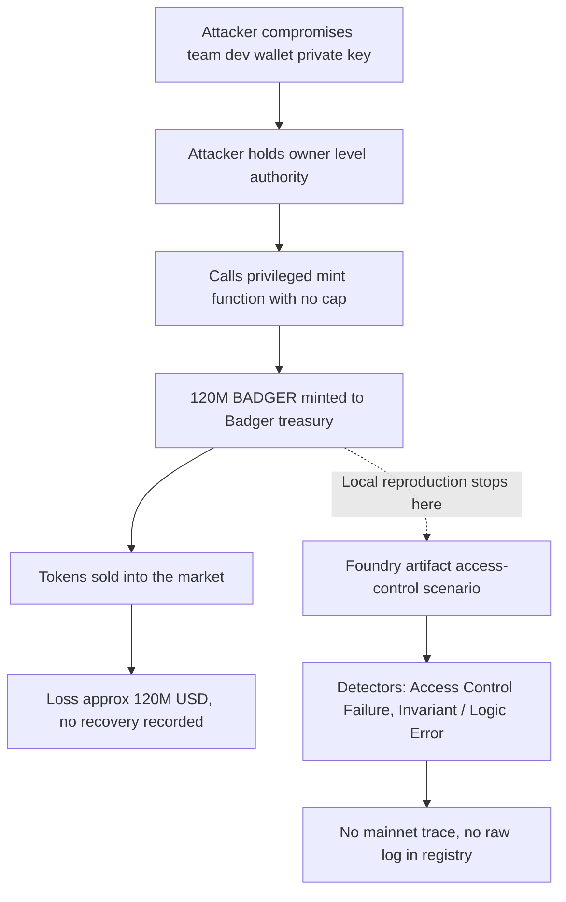

# Badger DAO Dev Wallet Mint — Forensic Report

## 1. Case header

| Field | Value |
| --- | --- |
| Incident ID | inc-0016 (`badger-dao-mint`) |
| Incident | Badger DAO Dev Wallet Mint |
| Chain | Ethereum |
| Date | 2021-12-02 |
| Reported loss | ~$120,000,000 USD, stated as 120,000,000 BADGER (native asset of the record) |
| Recovery | Not recovered (`recovered: false`) |
| Target | Badger DAO |
| Attacker actor | `0x18293a4b5c6d7e8f90a1b2c3d4e5f6071829304` — "Compromised dev wallet" |
| Victim actor | `0x293a4b5c6d7e8f90a1b2c3d4e5f60718293041526` — "Badger treasury" |
| Transaction of record | `0x18293a4b5c6d7e8f90a1b2c3d4e5f6071829304a5b6c7d8e9f90a1b2c3d4e5f60` |
| Attack vector | access-control |
| Classification | retrospective-classification, severity high, top confidence 0.9 |
| Bible pattern | Ownership Hijack + Drain (family: Access Control) |
| Bible signals | `ownership_transfer_then_drain` = observed; `event_order_violation` = expected; `drain_ratio_exceeded` = expected; notApplicable count 0 |
| Local reproduction | Scenario `access-control`, available, source `artifacts/access-control.json`, lab link `/lab?scenario=access-control` |
| Reference | Badger DAO post-mortem — https://badger.com/ |

## 2. Executive summary

This report is a retrospective classification of a historical public record, not a mainnet trace analysis of the 2021-12-02 Badger DAO incident. The published account states that a Badger DAO internal team wallet's private key was compromised, and that the compromised dev wallet was used to mint an unbounded amount of BADGER — recorded here as 120,000,000 BADGER, valued at roughly $120,000,000. The mechanism is an access-control failure: a key holder with owner-level authority exercised an unconstrained mint path, and the resulting tokens were sold into the market, with no recovery recorded. Classification confidence is 0.9 on the single finding (vector `access-control`, severity high), mapped to the Bible pattern Ownership Hijack + Drain, with one signal `ownership_transfer_then_drain` marked observed because the published narrative names the mechanism, and two signals (`event_order_violation`, `drain_ratio_exceeded`) marked expected because no raw log for this incident exists in the registry. Mayall's detectors were executed against the local Foundry reproduction of the same access-control vector, and they describe that reproduction only — they are not observations of the historic mainnet transaction.

## 3. Attack sequence

1. **Key compromise.** An internal Badger DAO team wallet had its private key compromised by an attacker. The record identifies the resulting address `0x18293a4b5c6d7e8f90a1b2c3d4e5f6071829304` as the "Compromised dev wallet" and assigns it the attacker role.
2. **Owner-authority access.** The attacker operated from the compromised dev wallet and therefore held whatever protocol-owner authority that wallet's key carried.
3. **Unbounded mint.** Using that authority, the attacker called the privileged mint path with no effective cap, producing 120,000,000 BADGER against the Badger treasury at `0x293a4b5c6d7e8f90a1b2c3d4e5f60718293041526`. The root cause as published is specifically the unbounded mint, not a market or oracle manipulation.
4. **Dump into the market.** The minted BADGER was then sold into the market, realising roughly $120,000,000 for the attacker.
5. **No recovery.** The record carries `recovered: false`; no mitigating recovery transaction is described.
6. **Boundary of this report.** The registry contains a single transaction reference for this incident. The disposition of every minted token beyond the stated market sale — where the remainder went, whether into OTC desks, liquidity pools, or other addresses — is not recorded in the data available and is not asserted here.

### Attack flow

## 4. Evidence reconstruction

| Claim | Status | Basis |
| --- | --- | --- |
| A team dev wallet private key was compromised | Supported | Published root cause and summary for inc-0016 |
| Attacker minted 120,000,000 BADGER with no effective cap | Supported | Published root cause states an unbounded mint of an unbounded amount, summarised as 120M BADGER |
| Minted tokens were sold into the market for roughly $120M | Supported | Published summary states the tokens were dumped into the market for roughly $120M |
| Reported loss magnitude is $120,000,000 USD | Supported | `lossUsd: 120000000`, `lossAmount: 120000000`, `lossAsset: BADGER` |
| Attacker address is the compromised dev wallet `0x18293a4b5c6d7e8f90a1b2c3d4e5f6071829304` | Supported | Actor list, role `attacker` |
| Victim is the Badger treasury `0x293a4b5c6d7e8f90a1b2c3d4e5f60718293041526` | Supported | Actor list, role `victim` |
| Incident date is 2021-12-02 on Ethereum | Supported | Incident record fields |
| Funds were not recovered | Supported | `recovered: false` |
| Transaction `0x18293a4b5c6d7e8f90a1b2c3d4e5f6071829304a5b6c7d8e9f90a1b2c3d4e5f60` is the mint | Partially supported | It is the only transaction in the registry for this incident and is cited as an evidence ref for the finding; the record does not state its function, block, or internal calls |
| The mint was executed from the dev wallet in one transaction | Not established | No raw log or trace is in the registry; only the tx hash reference exists |
| On-chain event ordering proves the ownership-then-drain sequence | Not established | `event_order_violation` status is `expected`; the note states a trace would be required and no raw log for this incident is in the registry |
| A measurable drain ratio from the treasury was computed | Not established | `drain_ratio_exceeded` status is `expected`; the note states a trace would be required |
| The historic mint is unbounded and the victim balance was zeroed | Local reproduction only | The local detector evidence records "Victim balance moved 50000000000000000000000 -> 0 wei" in the Foundry artifact, not on mainnet |
| A privileged state-changing function was reachable by an untrusted caller in the reproduction | Local reproduction only | Local detector `det-access-control` rationale and evidence "Privilege boundary referenced in the exploit (onlyowner)" |
| An invariant was enforced on one path but not the attacker's path | Local reproduction only | Local detector `det-logic` rationale and evidence "Broken design invariant referenced (intended)" |
| The full disposition of all 120M minted BADGER | Absent | The record states only that tokens were sold into the market; the disposition of the remainder is not recorded and is not asserted here |

## 5. Detection analysis

Two detectors fired against the local Foundry artifact for the same attack vector (`artifacts/access-control.json`). As stated in the record, "Detections were executed against the local Foundry artifact for the same attack vector. They describe the reproduction, not the historic mainnet transaction."

**det-access-control — "Access Control Failure"** fired. Confidence 0.7, severity high. Rationale: "A state-changing privileged function is reachable by an untrusted caller, so the attacker can act with protocol-owner authority." Evidence: "Privilege boundary referenced in the exploit (onlyowner)". Its stated limitation: "Sees the symptom (an authority changed, a privileged function was called) but not whether the caller was entitled to it."

**det-logic — "Invariant / Logic Error"** also fired, with vector `logic-error`. Confidence 0.7, severity high. Rationale: "The protocol enforced an invariant in one code path but not in the path the attacker used, so value escaped through an unguarded branch." Evidence: "Broken design invariant referenced (intended)" and "Victim balance moved 50000000000000000000000 -> 0 wei". No separate limitation text is recorded for this detector beyond the shared note quoted above, so the access-control detector's limitation is the only verbatim limitation on file for the pair.

**Bible signal names that would prove the pattern.** For the mapped pattern Ownership Hijack + Drain: `ownership_transfer_then_drain` (family Sequence) has status `observed` — the published narrative names this mechanism, and the registry notes this is "a record-level statement, not a log observation"; `event_order_violation` (family Sequence) has status `expected` — the note states it "Would be required to prove the pattern from a trace; no raw log for this incident is in the registry"; `drain_ratio_exceeded` (family Value) has status `expected` — the note states it "Would be required to prove the pattern from a trace; no raw log for this incident is in the registry". No signal carries status `notApplicable` in this incident. No Bible signal is claimed here to have been observed on-chain.

**What the local reproduction proves.** It proves that in the Foundry artifact, a privileged mint path was reachable by a caller without entitlement to it, and that value moved out of the victim account to zero in that path. It reproduces the same access-control attack vector as the historical incident.

**What the local reproduction cannot prove.** It cannot prove anything about the specific mainnet transaction, the historic private key compromise, the token count actually minted on 2021-12-02, the realised USD proceeds, the disposition of tokens beyond the stated sale, or the on-chain event ordering and drain ratio needed for the two `expected` signals. The detector limitations compound this: the access-control detector itself "Sees the symptom (an authority changed, a privileged function was called) but not whether the caller was entitled to it," so it cannot by itself distinguish legitimate owner action from key theft.

## 6. Remediation

Controls are specified per attack vector and tied to the mapped Bible pattern Ownership Hijack + Drain (family Access Control).

**Access-control — unbounded privileged mint (primary vector, `det-access-control`).**
- Impose a hard cap on any mint path, enforced in code and not by configuration alone, so no single key can create unbounded supply. This directly targets the published root cause.
- Gate every state-changing privileged function behind a threshold or multisig signer set, so compromise of one key does not confer full mint authority.
- Add per-block and per-epoch mint rate limits with alerting on abnormal issuance volume.
- Monitor and alert on every mint event, including the mint amount, the caller, and the resulting supply change, so an unbounded call is caught at the first block.
- Pattern link: `ownership_transfer_then_drain` — the chain of privileged authority is the point of failure the pattern exploits.

**Invariant / logic consistency (`det-logic`).**
- Enforce the same invariant on every branch that can move value, including emergency and admin paths, rather than only the primary code path.
- Add explicit tests asserting that the victim balance cannot be driven to zero by an unauthorized path and that no path bypasses the supply cap.
- Apply invariant checks at the settlement boundary so a value escape is reverted rather than completed.
- Pattern link: `event_order_violation` and `drain_ratio_exceeded` — the two `expected` signals here are the trace-time checks that would have detected the unguarded branch and the disproportionate outflow; implementing the invariant so these checks pass by construction removes the exploitable gap.

**Key management (root cause — compromised team dev wallet).**
- Move treasury and mint operations off single hot keys onto hardware-backed multisig custody, with key rotation on a defined cadence and on every personnel change.
- Eliminate long-lived dev-wallet keys for privileged operations; scope any remaining dev key to non-privileged actions.
- Maintain a deposit address whitelist and a short settlement delay on large mints or treasury outflows, so a compromised key cannot immediately realise value.
- Pattern link: `ownership_transfer_then_drain` — the observed signal is the narrative of an authority change followed by a drain; the control set must break the second link, not merely the first.

## 7. Client action plan

**First 24 hours**
1. Rotate and revoke every key associated with the affected Badger team and treasury wallets; invalidate any key that could have interacted with the mint path, and confirm the replacement multisig is the only signer with mint rights.
2. Confirm the current mint path is paused or capped, and record the on-chain state of the token contract's supply, admin roles, and any paused or unpaused flags, with dated screenshots or node references.
3. Freeze outbound movement from any wallet that still holds BADGER exposure until signer inventory is complete.
4. Log the incident reference `inc-0016` and the sole transaction reference `0x18293a4b5c6d7e8f90a1b2c3d4e5f6071829304a5b6c7d8e9f90a1b2c3d4e5f60` as the starting point for any raw-log retrieval, and attempt to source the original transaction trace and the post-mortem referenced at https://badger.com/.
5. Publish a holding statement internally and, where required, externally stating only what the public record supports, without asserting a disposition of the minted tokens beyond the recorded market sale.

**First week**
1. Retrieve the raw transaction log for the transaction of record and produce a trace that would allow `event_order_violation` and `drain_ratio_exceeded` to be evaluated directly, moving them from `expected` to observed or not observed on evidence rather than on narrative.
2. Audit the mint function in source and at bytecode level, documenting the current supply cap, the access-control modifier chain, and every branch that can reach the mint body.
3. Build a complete signer and key inventory for all privileged roles, mapping each key to its holder, its custody method, and its last rotation date.
4. Quantify exposure: total BADGER minted outside the sanctioned schedule, treasury balance before and after, and the share of supply affected.
5. Run the Mayall access-control scenario against the live client codebase to confirm the local reproduction's findings hold on production code, and extend the check to the invariant/logic path.

**First month**
1. Implement the capped, multisig-gated mint path with a phased cap and documented upgrade path; ship the invariant tests covering every value-moving branch.
2. Deploy continuous monitoring on mint events, supply changes, treasury outflows, and signer-set changes, with alerting thresholds and a documented escalation path to the treasury signers.
3. Stand up the remaining controls — key rotation cadence, settlement delay and deposit whitelist on large outflows, and a scoped dev key with no mint privileges.
4. Produce a quarterly attestation covering signer inventory integrity, cap configuration, and detector coverage, and re-run the local Foundry reproduction as a regression test in CI on every protocol change.
5. Close out the incident record with the trace-based signal determinations, the final exposure reconciliation, and an updated classification for `inc-0016` that reflects evidence rather than published narrative.