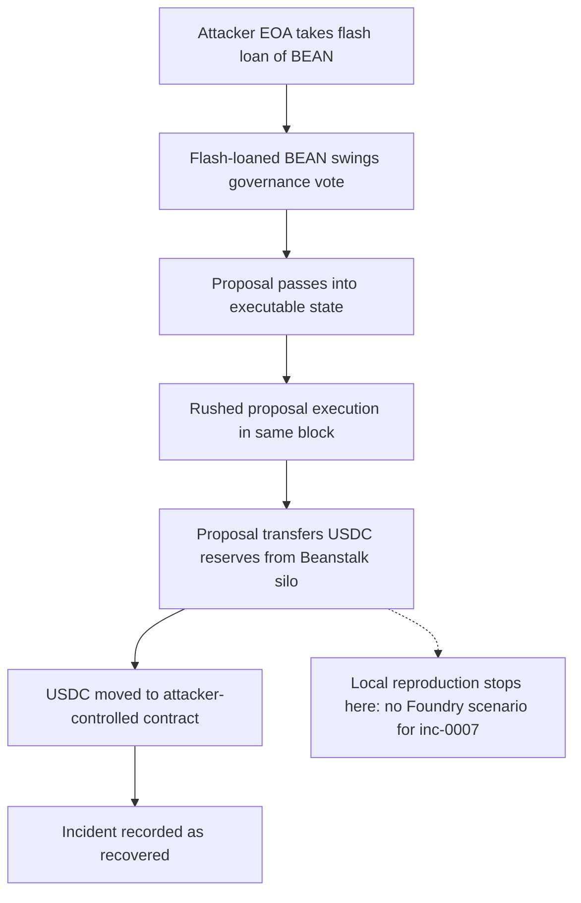

# Beanstalk Governance Capture — Forensic Incident Report

## 1. Case header

| Field | Value |
|---|---|
| Incident | Beanstalk Governance Capture (`inc-0007`, `beanstalk-governance-attack`) |
| Chain | Ethereum |
| Date | 2022-04-21 |
| Reported loss | 75,000,000 USD — 75,000,000 USDC |
| Recovered | Yes (`recovered: true`) |
| Target | Beanstalk |
| Actors | Attacker EOA `0x3f0a1e2b3c4d5e6f708192a3b4c5d6e7f80912a3b`; Beanstalk silo `0x9f8e7d6c5b4a39281706f5e4d3c2b1a09f8e7d6c` (victim) |
| Vectors | Front-running; Access control |
| Classification | `retrospective-classification` — severity **high**, top confidence **0.82** |
| Local reproduction | None. No local Foundry reproduction exists for this incident; no scenario ID, no detector was executed |
| Reference | Beanstalk disclosure — https://beanstalk.farm/announcement |

Bible mapping: Front Running → **Governance Manipulation** (Graph / Attribution family), confidence 0.82, severity medium; Access Control → **Ownership Hijack + Drain**, confidence 0.62, severity high.

## 2. Executive summary

On 2022-04-21 an attacker on Ethereum used a flash loan of BEAN to swing a Beanstalk governance vote and then, within the same block, executed the proposal he had just passed, transferring the protocol's USDC reserves to a contract he controlled — a reported loss of 75,000,000 USDC (75,000,000 USD) from the Beanstalk silo, with `recovered: true` recorded on the incident. This report is a **retrospective classification over public records**, not a mainnet trace analysis: the mechanism is taken from the published root cause and summary for the incident, and no raw transaction logs were re-derived. The finding set resolves to two vectors — front-running (confidence 0.82, medium) mapped to the Bible pattern **Governance Manipulation**, and access-control (confidence 0.62, high) mapped to **Ownership Hijack + Drain** — against 5 `observed`, 1 `expected` and 0 `notApplicable` Bible signal statuses. No local Foundry reproduction exists for this incident and no Mayall detector was executed, so the detection analysis in Section 5 is a **Bible-signal mapping only** and not a set of observed detector firings. The record states that the proposal transferred reserves to a contract the attacker controlled; the disposition of the funds beyond that transfer is not recorded in the incident data.

## 3. Attack sequence

1. The attacker obtained a flash loan of BEAN, which provided temporary voting weight without committed capital.
2. Using that flash-loaned BEAN, the attacker swung a Beanstalk governance vote, moving the proposal into an executable state.
3. The proposal execution was rushed — governance instantiation and proposal execution occurred within the same block, so the rushed execution window became part of the exploit rather than an operational convenience.
4. The attacker immediately executed the proposal that had just been passed.
5. That proposal transferred the protocol's USDC reserves out of the Beanstalk silo to a contract the attacker controlled.
6. The incident records `recovered: true`. The record does not state how the funds were recovered, nor does it describe any subsequent transfer, sale, dispersion or extraction beyond the transfer to the attacker-controlled contract.

### Attack flow

The dashed node marks where the local reproduction stops: no local Foundry scenario exists for this incident, so the flow above is reconstructed from the published root cause and summary only and was not re-executed locally.

## 4. Evidence reconstruction

| Claim | Status | Basis |
|---|---|---|
| A flash loan of BEAN was used to swing a governance vote | Supported | Root cause and summary both name the flash-loaned BEAN mechanism; `flashloan_bracket_detected` is `observed` at the record level |
| Governance instantiation and proposal execution occurred in the same block | Supported | Root cause: "a rushed proposal execution let the attacker capture a governance vote and drain the silo in the same block"; `governance_instant_execution` is `observed` at the record level |
| The proposal transferred USDC reserves to an attacker-controlled contract | Supported | Summary: the proposal "transferred the protocol's USDC reserves to a contract they controlled" |
| The Beanstalk silo (victim) held the drained USDC reserves | Supported | Victim actor `0x9f8e7d6c5b4a39281706f5e4d3c2b1a09f8e7d6c` labelled "Beanstalk silo" |
| Loss of 75,000,000 USDC (75,000,000 USD) | Supported | `lossUsd` / `lossAmount` / `lossAsset` fields of the incident record |
| The loss was recovered | Supported | `recovered: true`; the record does not state the recovery mechanism or the recovering party |
| The attacker held an unauthorised privilege that was exercised | Not proven | `ownership_transfer_then_drain` is `expected`, not `observed` — a full trace would be needed, and no raw log for this incident is in the registry |
| Where the transferred USDC went after reaching the attacker-controlled contract | Not recorded | The incident record stops at the transfer; no subsequent transfer, sale, dispersion or extraction is described |
| On-chain ordering placing the attacker ahead of a victim within a block | Not proven | The front-running detector limitation states the trace alone cannot prove this ordering; no detector was executed |
| A local Foundry reproduction of the same attack vector | Does not exist | `localDetection.available: false`, `scenarioId: null`, `detections: []` |

**What the local reproduction proves:** nothing for this incident — no local Foundry reproduction exists and no detector was executed.

**What it cannot prove:** every mechanism above is asserted at record level from the published root cause and summary, not from a re-executed trace or a local scenario. No log-level ordering, no caller-entitlement proof, and no fund disposition beyond the reserve transfer are available.

## 5. Detection analysis

**No detector fired on this incident.** The local detection block records `available: false` and `detections: []`, with the note: "No local Foundry reproduction exists for this incident. No detector was executed; the detection analysis below is a Bible-signal mapping only." The mapping below is therefore a statement of which Bible signals each vector asserts, and of what a detector would need to observe to prove the pattern — not a report of detector output.

**Front Running — Bible pattern: Governance Manipulation (Graph / Attribution family), confidence 0.82, severity medium.**

| Bible signal | Status | Family | Meaning in this record |
|---|---|---|---|
| `governance_instant_execution` | observed | Sequence | The published narrative names this mechanism. It is a record-level statement, not a log observation. |
| `flashloan_bracket_detected` | observed | Structural | The published narrative names this mechanism. It is a record-level statement, not a log observation. |
| `drain_ratio_exceeded` | observed | Value | The published narrative names this mechanism. It is a record-level statement, not a log observation. |

Detector limitation, quoted verbatim: "Needs the ordering to be described. The trace alone cannot prove an attacker was ordered ahead of a victim within a block."

**Access Control — Bible pattern: Ownership Hijack + Drain (Access Control family), confidence 0.62, severity high.**

| Bible signal | Status | Family | Meaning in this record |
|---|---|---|---|
| `ownership_transfer_then_drain` | expected | Sequence | Would be required to prove the pattern from a trace; no raw log for this incident is in the registry. |
| `event_order_violation` | observed | Sequence | The published narrative names this mechanism. It is a record-level statement, not a log observation. |
| `drain_ratio_exceeded` | observed | Value | The published narrative names this mechanism. It is a record-level statement, not a log observation. |

Detector limitation, quoted verbatim: "Sees the symptom (an authority changed, a privileged function was called) but not whether the caller was entitled to it."

**Signal budget:** 5 `observed`, 1 `expected`, 0 `notApplicable`. The single `expected` signal — `ownership_transfer_then_drain` — is the one that would convert the access-control finding from an assertion into a proof, and it is exactly the signal a full trace would be required to produce. Note also that `drain_ratio_exceeded` is carried by both findings, so the five `observed` statuses do not represent five independent pieces of evidence; they overlap on that Value-family signal.

## 6. Remediation

Controls below are addressed per vector and tied to the Bible pattern each one defends.

**Front-running / Governance Manipulation**

1. **Timelock on proposal execution** — route every executed proposal through a timelock so voting and execution cannot occur in the same block. This directly targets `governance_instant_execution` (Sequence), whose `observed` status rests on the rushed same-block execution in the published narrative.
2. **Flash-loan-aware voting weight** — derive voting power from a snapshot that cannot be inflated within a single transaction, or apply a delay between the vote and the vote being counted. This targets `flashloan_bracket_detected` (Structural), the mechanism that gave the attacker voting weight without committed capital.
3. **Vote escrow and weight decay over the voting window** — force BEAN used for voting to be locked, or its weight to decay, so a flash loan cannot carry a proposal to passage on its own. This defends the Governance Manipulation pattern at the weight-acquisition step rather than at the execution step.
4. **Drain-ratio alerting on silo outflows** — monitor and alarm when a single proposal or block moves an outsized share of silo reserves, targeting `drain_ratio_exceeded` (Value).

**Access control / Ownership Hijack + Drain**

5. **Per-call authorisation and role-entitlement logging for privileged proposal execution** — validate and record the entitlement of the caller executing a proposal, so an authority change followed by a privileged call can be proven from logs. This targets `ownership_transfer_then_drain` (Sequence), the one signal left `expected`, and `event_order_violation` (Sequence), whose `observed` status likewise rests on the published narrative rather than on logs.
6. **Segregation of proposal-author and proposal-executor roles** — require distinct entities or distinct keys for authoring a proposal and executing it, with an executor permitted only to execute proposals that passed under the timelock from Control 1. This defends the Ownership Hijack + Drain pattern by breaking the single-actor chain.
7. **Timelock-gated ownership and admin transfers** — apply the same delay to any admin or ownership change as to proposal execution, so a same-block privilege change cannot be monetised immediately.
8. **Reserve pull rather than push, with per-call caps** — require reserve movement out of the silo to be bounded per call and to emit an explicit, attributable transfer record, reducing the blast radius that `drain_ratio_exceeded` describes.

**Cross-cutting**

9. **Reproducibility** — build a local Foundry scenario for this incident and register it under a scenario ID, so the detection analysis can be validated against executed detectors rather than mapped signals alone. At present `scenarioId` is `null` for both the incident and the local detection block.

## 7. Client action plan

### First 24 hours

1. **Confirm and preserve the incident record.** Fix the canonical record for `inc-0007`: loss 75,000,000 USDC on Ethereum dated 2022-04-21, the attacker EOA, the Beanstalk silo, and the single recorded transaction `0x3f0a1e2b3c4d5e6f708192a3b4c5d6e7f80912a3b4c5d6e7f8091a2b3c4d5e6f`. Keep the Beanstalk disclosure as the primary reference.
2. **Record the fund disposition explicitly as unrecorded.** The record stops at the transfer of USDC reserves to an attacker-controlled contract; mark the onward disposition as not recorded rather than inferring a dispersion or extraction.
3. **Harvest the raw logs for the incident block.** No raw log for this incident is in the registry, which is what holds `ownership_transfer_then_drain` at `expected`. Pulling the logs for the recorded transaction is the single highest-value action available.
4. **Scope current exposure to the same pattern.** Search the target's live deployment for a proposal path that permits execution without a timelock, and for any proposal or ownership change capable of moving silo reserves in a single block.

### First week

5. **Trace and formalise the ordering.** Use the recovered logs to determine whether the proposal instantiation and execution could occur in one block, and whether a flash-loan-funded vote was sufficient for passage. Document the result against the `governance_instant_execution` and `flashloan_bracket_detected` signals so they move from record-level assertion to log-observed status.
6. **Validate the access-control finding.** From the same logs, establish whether an authority changed and whether the privileged caller was entitled — the exact gap named by the access-control detector limitation: "Sees the symptom (an authority changed, a privileged function was called) but not whether the caller was entitled to it."
7. **Close the drain-ratio gap.** Measure the proportion of silo reserves moved by the proposal and calibrate a monitoring threshold on `drain_ratio_exceeded` for the live protocol.
8. **Author the local Foundry scenario.** Implement the flash-loan-vote-then-execute path as a scenario, assign a scenario ID, and link it to `inc-0007` so future runs produce executed detector evidence instead of signal mappings.
9. **Issue the governance control set.** Deliver the timelock, flash-loan-aware voting weight, vote escrow, and segregated author/executor controls as a single design package with an implementation timeline.

### First month

10. **Deploy the monitoring set.** Enable drain-ratio, same-block governance execution, and privilege-change-then-drain detectors against the live protocol, with alert thresholds set from the incident-calibrated values.
11. **Complete the remediations that require protocol change.** Roll out role segregation, timelocked ownership and admin transfers, and capped per-call reserve movement, and verify each against the Bible patterns it defends.
12. **Re-run the full detection suite.** With the scenario registered, execute the Mayall detectors against the local reproduction and replace the mapping-only detection analysis with recorded detector output, including confidence and evidence.
13. **Close the case file.** Reclassify the six Bible signal statuses on the strength of trace-backed evidence, and update the incident's severity and confidence values — currently top confidence 0.82 with 5 `observed`, 1 `expected`, 0 `notApplicable` — to reflect what the logs actually prove.
14. **Replicate the pattern hunt.** Apply the same three signal checks to other Beanstalk-adjacent or sibling governance protocols to find the pattern before it is exploited.