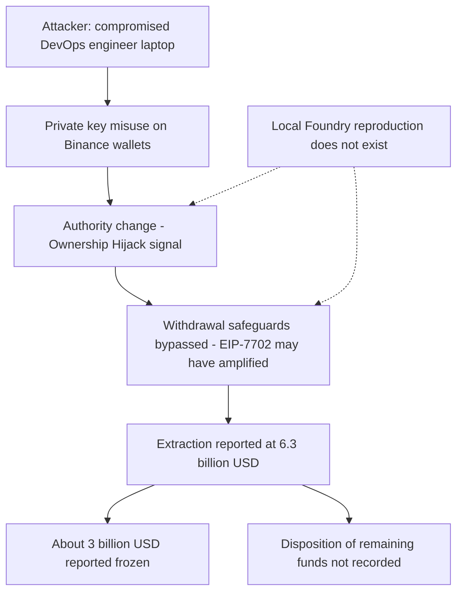

# Binance $6.3B Breach — Mayall Forensic Report

## 1. Case header

| Field | Value |
|---|---|
| Incident ID | inc-0017 (`binance-7702-breach`) |
| Incident name | Binance $6.3B Breach |
| Chain | Ethereum |
| Date of incident | 2026-10-30 |
| Target | Binance |
| Reported loss (USD) | $6,300,000,000 |
| Reported loss (native asset) | Not recorded — `lossAmount` and `lossAsset` are null in the registry |
| Recovery status | `recovered: false` in the registry; the published summary separately reports about $3 billion frozen |
| Actors | No actors registered in the registry (`actors: []`). Published attribution in the summary: TRM Labs attributed the theft to North Korea's TraderTraitor with high confidence |
| Attack vectors | `access-control`; `delegatecall-injection` |
| Classification | `retrospective-classification`, severity **critical**, top confidence **0.76** |
| Local reproduction | None — `reproducible: false`, `scenarioId: null`, local detection `available: false`, no detector executed |
| Recorded transactions | None — `txs: []`; no transaction hash, address, or on-chain log is present in the record |

Findings summary:

| Vector | Label | Severity | Confidence | Bible pattern | Bible family |
|---|---|---|---|---|---|
| `access-control` | Access Control | high | 0.76 | Ownership Hijack + Drain | Access Control |
| `delegatecall-injection` | Delegate Call Injection | critical | 0.56 | Delegatecall Privilege Escalation | Access Control |

Bible signal counts: **observed 2**, **expected 4**, **notApplicable 0**.

## 2. Executive summary

This is a retrospective classification of a historic incident over public records, not a mainnet trace analysis; the registry holds no transaction hash, address, raw log, or local Foundry reproduction for it, so every finding below is a record-level statement. Binance disclosed a loss of $6,300,000,000 on 2026-10-30, reported in the summary as the largest hack in cryptocurrency history, with the loss expressed in USD only and no native-asset amount recorded. The published root cause describes key misuse rather than a smart-contract exploit: attackers gained access to a compromised DevOps engineer's laptop and misused private keys, and Binance and Blockaid's CEO characterize the event as key misuse, not theft of a contract. EIP-7702 is stated in the record not to have caused the hack — the wallets could have been drained without it — but to have possibly amplified losses by helping bypass withdrawal safeguards, which is why a delegatecall-injection vector remains classified alongside access control. About $3 billion was frozen according to the summary, the FBI and Secret Service joined the response, and TRM Labs attributed the theft to North Korea's TraderTraitor with high confidence.

## 3. Attack sequence

The narrative below is derived only from the published root cause and summary held in the registry.

1. **Compromise of the operator environment.** Attackers gained access to a compromised DevOps engineer's laptop. The record describes this as the entry point and does not describe the intrusion method, the dwell time, or the specific controls bypassed on that device.
2. **Private-key misuse.** The compromised laptop was used to misuse private keys belonging to Binance-affiliated operations. Binance and Blockaid's CEO describe this as key misuse rather than a contract-level exploit.
3. **Authority change on affected wallets.** The access-control finding classifies the incident as **Ownership Hijack + Drain**, with the signal `ownership_transfer_then_drain` in status **observed** — that is, the published narrative names this mechanism. This is a record-level statement, not a log observation, and the registry contains no raw log to confirm it.
4. **Privilege escalation and safeguard bypass.** The record states that EIP-7702 did not cause the hack, because the wallets could have been drained without it, but that the upgrade may have amplified the losses by helping bypass withdrawal safeguards. The delegatecall-injection finding maps this to **Delegatecall Privilege Escalation**, with `ownership_transfer_then_drain` again in status **observed** and the structural signals `delegatecall_storage_write` and `proxy_implementation_change` in status **expected**.
5. **Extraction.** The outcome recorded is a $6,300,000,000 loss against the Binance target on Ethereum. The record does not state the individual transfer, sale, dispersion, or final destination of the extracted assets, so the disposition of the funds beyond the reported freeze is not recorded here.
6. **Freeze and response.** The summary reports that about $3 billion was frozen, that the FBI and Secret Service joined the response, and that referenced reporting covers the recovery of assets, $5 billion in replacement crypto in custody, and attacker Bitcoin holdings that a cited headline states exceed Coinbase's Bitcoin treasury. The registry field `recovered` remains `false`.
7. **Attribution.** TRM Labs attributed the theft to North Korea's TraderTraitor with high confidence. No actor entity is registered against this incident and no address is recorded.

### Attack flow

Dotted edges mark the boundary: the local reproduction stops before the privilege-escalation and safeguard-bypass steps, because no local Foundry scenario exists for this incident and no detector was executed.

## 4. Evidence reconstruction

| Claim | Status | Basis |
|---|---|---|
| Loss of $6,300,000,000 on 2026-10-30 against Binance | Supported at record level | Incident fields `lossUsd: 6300000000`, `date: 2026-10-30`, `target: Binance`; summary confirms Binance's own disclosure |
| Loss expressed in a native asset | Absent | `lossAmount: null` and `lossAsset: null` — no native-asset figure is recorded, so only the USD amount can be reported |
| Entry point was a compromised DevOps engineer's laptop | Supported at record level | Root cause states attackers gained access to a compromised DevOps engineer's laptop and misused private keys |
| Event was key misuse, not a smart-contract exploit | Supported at record level | Root cause and summary both attribute it to private-key misuse, citing Binance and Blockaid's CEO |
| EIP-7702 did not cause the hack but may have amplified losses via withdrawal safeguards | Supported at record level | Root cause states the wallets could have been drained without EIP-7702, and that the upgrade may have helped bypass withdrawal safeguards |
| `ownership_transfer_then_drain` mechanism | Observed (record-level) | Signal status `observed`; note states the published narrative names this mechanism and that it is a record-level statement, not a log observation |
| `event_order_violation` sequence | Expected | Signal status `expected`; note states it would be required to prove the pattern from a trace and that no raw log for this incident is in the registry |
| `drain_ratio_exceeded` value signal | Expected | Signal status `expected`; note states it would be required to prove the pattern from a trace and that no raw log for this incident is in the registry |
| `delegatecall_storage_write` structural signal | Expected | Signal status `expected`; note states it would be required to prove the pattern from a trace and that no raw log for this incident is in the registry |
| `proxy_implementation_change` structural signal | Expected | Signal status `expected`; note states it would be required to prove the pattern from a trace and that no raw log for this incident is in the registry |
| Attribution to North Korea's TraderTraitor | Supported at record level | Summary states TRM Labs attributed the theft to TraderTraitor with high confidence; `actors` array is empty, so no actor entity is registered |
| Roughly $3 billion frozen | Supported at record level | Summary states about $3 billion was frozen; the registry field `recovered` is `false`, so frozen and recovered are not equivalent in this record |
| FBI and Secret Service involvement | Supported at record level | Summary states both agencies joined the response |
| Transaction hashes, attacker addresses, transfer paths | Absent | `txs: []` and `actors: []` — no hash, address, or route is recorded, so no fund route can be reconstructed |
| Local Foundry reproduction of the attack vector | Absent | `reproducible: false`, `scenarioId: null`, local detection `available: false`; no scenario file, no detector run, no reproduction artifact |
| What the local reproduction proves | Nothing — no reproduction exists | `localDetection.detections: []`; the note states no local Foundry reproduction exists for this incident and no detector was executed, so the detection analysis is a Bible-signal mapping only |
| What the local reproduction cannot prove | Everything on-chain: event ordering, drain ratios, delegatecall storage writes, proxy implementation changes, and the disposition of extracted funds | Same source: no scenario, no detector execution, no raw log in the registry, and no recorded transaction |

## 5. Detection analysis

**No Mayall detector fired, and no detector was executed.** The local detection record reports `available: false`, `scenarioId: null`, `detections: []`, and the note: *"No local Foundry reproduction exists for this incident. No detector was executed; the detection analysis below is a Bible-signal mapping only."* With no Foundry scenario to replay, there is no runtime signal, no detector score, and no observed event to report for either vector. The confidences below come from the retrospective classification of the published record, not from detector output.

**Access Control — `access-control` (confidence 0.76, severity high, Bible pattern Ownership Hijack + Drain, family Access Control).**

- Evidence basis: nine Cointelegraph references recorded in the registry — the Binance-linked wallet report, the live-updates and TraderTraitor linkage, the EIP-7702 role analysis, the Blockaid CEO private-key-misuse statement, the North Korea attribution piece, the Binance and FBI asset-recovery report, the $5 billion replacement-crypto custody report, the attacker Bitcoin holdings report, and the incident recap.
- Bible signals for this vector: `ownership_transfer_then_drain` (**observed**), `event_order_violation` (**expected**), `drain_ratio_exceeded` (**expected**).
- Limitation, quoted verbatim: *"Sees the symptom (an authority changed, a privileged function was called) but not whether the caller was entitled to it."*

**Delegate Call Injection — `delegatecall-injection` (confidence 0.56, severity critical, Bible pattern Delegatecall Privilege Escalation, family Access Control).**

- Evidence basis: the same nine recorded Cointelegraph references; no structural trace evidence is present in the registry, which is why confidence sits below the access-control finding.
- Bible signals for this vector: `delegatecall_storage_write` (**expected**), `proxy_implementation_change` (**expected**), `ownership_transfer_then_drain` (**observed**).
- Limitation, quoted verbatim: *"Detects the opcode, not the damage. Whether the delegated code was hostile is inferred from the outcome."*

**Signals that would prove each pattern.** Ownership Hijack + Drain requires `ownership_transfer_then_drain`, `event_order_violation`, and `drain_ratio_exceeded`; Delegatecall Privilege Escalation requires `delegatecall_storage_write`, `proxy_implementation_change`, and `ownership_transfer_then_drain`. Only `ownership_transfer_then_drain` is currently **observed** in either family, and per the record's own note that observation means the published narrative names the mechanism — it is a record-level statement, not a log observation. The remaining four signals are **expected**, meaning a full trace would be needed to establish them; no signal in this case is **notApplicable**, because the record describes both variants.

**What a live run would need to supply.** A Foundry scenario for the key-misuse and7702-authorized-wallet vector, a captured transaction set with logs, and the raw registry entry that would move the four **expected** signals to observed. Until that exists, the access-control and delegatecall findings remain record-level classifications with a top confidence of 0.76.

## 6. Remediation

Controls are mapped to the Bible pattern each one defends.

**Access Control — Ownership Hijack + Drain.**

1. Isolate signing authority from the operator endpoint. Move treasury key operations off laptops that carry DevOps access into hardware-backed, transaction-policy-gated signing infrastructure, so a compromised workstation cannot produce a valid signature. This targets `ownership_transfer_then_drain` by removing the compromised host from the authority path.
2. Enforce transaction policy outside the signer. Apply allow-listed destination contracts, per-transaction value ceilings, and mandatory multi-party approval above threshold so that key misuse alone cannot drain a wallet. This is the control that `event_order_violation` and `drain_ratio_exceeded` verify: a trace must show a drain attempt was blocked rather than executed.
3. Alert on authority-change and privileged-call events. Treat ownership transfer, role grant, and privileged withdrawal calls as high-severity alerts with immediate offboarding of the affected operator session, so the symptom the access-control detector sees is caught while the session is still live.
4. Rotate and re-attest keys after any DevOps-adjacent incident. Because the record names a compromised engineer laptop, treat every key and credential reachable from that device as burned.

**Delegate Call Injection — Delegatecall Privilege Escalation.**

5. Separate delegated code from administrative authority. Where7702-style delegation is used on operational wallets, do not let the delegated implementation carry withdrawal or role-management capability, so `proxy_implementation_change` cannot become a value-transfer primitive.
6. Pin and alert on implementation changes. Emit an event on every implementation or delegation change on treasury-adjacent contracts and require an out-of-band confirmation step for any change to a withdrawal path.
7. Treat EIP-7702 as an amplifier, not the root cause. The record is explicit that the wallets could have been drained without the upgrade; therefore safeguard bypass must be prevented at the key and policy layer (controls 1–4) and not only at the protocol layer, and the withdrawal safeguards themselves must be re-verified as effective under delegated-code execution.
8. Add a structural scan for delegatecall targets reaching privileged functions in the pre-deployment pipeline, so `delegatecall_storage_write` and `proxy_implementation_change` are caught before deployment rather than after a loss.

**Forensic instrumentation.**

9. Instrument and retain raw logs for privileged calls and authority changes on all Binance-affiliated wallet infrastructure. The four **expected** signals in this case could not be confirmed purely because no raw log exists in the registry; logging discipline is what converts a record-level classification into a provable one.

## 7. Client action plan

**First 24 hours**

1. Assume the compromised DevOps engineer's laptop was fully compromised. Revoke all sessions, tokens, and credential material reachable from that device; enforce a password reset and full re-imaging rather than cleanup.
2. Revoke and re-issue signing authority for every wallet the record implicates. Complete rotation before any further operational signing, and record which key pairs were live during the exposure window.
3. Freeze discretionary outflows on treasury-adjacent wallets and enable a transaction-approval gate with per-transaction value ceilings and multi-party sign-off, so no single key can move funds while review is underway.
4. Confirm and extend the reported freeze. Verify the approximately $3 billion freeze against authoritative exchange and custodian records, and identify the counterparties holding the remaining assets, since the disposition of the balance is not recorded in this file.
5. Determine and document the EIP-7702 exposure: which wallets held delegations at the time of the incident, what code each delegation pointed to, and which of those wallets had withdrawal safeguards bypassed. This is the fastest available path to converting the delegatecall finding from inference to evidence.
6. Engage law enforcement and analytics support as already begun. The record notes FBI and Secret Service involvement and TRM Labs attribution to TraderTraitor; open a formal channel to exchange countersignature and address data, and preserve the current state of all relevant endpoint and key-usage telemetry.

**First week**

7. Build the missing Foundry reproduction. Construct a scenario for the key-misuse and delegated-wallet vector so the access-control and delegatecall-injection detectors can actually run, and target the four **expected** signals — `event_order_violation`, `drain_ratio_exceeded`, `delegatecall_storage_write`, `proxy_implementation_change` — as the acceptance criteria for that build.
8. Close the detection gaps that made this case retrospective-only. Implement the alert on authority change, role grant, and privileged withdrawal calls, and stand up a raw-log retention pipeline for privileged calls across all Binance-affiliated wallet infrastructure.
9. Re-verify withdrawal safeguards under delegated-code execution. Test that EIP-7702 delegations on operational wallets cannot reach withdrawal or role-management logic, and that any implementation change triggers an out-of-band confirmation.
10. Complete a blast-radius review over every credential, key, and privileged session reachable from DevOps systems, including contractors and third-party tooling, and record the exposure set in the incident file.
11. Formalise the transaction policy engine: allow-listed destinations, value ceilings, dual control above threshold, and an independent signing path that cannot be reached from a general-purpose workstation.

**First month**

12. Complete a defensive restructuring of the authority chain: no privileged key material on endpoint devices, hardware-backed signing with policy enforcement at the signing layer, and documented separation of duties between DevOps access and signing access.
13. Operationalise the monitoring and response stack with named owners and runbooks for privileged-call alerting, freeze activation, and counterparty escalation — including the liaison path with the FBI, Secret Service, and TRM Labs established in the first week.
14. Establish governance for7702-era risk: a policy for when delegation is permitted on treasury-adjacent wallets, an approved list of delegated implementations, mandatory re-attestation of any delegation, and a review cadence for implementation changes on withdrawal paths.
15. Extend the forensic registry so future incidents capture transaction hashes, addresses, logs, and reproduction scenario IDs at case creation. The absence of these fields is the single largest driver of the 0.76 top confidence in this classification, and closing it is what converts retrospective classification into trace-grade proof.
16. Reassess coverage against the full Bible pattern set once the reproduction and logs exist, and commission an independent validation of the reconstructed attack sequence against the corrected evidence before the file is closed.