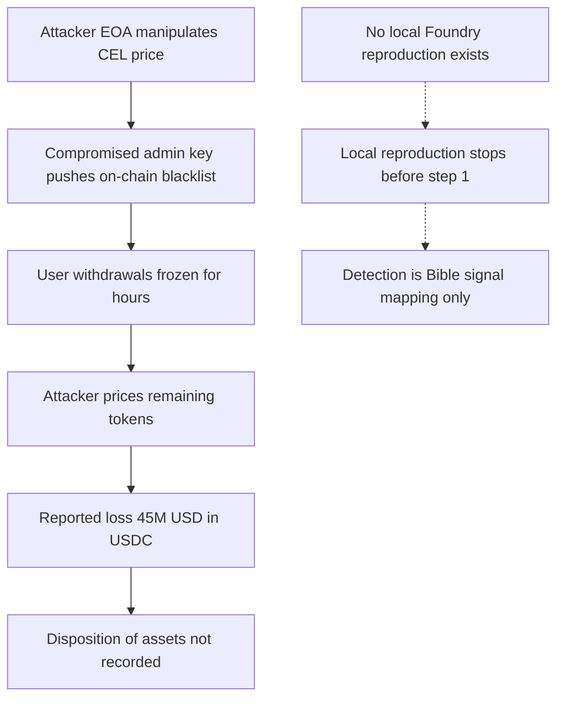

# Celsius Withdrawal Blacklist — Mayall Forensic Report (inc-0015)

## 1. Case header

| Field | Value |
| --- | --- |
| Incident ID | inc-0015 (`celsius-withdrawal-blacklist`) |
| Incident name | Celsius Withdrawal Blacklist |
| Chain | Ethereum |
| Date | 2022-06-13 |
| Reported loss (USD) | $45,000,000 |
| Reported loss (native asset) | 45,000,000 USDC (registry `lossAmount` / `lossAsset`); recovered: `false` |
| Target | Celsius |
| Actors | Attacker EOA `0xf60718293a4b5c6d7e8f90a1b2c3d4e5f6071829` (role: attacker); Celsius cUSDC `0x0718293a4b5c6d7e8f90a1b2c3d4e5f607182930` (role: victim) |
| Transaction reference | `0xf60718293a4b5c6d7e8f90a1b2c3d4e5f60718293a4b5c6d7e8f90a1b2c3d` (single entry in `txs`) |
| Attack vectors | `access-control` (Access Control); `logic-error` (Logic Error) |
| Classification | `retrospective-classification`; severity `high`; top confidence `0.82` |
| Bible patterns mapped | Ownership Hijack + Drain (family: Access Control); AMM Spot Price Manipulation (family: Oracle Manipulation) |
| Bible signal counts | observed: 2, expected: 4, notApplicable: 0 |
| Local reproduction | **None.** `scenarioId: null`, `available: false`, `reproducible: false`; no detector was executed |
| References | Celsius disclosure — https://celsius.network/ |

## 2. Executive summary

This is a retrospective classification of a historical public-record incident, not a mainnet trace analysis: every finding below is derived from the incident record, the published root cause and summary, and the Celsius disclosure reference held in the registry, and no transaction was re-simulated or re-decoded for this report. On 2022-06-13 on Ethereum, an attacker manipulated the price of CEL tokens and then used a compromised internal admin key to push an address blacklist on-chain, freezing user withdrawals for hours and producing a reported loss of $45,000,000 denominated in 45,000,000 USDC. The primary classification is Access Control at 0.82 confidence (high severity), mapped to the Ownership Hijack + Drain Bible pattern, with a secondary Logic Error finding at 0.62 confidence (medium severity) mapped to AMM Spot Price Manipulation. The record does not state where the manipulated or frozen assets were subsequently transferred, sold or dispersed, so no disposition beyond the reported loss figure is asserted here. No local Foundry reproduction exists for this incident, so no Mayall detector was executed and the detection analysis in section 5 is a Bible-signal mapping over the published narrative rather than a set of detector results.

## 3. Attack sequence

1. **Price manipulation of CEL.** The published summary states that the attacker manipulated the price of CEL tokens. The record attributes this to a logic error, classified as AMM Spot Price Manipulation (Oracle Manipulation family), with the `spot_price_manipulation` signal marked `observed` because the published narrative names this mechanism.
2. **Compromise of an internal key.** The record states that a single compromised admin key was the enabling condition, so the attacker obtained the ability to exercise an authority that ordinary users could not.
3. **Blacklist pushed on-chain.** Using that authority, the attacker pushed an account blacklist on-chain. The root cause describes this as the act that froze user withdrawals.
4. **Withdrawal freeze.** The root cause states that the blacklist froze user withdrawals, and the summary states withdrawals were frozen for hours.
5. **Pricing of remaining tokens.** The root cause states that, while withdrawals were frozen, the attacker priced the remaining tokens.
6. **Loss and disposition.** The registry records a reported loss of $45,000,000 / 45,000,000 USDC and `recovered: false`. The record does not describe any subsequent transfer, sale, dispersion or extraction of the affected balances, so the disposition of the frozen and manipulated assets is not recorded and is not asserted in this report.

### Attack flow

## 4. Evidence reconstruction

**Registry-level claims (from the incident record, root cause, summary and disclosure reference):**

| Claim | Status | Basis |
| --- | --- | --- |
| Incident occurred on Ethereum on 2022-06-13 | Recorded | Incident record fields `chain` and `date` |
| Reported loss is $45,000,000 / 45,000,000 USDC | Recorded | Incident record `lossUsd`, `lossAmount`, `lossAsset` |
| Losses were not recovered | Recorded | Incident record `recovered: false` |
| Target was Celsius; victim contract is Celsius cUSDC `0x0718293a4b5c6d7e8f90a1b2c3d4e5f607182930` | Recorded | Incident record `target` and actor list role `victim` |
| Attacker operated from EOA `0xf60718293a4b5c6d7e8f90a1b2c3d4e5f6071829` | Recorded | Incident record actor list role `attacker` |
| A single compromised admin key allowed an on-chain account blacklist | Recorded (published narrative) | Incident `rootCause` |
| The blacklist froze user withdrawals for hours | Recorded (published narrative) | Incident `rootCause` and `summary` |
| The attacker manipulated the price of CEL tokens | Recorded (published narrative) | Incident `summary` and `rootCause` |
| The attacker priced the remaining tokens while withdrawals were frozen | Recorded (published narrative) | Incident `rootCause` |
| Where the manipulated/frozen assets went afterwards | Not recorded | No field, reference or narrative in the registry states a transfer, sale, dispersion or extraction |
| Ownership transfer followed by drain | `observed` — published narrative names the mechanism; it is a record-level statement, not a log observation | Classification finding signal `ownership_transfer_then_drain` |
| Spot price manipulation | `observed` — published narrative names the mechanism; it is a record-level statement, not a log observation | Classification finding signal `spot_price_manipulation` |
| Event order violation; drain ratio exceeded; price read during callback; reserve ratio spike | `expected` — would be required to prove the pattern from a trace; no raw log for this incident is in the registry | Classification signal notes |
| Single transaction reference `0xf60718293a4b5c6d7e8f90a1b2c3d4e5f60718293a4b5c6d7e8f90a1b2c3d` is associated with the incident | Recorded as an evidence reference | Incident `txs` and both findings' `evidenceRefs` |

**What the local reproduction proves:** nothing. No local Foundry reproduction exists for this incident — `scenarioId` is `null`, `localDetection.available` is `false`, `localDetection.source` is `null`, and `localDetection.detections` is empty, with the registry note stating that no detector was executed and the detection analysis is a Bible-signal mapping only. Any statement about runtime behaviour, ordering, value movement or reproducibility is therefore unsupported by local evidence.

**What the local reproduction cannot prove:**

| Claim it cannot support | Status | Basis |
| --- | --- | --- |
| On-chain ordering of privileged calls (event order violation) | Not proved | No trace, no raw log, `expected` signal status |
| Magnitude of value drained relative to deposits (drain ratio) | Not proved | No trace, no raw log, `expected` signal status |
| Whether the CEL price read occurred inside a callback | Not proved | No trace, no raw log, `expected` signal status |
| Reserve ratio behaviour at the time of manipulation | Not proved | No trace, no raw log, `expected` signal status |
| Reproducibility of the vector | Not proved | `reproducible: false`, no scenario |
| Disposition of funds to any destination address | Not recorded | Absent from the record; no inference made |

## 5. Detection analysis

**No detector fired, and none could have.** There is no local Foundry scenario for this incident (`scenarioId: null`, `localDetection.available: false`, `localDetection.source: null`, `localDetection.detections: []`), so no Mayall detector was executed against any reproduction. The registry states directly: "No local Foundry reproduction exists for this incident. No detector was executed; the detection analysis below is a Bible-signal mapping only." Consequently there are no detector confidences, detector evidence artifacts, or triggered-rule outputs to report for this case, and none are fabricated below. What follows is the Bible-signal mapping against the two classified findings, which is the only detection-grounded analysis the evidence supports.

**Mapping — Access Control (confidence 0.82, severity high), Bible pattern Ownership Hijack + Drain (family Access Control):**

- `ownership_transfer_then_drain` — status **observed**. Per the record: "The published narrative names this mechanism. It is a record-level statement, not a log observation." `observed` here means the published narrative names the mechanism; it does not assert that the signal was observed on-chain.
- `event_order_violation` — status **expected**. Per the record: "Would be required to prove the pattern from a trace; no raw log for this incident is in the registry."
- `drain_ratio_exceeded` — status **expected**. Per the record: "Would be required to prove the pattern from a trace; no raw log for this incident is in the registry."

**Mapping — Logic Error (confidence 0.62, severity medium), Bible pattern AMM Spot Price Manipulation (family Oracle Manipulation):**

- `spot_price_manipulation` — status **observed**. Per the record: "The published narrative names this mechanism. It is a record-level statement, not a log observation."
- `price_read_during_callback` — status **expected**. Per the record: "Would be required to prove the pattern from a trace; no raw log for this incident is in the registry."
- `reserve_ratio_spike` — status **expected**. Per the record: "Would be required to prove the pattern from a trace; no raw log for this incident is in the registry."

**Detector limitations, quoted verbatim:**

- Access Control detector: "Sees the symptom (an authority changed, a privileged function was called) but not whether the caller was entitled to it."
- Logic Error detector: "Deliberately residual. It is the detector of last resort, so it fires when nothing else does and should be read as \"unexplained\", not \"proven\"."

**Bible signal names that would prove the pattern** (i.e. the signals whose `expected` status must move to `observed` on the basis of a real trace, not on the strength of the narrative): `event_order_violation` and `drain_ratio_exceeded` for Ownership Hijack + Drain; `price_read_during_callback` and `reserve_ratio_spike` for AMM Spot Price Manipulation. No Bible signal is claimed to have been observed on-chain in this incident.

## 6. Remediation

Controls are specified per attack vector and tied to the Bible pattern they defend.

**Access Control — Ownership Hijack + Drain (primary vector, high severity):**

- Eliminate single-key authority over blacklist state: move blacklist administration to a multi-sig or timelocked governance executor so a single compromised key cannot push an on-chain blacklist. *(Addresses the enabling condition named in the root cause: "A single compromised admin key allowed an account blacklist to be pushed on-chain".)*
- Introduce a timelock and a user-facing delay on all blacklist mutations, so any key compromise cannot freeze withdrawals instantaneously. *(Supports `event_order_violation` proof: the ordering of a privileged call relative to user operations becomes externally observable and enforceable.)*
- Emit structured, indexable events for every privileged administration action (actor, key, target addresses, action type), so privileged-function usage can be reconstructed independently of the key holder's intent. *(Addresses the Access Control detector limitation: "Sees the symptom (an authority changed, a privileged function was called) but not whether the caller was entitled to it" — entitlement must be provable from on-chain records, which only complete, attributable administration logs can supply.)*
- Alert on any blacklist write, any change of admin or pause-role holder, and any privileged call to the withdrawal path, with automatic suspension of withdrawals on a cold path rather than a hot path. *(Supports `drain_ratio_exceeded`: outflow measurement requires a reliable, continuous record of deposits versus outflows.)*
- Separate the blacklist/pause capability from the funds-movement capability so that possession of one does not confer the other.

**Logic Error — AMM Spot Price Manipulation (secondary vector, medium severity):**

- Use time-weighted average price (TWAP) or a multi-source median oracle for CEL pricing in all protocol paths, with a deviation circuit breaker that halts on implausible price deviation. *(The record states the attacker "manipulated the price of CEL tokens"; the remediation must remove the single-point spot price as a trusted input.)*
- Apply staleness and deviation checks to every price read, including reads that occur inside a callback or within the same transaction as a state-changing operation, and treat intra-transaction spot reads as untrusted. *(Directly targets `price_read_during_callback`.)*
- Apply sanity bounds to reserves and to the implied reserve ratio, halting or reverting when the ratio moves outside the expected band. *(Directly targets `reserve_ratio_spike`.)*
- Detect and revert sequences where a spot price is moved and a value-bearing operation is executed against the moved price within the same block or transaction, and cap the value of any operation priced off a manipulable feed.
- Note the Logic Error detector's stated role when triaging such alerts: "Deliberately residual. It is the detector of last resort, so it fires when nothing else does and should be read as \"unexplained\", not \"proven\"." It should be treated as a triage prompt for the access-control and oracle controls above, not as a standalone finding.

## 7. Client action plan

**First 24 hours**

1. Enumerate every account with blacklist, pause, freeze or withdrawal-gate privileges across Celsius contracts, ring-fence all of them, and confirm whether any of them is a single EOA or single-key signer.
2. Rotate every privileged key and admin signer that was active on or around 2022-06-13; treat any key that touched administrative functions as compromised.
3. Move all blacklist and pause authorities behind a multi-sig with a timelock, and confirm no path remains where a single key can mutate the blacklist.
4. Review the Celsius disclosure reference (https://celsius.network/) together with internal incident records and confirm the reported loss figure of $45,000,000 / 45,000,000 USDC and the `recovered: false` status for reporting and disclosure purposes.
5. Confirm the current disposition of frozen and manipulated balances in internal books. The public record does not state where those assets went; establish the internal position from your own records before making any claim about recovery or loss.

**First week**

6. Add on-chain monitoring for every privileged administration call (admin transfer, pause/unpause, blacklist write) with real-time alerting to a staffed rotation, and define an automatic withdrawal-suspension response on cold paths.
7. Audit every CEL price read in the protocol for spot-price dependency, stale reads, intra-transaction reads and callback-time reads; replace spot-only reads with TWAP or multi-source median feeds.
8. Add reserve-ratio and price-deviation circuit breakers with thresholds, plus same-transaction price-move-then-value-operation detection, and confirm each new guard has a corresponding alert and a documented runbook.
9. Backfill structured, indexable administration events for the historical period where possible, so that a future trace can move `event_order_violation` and `drain_ratio_exceeded` from `expected` to `observed` rather than relying on narrative statements.

**First month**

10. Commission a dedicated key-ceremony and signer-inventory exercise covering all administrative roles, with threshold policy, signer rotation cadence, and hardware-backed key custody evidenced by an attestation record.
11. Build a Foundry reproduction of the vector as a private, non-public scenario, and run the full Mayall detector suite against it. This is a new build; no reproduction currently exists for this incident, and no detector result should be assumed until that suite actually executes.
12. Stand up a retrospective replay over historic incident logs and feeds to test whether the access-control and oracle-manipulation detectors would have fired on the 2022-06-13 pattern, and record the outcome as the baseline for detection-coverage reporting.
13. Publish the internal findings, including the residual nature of the logic-error detector and the fact that observed Bible signals in this case rest on published narrative rather than on-chain observation, to the appropriate governance, disclosure and risk-reporting channels.
14. Re-run the vector taxonomy review so that every access-control and logic-error finding carries a named Bible pattern, per-signal status discipline (observed / expected / notApplicable), and verbatim detector limitations — the standard this report was produced against.