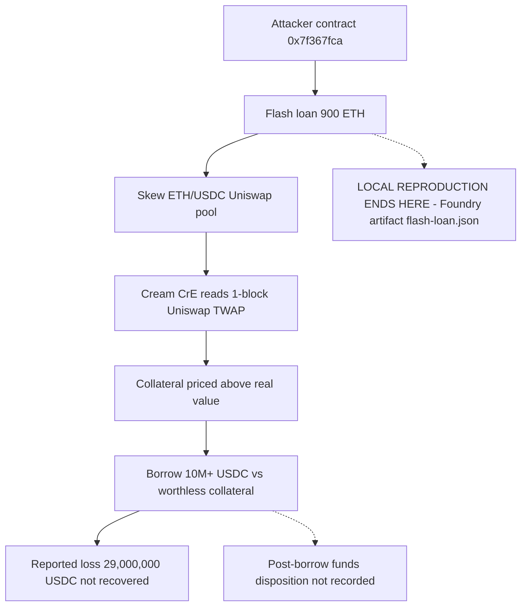

# Cream Finance Flash Loan Attack — Forensic Report

## 1. Case header

| Field | Value |
|---|---|
| Incident | inc-0008 — Cream Finance Flash Loan Attack (`cream-finance-flash-loan`) |
| Chain | Ethereum |
| Date | 2021-10-27 |
| Reported loss | USD 29,000,000 — 29,000,000 USDC |
| Recovered | No (`recovered: false`) |
| Target | Cream Finance — Cream CrE lending |
| Attack vectors | Flash Loan; Oracle Manipulation |
| Classification | Retrospective classification over public records; severity **critical**; top confidence **0.90** |
| Local reproduction | Scenario `flash-loan` (`artifacts/flash-loan.json`, `/lab?scenario=flash-loan`), reproducible: yes |
| Actors | `0x7f367fca787dcd6f3b9f3f4b4b0f4f6e9d3b8a11` — Exploit contract (attacker); `0x4c4d1e4a1f0b9c8d7e6f5a4b3c2d1e0f9a8b7c6` — Cream CrE lending (victim) |
| Transaction of record | `0x8f4b1e0c9a8b7c6d5e4f3a2b1c0d9e8f7a6b5c4d3e2f1a0b9c8d7e6f5a4b3c2d` |
| Reference | Cream Finance post-mortem — https://medium.com/@Creamdotfinance/post-mortem-312e84d4-0e50-433a2f61fb83 |
| Bible signal counts | observed 4 · expected 2 · notApplicable 1 |

## 2. Executive summary

This report is a retrospective classification of the 2021-10-27 Cream Finance incident against the Mayall Bible exploit patterns; it is not a mainnet trace analysis and no raw transaction log for this incident is held in the registry. The published record describes an attacker who took a flash loan, skewed the ETH/USDC Uniswap pool with a single large swap, and borrowed more than 10 million USDC against worthless collateral in the same transaction, for a reported loss of 29,000,000 USDC (USD 29,000,000) that the record states was not recovered. The root cause is a collateral valuation that read a Uniswap TWAP over a one-block window that the attacker could move within the same transaction, which made the borrow limit attacker-controlled and the attack capital-free and atomic. Two Bible patterns are matched — Flash Loan + Oracle Manipulation (confidence 0.90) and TWAP Manipulation (confidence 0.84) — with four signals marked observed, two expected and one notApplicable. The local Mayall reproduction of the same attack vector fires on two detectors, Oracle Manipulation (confidence 0.90) and Flash Loan (confidence 0.85); these detections describe the Foundry artifact, not the historic transaction.

## 3. Attack sequence

1. The attacker contract `0x7f367fca787dcd6f3b9f3f4b4b0f4f6e9d3b8a11` initiated an atomic transaction recorded as `0x8f4b1e0c9a8b7c6d5e4f3a2b1c0d9e8f7a6b5c4d3e2f1a0b9c8d7e6f5a4b3c2d`.
2. A flash loan was taken, providing the capital used within the same transaction — the local reproduction step is recorded as "Flash loan of 900 ETH".
3. The attacker skewed the ETH/USDC Uniswap pool with a single large swap, moving the price the lending market relied on.
4. Cream Finance's CrE lending market valued the deposited collateral against a Uniswap TWAP with a one-block window that the attacker could move inside that same transaction.
5. Because the TWAP had moved, the collateral was worth materially more on paper than it was worth in reality; the borrow limit became attacker-controlled.
6. The attacker borrowed 10M+ USDC against the worthless collateral in the same transaction.
7. The reported loss is 29,000,000 USDC (USD 29,000,000), and the record states recovery was not achieved (`recovered: false`).
8. The published record describes the minting/borrowing outcome of the transaction; it does not state a subsequent transfer, sale, dispersion or extraction path for the funds. The disposition of the borrowed USDC beyond the borrow is therefore not recorded in this case file and is not asserted here.

### Attack flow

## 4. Evidence reconstruction

| Claim | Status | Basis |
|---|---|---|
| A flash loan was used inside the attack transaction | Observed in the published narrative | Summary: "The attacker took a flash loan"; vector `flash-loan`; Bible signal `flashloan_bracket_detected` — observed, "The published narrative names this mechanism. It is a record-level statement, not a log observation." |
| The ETH/USDC Uniswap pool was skewed to move the price used for collateral valuation | Observed in the published narrative | Summary; root cause; Bible signal `spot_price_manipulation` — observed, record-level statement |
| A TWAP drift and reserve-ratio spike occurred | Observed in the published narrative | Root cause describes a one-block Uniswap TWAP; Bible signals `twap_drift_detected` and `reserve_ratio_spike` — observed, record-level statements |
| Collateral valuation used a one-block Uniswap TWAP the attacker could move in-transaction | Observed in the published narrative | Root cause text as published |
| More than 10M USDC was borrowed against worthless collateral in the same transaction | Observed in the published narrative | Summary: "borrowed 10M+ USDC against worthless collateral in the same transaction" |
| Reported loss is 29,000,000 USDC (USD 29,000,000) | Observed in the published record | Incident loss fields; severity critical |
| Funds were not recovered | Observed in the published record | `recovered: false` |
| Where the borrowed USDC went after the borrow (transfer, sale, dispersion, extraction) | Not recorded | The record does not state a disposition; no inference is drawn |
| The price was read during a callback | Expected — needs a full trace | Bible signal `price_read_during_callback` — expected, "Would be required to prove the pattern from a trace; no raw log for this incident is in the registry." |
| A drain ratio was exceeded | Expected — needs a full trace | Bible signal `drain_ratio_exceeded` — expected, "Would be required to prove the pattern from a trace; no raw log for this incident is in the registry." |
| The attacker's address was funded before the attack | Not applicable | Bible signal `address_funded_before_attack` — notApplicable, "The published record does not describe the variant this signal belongs to (pattern: TWAP Manipulation)." |
| The exploit contract and the victim address performed the roles recorded above | Observed in the record | Actor addresses and roles as published |
| The specific historic transaction hash is `0x8f4b1e0c...a4b3c2d` | Observed in the record | Incident `txs` entry; used as an evidence reference for both findings |

**What the local reproduction proves (and cannot prove).** The Foundry artifact `artifacts/flash-loan.json` reproduces the same attack vector. It shows an atomic flash-borrow primitive (`flashloan, flash loan, flashloanpool, flash`), a flash loan of 900 ETH at attack step 1, a spot-price dependency, and a price-bearing storage slot mutated during the exploit (`oracle.bonds[attacker]`). This establishes that the vector is mechanically reproducible and that the borrow limit in the reproduction is attacker-controlled.

**What it cannot prove.** The detectors "were executed against the local Foundry artifact for the same attack vector. They describe the reproduction, not the historic mainnet transaction." They therefore cannot establish what actually happened in transaction `0x8f4b1e0c...a4b3c2d`, cannot confirm the historical loss amount, cannot confirm the actor addresses on mainnet, and cannot substitute for the raw logs required by the two `expected` Bible signals.

## 5. Detection analysis

Two Mayall detectors fire on the local `flash-loan` scenario, and both are critical severity.

**det-oracle — Oracle Manipulation** (vector `oracle-manipulation`), confidence **0.90**, severity critical. Rationale: "Collateral valuation depends on a spot price the attacker can move within the same transaction, so the borrow limit is attacker-controlled." Evidence:
- "Oracle or price-source dependency identified (oracle, spot price)"
- "Price-bearing storage slot mutated during the exploit: oracle.bonds[attacker] (0x2690e5e24a20d3307ee7e2752efcc06c35d30389fa4ef7029e2d0eb72c621307)"
- "Attack sequence explicitly manipulates a quoted price before the extraction step"

**det-flash-loan — Flash Loan** (vector `flash-loan`), confidence **0.85**, severity critical. Rationale: "A flash-borrowed balance is used inside the same transaction to inflate a value assumption, so the attack is capital-free and atomic." Evidence:
- "Trace and artifact reference an atomic flash-borrow primitive (flashloan, flash loan, flashloanpool, flash)"
- "Attack step 1: Flash loan of 900 ETH"

**Bible signals that would prove the pattern.** Flash Loan + Oracle Manipulation — `flashloan_bracket_detected` (observed, Structural), `spot_price_manipulation` (observed, Oracle), `price_read_during_callback` (expected, Oracle), `drain_ratio_exceeded` (expected, Value). TWAP Manipulation — `twap_drift_detected` (observed, Oracle), `reserve_ratio_spike` (observed, Oracle), `address_funded_before_attack` (notApplicable, Behavioural). The four observed statuses mean the published narrative names the mechanism; they are not log observations and no Bible signal here is claimed as observed on-chain. The two expected signals need a full trace of the historic transaction, which this case file does not contain.

**Detector limitations, quoted verbatim.**

Flash Loan detector: "Keyed on vocabulary as much as structure. A flash loan that is never named in the artifact can be missed unless the value transfer is unusually large."

Oracle Manipulation detector: "Cannot distinguish a manipulated price from a legitimately repriced asset without a reference value from outside the transaction."

## 6. Remediation

- **Remove in-transaction price settability from collateral valuation (Flash Loan + Oracle Manipulation; TWAP Manipulation).** Derive collateral value from a time-weighted window long enough that a single swap cannot move it within one transaction — the failure was specifically a one-block window. Extend the TWAP window and require multiple blocks of elapsed time before a newly deposited collateral can be borrowed against.
- **Enforce a price-deviation circuit breaker on oracle reads (TWAP Manipulation — `twap_drift_detected`, `reserve_ratio_spike`).** Compare the oracle value against an independent external reference and reject or freeze a borrow when the two diverge materially, which is precisely the condition the oracle detector cannot currently distinguish without an outside reference.
- **Block borrows sized from the same transaction that supplied the price (Flash Loan + Oracle Manipulation — `price_read_during_callback`, `drain_ratio_exceeded`).** Deny or re-price a borrow when the collateral valuation was read within a callback or the same transaction window in which the price source was manipulated, and cap borrow size against a conservative, lagged price.
- **Add an atomicity-aware borrow guard (Flash Loan — `flashloan_bracket_detected`).** Detect flash-borrowed balances entering a lending call path and require that the effective borrow limit be computed without any balance that is repayable within the same transaction.
- **Instrument the price-bearing storage slots and the borrow path (Oracle Manipulation — `oracle.bonds[attacker]`).** Emit structured events on every oracle write and every borrow-limit recomputation so a post-hoc trace can reconstruct whether a price read occurred during a callback and whether a drain ratio was exceeded.
- **Establish an external reference price for every collateral asset (TWAP Manipulation detector limitation).** Without it, manipulated and legitimately repriced assets are indistinguishable; a second price source or exchange-level outlier check is required to close this gap.
- **Prepare an incident-response path for non-recovery (Case header: `recovered: false`).** Document freeze authority and fund-recovery procedures so that a repeat of this pattern is contained before the loan is repaid.

## 7. Client action plan

**First 24 hours**
1. Inventory every lending market and collateral asset priced by a Uniswap TWAP, and flag any using a window short enough to be moved inside a single transaction (Case header, root cause).
2. Add a temporary minimum TWAP window — at minimum, several blocks — as a hotfix on the affected collateral types, and apply the same to newly listed assets until they are reviewed.
3. Enable alerting on large swaps in the price-source pools feeding those markets, and alert on any borrow sized above a conservative lagged-price limit (Bible pattern: TWAP Manipulation; `reserve_ratio_spike`).
4. Confirm the current state of the reported 29,000,000 USDC loss and whether any freeze or recovery action is still open, given `recovered: false`.
5. Confirm the exposure of the victim market `0x4c4d1e4a1f0b9c8d7e6f5a4b3c2d1e0f9a8b7c6` and of any market sharing the same oracle pattern.

**First week**
1. Implement the cross-oracle price-deviation circuit breaker on all collateral valuation paths, using an external reference price as the comparison baseline.
2. Deploy the atomicity-aware borrow guard that detects flash-borrowed balances in the lending call path and removes them from the effective borrow limit.
3. Add structured events on oracle writes and borrow-limit recomputation so that `price_read_during_callback` and `drain_ratio_exceeded` can be evaluated from a trace in future incidents (both are currently `expected`, not observed).
4. Run the Mayall local `flash-loan` scenario (`/lab?scenario=flash-loan`) against the patched deployment and confirm the det-oracle and det-flash-loan detectors no longer produce an attacker-controlled borrow limit.
5. Review the security of the flash-borrow pattern in the same way the oracle detector's limitation requires, since flash-loan detection "is keyed on vocabulary as much as structure" and can miss unnamed flash loans.

**First month**
1. Complete a full re-audit of all TWAP window lengths and oracle integrations across lending products, and record the reasoning for each window choice.
2. Stand up an independent reference-price service for the collateral universe, closing the gap that manipulated and legitimately repriced assets are currently indistinguishable.
3. Implement withdrawal caps, borrow-rate spikes and liquidity throttles that can be triggered by the oracle-deviation and drain-ratio conditions, providing a non-recovery containment path.
4. Formalise the flash-loan integration review gate — any new collateral, new pool or new oracle must clear a documented detection check before listing.
5. Run a regression and adversarial exercise covering the Flash Loan + Oracle Manipulation pattern and the TWAP Manipulation pattern, and review detection coverage against the two expected Bible signals and the one notApplicable signal to confirm which are structurally observable from traces.