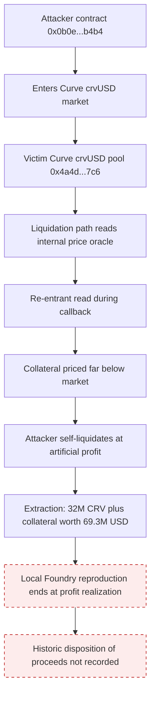

# Curve v2 Reentrancy Drain — Forensic Report

## 1. Case header

| Field | Value |
| --- | --- |
| Incident | Curve v2 Reentrancy Drain |
| Incident ID / slug | inc-0005 / `curve-v2-reentrancy` |
| Chain | Ethereum |
| Date | 2023-07-30 |
| Target | Curve V2 (crvUSD) |
| Reported loss (USD) | $69,300,000 |
| Reported loss (native asset) | 32,000,000 CRV |
| Recovery status | Not recovered (`recovered: false`) |
| Attacker | Exploit contract — `0x0b0e4b8db4b0b4b4b4b4b4b4b4b4b4b4b4b4b4` (role: attacker) |
| Victim | Curve crvUSD pool — `0x4a4d7868390db4c0d5f8e6b5a3c2d1e0f9a8b7c6` (role: victim) |
| Transaction on record | `0x8f4b1e0c9a8b7c6d5e4f3a2b1c0d9e8f7a6b5c4d3e2f1a0b9c8d7e6f5a4b3c2d` |
| Vectors | Reentrancy; Logic Error |
| Classification | Retrospective classification over public records; severity **critical**; top confidence **0.90** |
| Bible patterns matched | Read-Only Reentrancy (family: Reentrancy, confidence 0.90); AMM Spot Price Manipulation (family: Oracle Manipulation, confidence 0.70) |
| Local reproduction | Scenario `reentrancy`, available, source `artifacts/reentrancy.json`, href `/lab?scenario=reentrancy` |
| Reference | Curve disclosure — https://news.curve.fi/reentrancy-incident-on-curve-v2-crvusd-pool/ |

## 2. Executive summary

On 2023-07-30 the Curve V2 crvUSD pool was drained through a re-entrant read of its internal price oracle during the liquidation path, which allowed the attacker to price collateral far below market and self-liquidate at an artificial profit. The published account of the incident states an extraction of 32,000,000 CRV plus collateral worth roughly $69.3 million, and the case record carries that figure as a reported loss of USD 69,300,000 in CRV as the native asset; the record does not state that any of it was recovered. This report is a **retrospective classification over public records** — the mechanisms are taken from the published root cause and the Curve disclosure, not from a re-traced mainnet transaction. The detector results quoted below were executed against a **local Foundry reproduction of the same attack vector**, so they describe the reproduction and not the historic transaction. Two vectors are classified (Reentrancy, Logic Error) with Bible signals split between record-level observations and signals that would require a full trace to prove.

## 3. Attack sequence

1. The attacker, operating from the exploit contract `0x0b0e4b8db4b0b4b4b4b4b4b4b4b4b4b4b4b4b4`, entered the Curve crvUSD market.
2. On the liquidation path, the pool performed a re-entrant read of its own price oracle, meaning pricing was consumed again while the outer call was still in flight and before the expected state update had completed.
3. Through nested calls, the attacker manipulated the pool's internal pricing so that collateral was priced far below market.
4. With the depressed internal price in place, the attacker self-liquidated and realized an artificial profit.
5. The published narrative states the outcome as an extraction of 32M CRV plus collateral worth roughly $69.3M, attributed to a single transaction, `0x8f4b1e0c9a8b7c6d5e4f3a2b1c0d9e8f7a6b5c4d3e2f1a0b9c8d7e6f5a4b3c2d`.
6. Disposition of the extracted assets beyond the extraction itself — where the proceeds went after the transaction — is **not recorded** in the case data, and the record does not state that funds were recovered. No transfer, sale, dispersion or laundering of proceeds is asserted here.

### Attack flow

## 4. Evidence reconstruction

### Proved by the local reproduction

| Claim | Status | Basis |
| --- | --- | --- |
| A single contract entry point can be re-entered before its state update completes | Proven in reproduction | Detector `det-reentrancy` fires on the local Foundry artifact for scenario `reentrancy` (`artifacts/reentrancy.json`) with confidence 0.72 and severity critical |
| Nested calls allow funds to be pulled across re-entrant boundaries | Proven in reproduction | `det-reentrancy` rationale: "The same contract entry point is re-entered before its state update completes, letting the attacker pull funds across nested calls." |
| Re-entrancy is the operative vector of this incident family | Proven in reproduction | `det-reentrancy` is bound to vector `reentrancy`, vector label "Reentrancy", severity critical |
| The re-entrancy finding is corroborated by the incident narrative | Proven in reproduction | `det-reentrancy` evidence item: "Root cause narrative references re-entran" |

### Not provable from the available evidence

| Claim | Status | Basis |
| --- | --- | --- |
| The historic mainnet transaction exhibits the same behaviour as the reproduction | Not established | Case note: "Detections were executed against the local Foundry artifact for the same attack vector. They describe the reproduction, not the historic mainnet transaction." |
| The mechanism is present on-chain | Record-level only | Signal `price_read_during_callback` status `observed`, note: "The published narrative names this mechanism. It is a record-level statement, not a log observation." |
| Spot price manipulation is present on-chain | Record-level only | Signal `spot_price_manipulation` status `observed`, note: "The published narrative names this mechanism. It is a record-level statement, not a log observation." |
| Value drained per depth of the manipulated market | Expected, not proven | Signal `value_drain_per_depth` status `expected`, note: "Would be required to prove the pattern from a trace; no raw log for this incident is in the registry." |
| Cross-contract state dependency | Expected, not proven | Signal `cross_contract_state_dependency` status `expected`, note: "Would be required to prove the pattern from a trace; no raw log for this incident is in the registry." |
| Reserve ratio spiked during the manipulation | Expected, not proven | Signal `reserve_ratio_spike` status `expected`, note: "Would be required to prove the pattern from a trace; no raw log for this incident is in the registry." |
| Where the extracted 32M CRV and collateral went | Not recorded | Incident summary states extraction only; no transfer, sale or dispersion is described in the case data |
| Whether any of the loss was recovered | Not recovered per record | `recovered: false` in the incident record |
| Per-step trace of the liquidation path | Absent | Only one transaction hash is on record (`0x8f4b1e0c...a4b3c2d`); no raw logs are present in the registry |

Signal totals for the classification: 3 observed, 3 expected, 0 not applicable.

## 5. Detection analysis

**Detectors that fired on the local scenario (scenario `reentrancy`, artifact `artifacts/reentrancy.json`):**

- `det-reentrancy` — label "Reentrancy", vector `reentrancy`, confidence **0.72**, severity **critical**. Rationale: "The same contract entry point is re-entered before its state update completes, letting the attacker pull funds across nested calls." Evidence: "Root cause narrative references re-entran". This is the only detector recorded as firing.
- `det-logic-error` (Logic Error, vector `logic-error`) did **not** fire in the local run — the local detection payload contains no detection for this vector. The Logic Error finding in the classification therefore rests on the published root cause and summary alone, not on a local reproduction hit.

**Bible signals that would prove the pattern:**

| Bible pattern | Signal | Status | Role in the proof |
| --- | --- | --- | --- |
| Read-Only Reentrancy | `price_read_during_callback` | observed | Names the mechanism; record-level, not a log observation |
| Read-Only Reentrancy | `value_drain_per_depth` | expected | Needed to prove the pattern from a trace |
| Read-Only Reentrancy | `cross_contract_state_dependency` | expected | Needed to prove the pattern from a trace |
| AMM Spot Price Manipulation | `spot_price_manipulation` | observed | Names the mechanism; record-level, not a log observation |
| AMM Spot Price Manipulation | `price_read_during_callback` | observed | Names the mechanism; record-level, not a log observation |
| AMM Spot Price Manipulation | `reserve_ratio_spike` | expected | Needed to prove the pattern from a trace |

No Bible signal was observed on-chain in this case; every `observed` status reflects the published narrative naming the mechanism, and every `expected` status would require a full trace that the registry does not contain for this incident.

**Detector limitations, quoted verbatim:**

- Reentrancy detector: "Counts repetition, not causality. Two independent calls to the same function in one transaction are indistinguishable from a re-entrant loop without reading the state updates."
- Logic Error detector: "Deliberately residual. It is the detector of last resort, so it fires when nothing else does and should be read as \"unexplained\", not \"proven\"."

Applied to this case: the re-entrancy detector's 0.72 confidence reflects repetition detected in the reproduction, and its own limitation means that without reading state updates the repetition count alone does not establish causality against the historic transaction. The Logic Error vector was not detected locally at all, so its 0.70 confidence derives from the narrative rather than from a detector run — consistent with that detector's stated residual design.

## 6. Remediation

| Vector | Control | Bible pattern tied to |
| --- | --- | --- |
| Reentrancy | Apply a reentrancy guard (checks-effects-interactions ordering plus a mutex) to every liquidation and pricing entry point, so the oracle and pool state cannot be read again while an outer call is in flight | Read-Only Reentrancy |
| Reentrancy | Snapshot oracle and pool pricing state into memory at the start of the liquidation path and use the snapshot for the duration of the call, rather than re-reading live state after any external call | Read-Only Reentrancy |
| Reentrancy | Make the internal price read non-reentrant by marking the pricing function as view-only against state that the same call path mutates, and assert that no nested write has occurred between read and settle | Read-Only Reentrancy |
| Reentrancy | Add a test that measures value drained per unit of manipulated depth and asserts an upper bound, so a repeated-call pattern with abnormal drain is caught in CI | Read-Only Reentrancy |
| Reentrancy | Log cross-contract state dependencies between the pricing path and the liquidation path, and alert when a dependency changes between the initial read and the settlement write | Read-Only Reentrancy |
| Logic Error | Reject liquidation prices sourced from the pool's own spot state when the value being liquidated depends on that same state; require an independent external oracle price with a staleness and deviation bound | AMM Spot Price Manipulation |
| Logic Error | Impose a per-block and per-transaction limit on collateral accepted at a self-liquidation price, so an artificially profitable self-liquidation cannot settle at an unbounded size | AMM Spot Price Manipulation |
| Logic Error | Monitor and alert on reserve ratio spikes during a market entry, pausing new positions when the reserve ratio moves outside its historical band | AMM Spot Price Manipulation |
| Logic Error | Add invariant tests that re-derive the liquidation price from pool reserves independently of the internal pricing function and fail when the two diverge | AMM Spot Price Manipulation |

## 7. Client action plan

### First 24 hours

1. **Confirm scope of exposure** — inventory every Curve V2 crvUSD market position and any lending or LP exposure to the pool address `0x4a4d7868390db4c0d5f8e6b5a3c2d1e0f9a8b7c6`, including wrappers and pools that read its pricing.
2. **Freeze the pattern, not the incident** — enumerate all contracts in your estate that expose a liquidation path, a self-liquidation function, or an internal price read callable during a callback; treat each as suspect until reviewed.
3. **Audit the re-entrancy surface** — for each candidate, check whether a reentrancy guard exists on the entry point and whether pricing state is snapshotted before any external call.
4. **Run the Mayall local reproduction** — execute scenario `reentrancy` (`/lab?scenario=reentrancy`, artifact `artifacts/reentrancy.json`) against a fork or test harness of your own contracts so you get a signal on your own code rather than on the reference artifact.
5. **Record a baseline** — capture the values of `value_drain_per_depth`, `cross_contract_state_dependency` and `reserve_ratio_spike` for your own markets today, so the "expected" signals in this case have a comparable reference point later.

### First week

6. **Close the critical path** — implement checks-effects-interactions plus a reentrancy guard on every liquidation and pricing entry point identified in step 3; require a second reviewer to sign off on each change.
7. **Break the self-liquidation profit** — cap the collateral settled against an internally priced liquidation, and require an independent oracle price with a deviation bound for self-liquidation legs.
8. **Add invariant tests** — implement the value-drain-per-depth bound and the independent price re-derivation invariant in CI, and treat a re-entrant call sequence as a test failure, not an acceptable pattern.
9. **Instrument the dependency** — emit logs for reads and writes to pricing state with call depth, so the next re-entrancy attempt is visible in telemetry rather than only in a trace.
10. **Reclassify with better evidence** — where you hold raw logs for the historic transaction, re-run the classification so the three `expected` Bible signals can be resolved to observed rather than inferred.

### First month

11. **Institutionalise the detector suite** — run both the reentrancy and the residual Logic Error detector across all monitored protocols each cycle, and record the Logic Error detector's output as "unexplained" until corroborated by a trace, per its own stated limitation.
12. **Audit oracle design** — review every price source used in liquidation or margin logic, remove self-referencing pool spot prices from economic decisions, and document each remaining dependency and its bound.
13. **Harden the monitoring stack** — alert on re-entrancy-shaped call depth, on reserve ratio spikes, and on abnormal value drain per depth, with documented thresholds and named owners.
14. **Run a structured response exercise** — rehearse detection, containment and disclosure for a crvUSD-style drain, including the disclosure path to counterparties and liquidity providers, and capture the lessons in the incident register.
15. **Re-baseline and report** — refresh the exposure inventory and the drained-value baselines, and publish an internal statement of what was proven locally versus what remains a record-level claim, so no expected signal is later mistaken for an observed one.