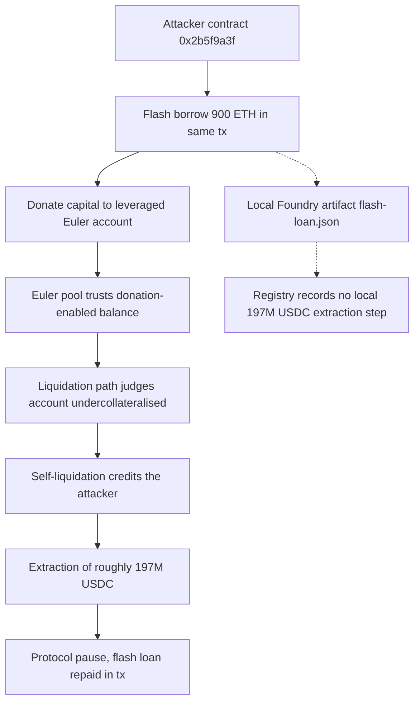

# Euler Finance Donation Account Exploit — Mayall Forensic Report

## 1. Case header

| Field | Value |
|---|---|
| Incident ID | `inc-0006` |
| Slug | `euler-finance-flash-loan` |
| Incident | Euler Finance Donation Account Exploit |
| Chain | Ethereum |
| Date | 2023-03-13 |
| Target | Euler Finance (Euler lending pool) |
| Reported loss | 197,000,000 USDC ≈ USD 197,000,000 |
| Recovered | Yes (`recovered: true`; recovery mechanics and timing are not recorded in the source data) |
| Classification method | Retrospective classification over public records — **not** a mainnet trace analysis |
| Severity | Critical |
| Top confidence | 0.90 |
| Attacker | Exploit contract `0x2b5f9a3f7c1e8d4b6a5f0e9d8c7b6a594837261` |
| Victim | Euler lending pool `0xc4976f7f1e2f4a3b5c6d7e8f90a1b2c3d4e5f607` |
| Recorded vectors | Flash loan, Logic error, Reentrancy |
| Reference transaction | `0x2b5f9a3f7c1e8d4b6a5f0e9d8c7b6a5948372615049382716aa0b1c2d3e4f5a6b7c8` |
| Local reproduction | Scenario `flash-loan`, source `artifacts/flash-loan.json`, available |
| Bible patterns matched | Classic Flash Loan Exploit (Flash Loan family), Donation Attack (Token Mechanism family), Read-Only Reentrancy (Reentrancy family) |
| Signal counts | 3 observed, 5 expected, 1 not applicable |
| Primary reference | Euler post-mortem — https://www.euler.finance/blog/euler-exploit-post-mortem |

## 2. Executive summary

On 2023-03-13 the Euler Finance lending pool on Ethereum suffered a critical exploit that the published record puts at approximately 197,000,000 USDC (USD 197,000,000), and the record states that the funds were subsequently recovered. The mechanism was a liquidation-logic defect: because the liquidation path trusted a donation-enabled balance, an attacker could inflate a leveraged account's balance with a flash-borrowed donation and then liquidate that same account for a profit, extracting the full amount in a single transaction before the protocol pause. Mayall classifies this incident retrospectively from public records rather than from a mainnet trace, and no on-chain observation in this report is derived from an execution trace. The detector results described below were executed against a local Foundry reproduction of the same attack vector (`artifacts/flash-loan.json`), so they describe the reproduction and not the historic transaction, and where the record is silent — including the disposition of the extracted USDC after extraction — this report says so rather than inferring it.

## 3. Attack sequence

1. The attacker prepared an exploit contract (`0x2b5f9a3f7c1e8d4b6a5f0e9d8c7b6a594837261`) designed to operate entirely within a single transaction.
2. The attacker took a flash loan, providing atomic capital at no financing cost within the same transaction.
3. That flash-borrowed capital was donated to a leveraged Euler account. Because the liquidation logic trusted a donation-enabled balance, the donation was credited as an increase in the account's balance rather than being accounted for separately.
4. The inflated balance pushed the leveraged account across the liquidation threshold even though the underlying position was not genuinely undercollateralised.
5. The attacker triggered the flawed liquidation path against its own inflated account.
6. The liquidation credited the attacker with the account's value, producing a profit from the round trip.
7. The extracted value — roughly $197M — left the Euler lending pool in that single transaction, ahead of the protocol pause.
8. The record states that funds were recovered; it does not describe the recovery mechanism, the timing, the counterparties, or the destination of the extracted USDC before recovery.

### Attack flow

The dotted branch marks the boundary of the local reproduction: the registry records the local scenario as covering the flash-borrow primitive and an in-transaction price/valuation manipulation, and does not record a local run that reproduced the full ~$197M USDC extraction.

## 4. Evidence reconstruction

### What the record establishes

| Claim | Status | Basis |
|---|---|---|
| The exploit contract `0x2b5f9a3f7c1e8d4b6a5f0e9d8c7b6a594837261` acted as the attacker | Recorded | `incident.actors[0]` |
| The Euler lending pool `0xc4976f7f1e2f4a3b5c6d7e8f90a1b2c3d4e5f607` was the victim | Recorded | `incident.actors[1]` |
| Reported loss of 197,000,000 USDC, USD 197,000,000 | Recorded | `incident.lossUsd`, `incident.lossAmount`, `incident.lossAsset` |
| The exploit executed in a single transaction before the protocol pause | Recorded | `incident.summary`; `incident.txs[0]` |
| Funds were recovered | Recorded | `incident.recovered: true` (no further detail given) |
| Root cause was liquidation logic trusting a donation-enabled balance | Recorded | `incident.rootCause` |
| A flash loan supplied the donated capital | Recorded | `incident.rootCause`, `incident.summary` |
| The attack combined flash-loan, logic-error and reentrancy vectors | Recorded | `incident.vectors` |
| The incident is documented publicly by Euler's own post-mortem | Recorded | `incident.references[0]` |

### What the local reproduction proves

| Claim | Status | Basis |
|---|---|---|
| A flash-borrow primitive of 900 ETH is used inside one transaction to inflate a value assumption | Local reproduction only | `det-flash-loan` evidence: "Attack step 1: Flash loan of 900 ETH"; "Trace and artifact reference an atomic flash-borrow primitive (flashloan, flash loan, flashloanpool, flash)" |
| Collateral valuation depends on a spot price the attacker can move within the same transaction | Local reproduction only | `det-oracle` rationale: "Collateral valuation depends on a spot price the attacker can move within the same transaction, so the borrow limit is attacker-controlled" |
| A price-bearing storage slot is mutated during the exploit — `oracle.bonds[attacker]` (`0x2690e5e24a20d3307ee7e2752efcc06c35d30389fa4ef7029e2d0eb72c621307`) | Local reproduction only | `det-oracle` evidence |
| The local artifact contains an attack sequence that manipulates a quoted price before the extraction step | Local reproduction only | `det-oracle` evidence |
| The attack is capital-free and atomic in the reproduced scenario | Local reproduction only | `det-flash-loan` rationale |

### What the record and the reproduction do not establish

| Claim | Status | Basis |
|---|---|---|
| Where the extracted USDC went after extraction (transfer, sale, dispersion, extraction destination) | Not recorded | The source data describes only that value was extracted; no disposition is stated, so no destination is asserted here |
| Any on-chain observation of the flash-loan bracket or the large value inflow | Not observed | `flashloan_bracket_detected` and `large_value_inflow_spike` are `observed` in the sense that the published narrative names the mechanism — a record-level statement, not a log observation |
| `drain_ratio_exceeded` | Expected, not observed | "Would be required to prove the pattern from a trace; no raw log for this incident is in the registry" |
| `net_negative_contract_balance` | Expected, not observed | Same basis as above |
| `price_read_during_callback`, `value_drain_per_depth`, `cross_contract_state_dependency` | Expected, not observed | All three reentrancy-family signals are `expected`; none is observed on-chain |
| `vault_share_price_spike` | Not applicable | "The published record does not describe the variant this signal belongs to (pattern: Donation Attack)" |
| Identity of the operator behind the exploit contract | Not recorded | Only the contract address and the label "Exploit contract" appear in the data |
| That the local run reproduced the full ~$197M USDC extraction | Not recorded | The registry records local detections against the artifact; it records no local value comparison against the historic loss |
| Confirmation of a read-only reentrancy mechanism on the historic transaction | Not confirmed | Reentrancy finding confidence is 0.64 with all three Bible signals `expected` |

## 5. Detection analysis

### Detectors that fired on the local scenario

Two detectors fired against the local Foundry artifact for the same attack vector (scenario `flash-loan`, source `artifacts/flash-loan.json`, `available: true`). The source note is explicit: "Detections were executed against the local Foundry artifact for the same attack vector. They describe the reproduction, not the historic mainnet transaction."

**`det-flash-loan` — Flash Loan — confidence 0.85, severity critical**
Rationale: "A flash-borrowed balance is used inside the same transaction to inflate a value assumption, so the attack is capital-free and atomic."
Evidence:
- "Trace and artifact reference an atomic flash-borrow primitive (flashloan, flash loan, flashloanpool, flash)"
- "Attack step 1: Flash loan of 900 ETH"

**`det-oracle` — Oracle Manipulation — confidence 0.90, severity critical**
Rationale: "Collateral valuation depends on a spot price the attacker can move within the same transaction, so the borrow limit is attacker-controlled."
Evidence:
- "Oracle or price-source dependency identified (oracle, spot price)"
- "Price-bearing storage slot mutated during the exploit: oracle.bonds[attacker] (0x2690e5e24a20d3307ee7e2752efcc06c35d30389fa4ef7029e2d0eb72c621307)"
- "Attack sequence explicitly manipulates a quoted price before the extraction step"

### Detectors that did not fire

No local detection entry exists in the record for the logic-error or the reentrancy vector, even though both are recorded vectors of the incident. Two readings are available from the data and both should be carried forward: the local scenario is a flash-loan artifact whose reproducible primitives are the flash borrow and the in-transaction price manipulation, and the logic-error detector — by its own published behaviour — fires only when nothing else does. Note also that the local artifact surfaces an oracle-manipulation vector that is not among the incident's three recorded vectors, which indicates the reproduction stresses the price-dependency angle rather than being a byte-for-byte model of the historic transaction.

### Bible signals that would prove each pattern

**Classic Flash Loan Exploit (Flash Loan family)** — confidence 0.90, severity critical
- `flashloan_bracket_detected` — status **observed** (Structural): "The published narrative names this mechanism. It is a record-level statement, not a log observation."
- `large_value_inflow_spike` — status **observed** (Value): same record-level caveat.
- `drain_ratio_exceeded` — status **expected** (Value): "Would be required to prove the pattern from a trace; no raw log for this incident is in the registry."

**Donation Attack (Token Mechanism family)** — confidence 0.84, severity medium
- `donation_balance_inflation` — status **observed** (Oracle): record-level statement only.
- `vault_share_price_spike` — status **notApplicable** (Value): "The published record does not describe the variant this signal belongs to (pattern: Donation Attack)."
- `net_negative_contract_balance` — status **expected** (Value): trace would be required.

**Read-Only Reentrancy (Reentrancy family)** — confidence 0.64, severity critical
- `price_read_during_callback` — status **expected** (Oracle)
- `value_drain_per_depth` — status **expected** (Structural)
- `cross_contract_state_dependency` — status **expected** (Additional)
All three require a full trace; none is observed on-chain for this incident.

Signal tally: 3 observed, 5 expected, 1 not applicable. No Bible signal in this report is claimed as an on-chain observation; `observed` here means the published narrative names the mechanism.

### Detector limitations, quoted verbatim

- Flash loan detector: "Keyed on vocabulary as much as structure. A flash loan that is never named in the artifact can be missed unless the value transfer is unusually large."
- Logic error detector: "Deliberately residual. It is the detector of last resort, so it fires when nothing else does and should be read as \"unexplained\", not \"proven\"."
- Reentrancy detector: "Counts repetition, not causality. Two independent calls to the same function in one transaction are indistinguishable from a re-entrant loop without reading the state updates."

The two local detections themselves (`det-flash-loan`, `det-oracle`) carry no separate limitation text in the source data; the limitations above are published at vector level and govern how far each vector's confidence may be read.

## 6. Remediation

**Flash loan — Bible pattern: Classic Flash Loan Exploit**
- Deny newly received or donated capital the ability to increase a borrow limit within the same transaction it arrived (addresses `flashloan_bracket_detected`; directly breaks the flash-donation step that made the exploit capital-free).
- Account for unsolicited token transfers in a separate ledger position rather than as available credit, so a deposit cannot be silently converted into borrowing capacity (supports `large_value_inflow_spike` prevention and the `donation_balance_inflation` fix below).
- Enforce per-account, per-transaction and per-block donation caps with alerting on donation bursts, so an account cannot cross the liquidation threshold on inflow alone.
- Apply a time-seeding or minimum-age rule before external transfers count toward collateral, making atomic capital unusable within one transaction.

**Logic error — Bible pattern: Donation Attack**
- Value accounts from internal ledger balances, not from raw token balance including direct transfers; treat a donation as realised P&L credited after a delay rather than as an immediate increase in the account's value (addresses `donation_balance_inflation`).
- Cap the leverage/margin factor so that no donation, however large, can by itself make an account liquidatable.
- Add invariant tests asserting that a donation cannot change an account's borrow limit or liquidation status; these tests would have failed before the incident.
- Do not derive per-account value from a raw-balance view; note that `vault_share_price_spike` is `notApplicable` to this variant, so share-price-drift defences do not address this case and should not be relied on here.

**Reentrancy — Bible pattern: Read-Only Reentrancy**
- Take a value snapshot before any external call and re-read it after, reverting on any mismatch, so a mid-transaction state change cannot be consumed by a read path (addresses `price_read_during_callback`).
- Apply a reentrancy guard and checks-effects-interactions ordering to the liquidation, donation and withdraw paths, and never read account or vault state through a view function that a callback can influence (addresses `cross_contract_state_dependency` and `value_drain_per_depth`).
- Enforce a single authoritative valuation per operation, computed once and consumed everywhere in that operation.

**Oracle / price dependency — local detector `det-oracle`**
- Replace single-source spot prices with time-weighted or multi-source pricing, with staleness, deviation and manipulation-bounds checks, so a price moved inside the same transaction cannot change the borrow limit (`oracle.bonds[attacker]`-style slot mutation and the reproduced price manipulation are what the detector flagged).
- Alert on price-source dependency changes and on borrow-limit outcomes that diverge from the external reference price.

## 7. Client action plan

**First 24 hours**
1. Acknowledge the scope of this record: the historic loss of 197,000,000 USDC is stated as recovered in the source data, so there is no open fund-loss action on the historic transaction; the exposure is to code paths and detector coverage, not to the extracted balance.
2. Freeze the classification as retrospective. Re-run the Mayall classification for `inc-0006` against the local scenario `flash-loan` (`/lab?scenario=flash-loan`) and preserve the resulting detector output and artifact `artifacts/flash-loan.json` as the evidentiary baseline.
3. Inventory every live contract that accepts unsolicited transfers and feeds a balance into a liquidation, borrow-limit or margin calculation. This is the exact step that failed at Euler.
4. Confirm whether any live deployment shares the read-only-reentrancy shape — a view read after an external call — and identify the reentrancy-guard coverage on each liquidation entry point.
5. Record explicitly what the current record cannot answer: the disposition of the extracted USDC before recovery, the identity of the operator, and confirmation of the reentrancy mechanism on-chain. Raise a trace-data request for the historic transaction so the five `expected` signals can be closed.

**First week**
1. Ship the donation-accounting fix in the highest-liquidity pool first: separate ledger treatment for donations, donation caps per account and per block, and a rule that a transfer cannot raise borrow capacity in the transaction it arrived.
2. Add the invariance test suite asserting that no donation changes an account's liquidation status or borrow limit; make it a CI gate on the liquidation and deposit modules.
3. Replace spot-price collateral references on the affected paths with time-weighted or multi-source pricing plus staleness and deviation bounds, and add a monitor for borrow-limit outcomes that diverge from the external reference price.
4. Re-run the flash-loan, logic-error and reentrancy detectors against the patched code and the live deployment, and compare the results against the local baseline recorded in step 2 of the first 24 hours.
5. Given the published flash-loan limitation — "Keyed on vocabulary as much as structure. A flash loan that is never named in the artifact can be missed unless the value transfer is unusually large." — add a value-based screen that flags large same-transaction inflows regardless of whether the primitive is labelled, so the detector's known blind spot does not carry into production.

**First month**
1. Complete the trace-data closure for `inc-0006`: obtain the historic logs so `drain_ratio_exceeded`, `net_negative_contract_balance`, `price_read_during_callback`, `value_drain_per_depth` and `cross_contract_state_dependency` move from `expected` to observed or are explicitly refuted, and re-issue the report at that confidence level.
2. Address the residual-detector gap documented in the logic-error limitation — "Deliberately residual. It is the detector of last resort, so it fires when nothing else does and should be read as \"unexplained\", not \"proven\"." — by ensuring every production artifact is covered by a structured flash-loan and price-dependency detector, so unexplained residuals are triaged as such rather than left as the primary signal.
3. Extend the reentrancy detector's blind spot — "Counts repetition, not causality. Two independent calls to the same function in one transaction are indistinguishable from a re-entrant loop without reading the state updates." — into a state-aware check that reads the state updates and reports causality, so the 0.64-confidence reentrancy classification on this incident can be raised or withdrawn on evidence.
4. Add a donation-pattern detection rule with the invariant assertions from remediation, and back-test it over the recorded incident history to confirm it would have flagged the Euler-style path pre-exploit.
5. Re-baseline the classification matrix quarterly against live artifacts and re-publish the detection coverage statement, separating the local Foundry reproduction results from any future on-chain trace results so the two evidence classes are never merged in client-facing reporting.