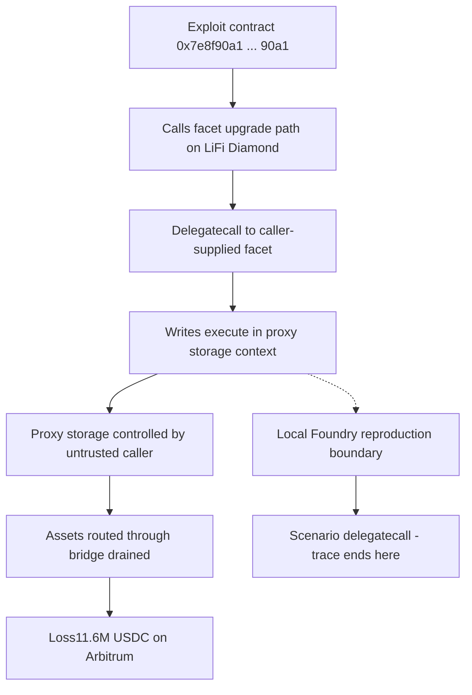

# Li.Fi Cross-Chain Bridge Exploit — Forensic Report

## 1. Case header

| Field | Value |
| --- | --- |
| Incident | inc-0011 — Li.Fi Cross-Chain Bridge Exploit |
| Chain | Arbitrum |
| Date | 2022-07-11 |
| Reported loss | 11,600,000 USD / 11,600,000 USDC |
| Funds recovered | Not recorded as recovered (`recovered: false`) |
| Target | Li.Fi Diamond (proxy) |
| Attackers | 0x7e8f90a1b2c3d4e5f60718293a4b5c6d7e8f90a1 — Exploit contract (attacker) |
| Victim | 0x8f90a1b2c3d4e5f60718293a4b5c6d7e8f90a1b2 — Li.Fi Diamond proxy (victim) |
| Vectors | bridge-exploit, access-control |
| Root cause | A facet upgrade to the LiFi Diamond included a delegatecall-based arbitrary execution path, giving an untrusted caller control over the proxy storage. |
| Classification | Retrospective classification over public records — not a mainnet trace analysis |
| Severity | Critical (top finding confidence 0.9) |
| Bible pattern | Delegatecall Privilege Escalation (family: Access Control) |
| Local reproduction | Scenario `delegatecall` — `/lab?scenario=delegatecall`, artifact `artifacts/delegatecall.json` (available: true) |
| Reference | Li.Fi post-mortem — https://li.fi/blog/the-lifi-incident/ |

## 2. Executive summary

Between 11,600,000 USDC (reported as 11,600,000 USD) routed through the Li.Fi cross-chain bridge on Arbitrum was drained from the LiFi Diamond proxy on 2022-07-11, and the record does not state that any of it was recovered. The published root cause is a facet upgrade that introduced a delegatecall-based arbitrary execution path, allowing an untrusted caller to take control of the proxy's storage; the exploit contract at 0x7e8f90a1b2c3d4e5f60718293a4b5c6d7e8f90a1 then executed against the proxy at 0x8f90a1b2c3d4e5f60718293a4b5c6d7e8f90a1b2, draining assets routed through the bridge. This report is a retrospective classification over public records — the published narrative and the vendor post-mortem — and not a mainnet trace analysis; no raw transaction log for the historic transaction is held in the Mayall registry. The supporting detector evidence comes from a local Foundry reproduction of the same attack vector, which describes the reproduction and not the historic transaction. The record does not describe the disposition of the drained assets beyond the loss figure itself, so no transfer, dispersion or extraction path is asserted here.

## 3. Attack sequence

1. A facet upgrade was applied to the LiFi Diamond. According to the published root cause, the upgraded facet included a delegatecall-based arbitrary execution path.
2. That upgrade path gave an untrusted caller control over the proxy storage of the LiFi Diamond — the delegatecall executed in the proxy's own context, so writes landed on the proxy's storage slots.
3. The malicious facet was executed via delegatecall against the LiFi Diamond proxy at 0x8f90a1b2c3d4e5f60718293a4b5c6d7e8f90a1b2 by the exploit contract at 0x7e8f90a1b2c3d4e5f60718293a4b5c6d7e8f90a1.
4. Assets routed through the bridge were drained in that execution, netting roughly $11.6M (11,600,000 USDC) on Arbitrum.
5. The registry records a single transaction for this incident, 0x7e8f90a1b2c3d4e5f60718293a4b5c6d7e8f90a1b2c3d4e5f60718293a4b5, and records no recovery of the funds.

### Attack flow

## 4. Evidence reconstruction

| Claim | Status | Basis |
| --- | --- | --- |
| The exploit drained ~11.6M USDC from LiFi Diamond on Arbitrum on 2022-07-11 | Supported | Incident record: `lossUsd` 11600000, `lossAsset` USDC, `date` 2022-07-11, `chain` Arbitrum |
| The attacker acted through a contract at 0x7e8f90a1b2c3d4e5f60718293a4b5c6d7e8f90a1 | Supported | Actor list, role `attacker`, label "Exploit contract" |
| The victim was the LiFi Diamond proxy at 0x8f90a1b2c3d4e5f60718293a4b5c6d7e8f90a1b2 | Supported | Actor list, role `victim`, label "LiFi Diamond proxy" |
| The mechanism was delegatecall against the proxy, mutating proxy storage | Supported at record level | Published root cause: facet upgrade "included a delegatecall-based arbitrary execution path, giving an untrusted caller control over the proxy storage"; `delegatecall_storage_write` and `proxy_implementation_change` are marked **observed** because the published narrative names the mechanism, not because a log was read |
| A facet upgrade immediately preceded the drain | Supported at record level | Root cause statement; `proxy_implementation_change` status **observed** (record-level statement, not a log observation) |
| A single transaction is associated with the incident | Supported | `txs`: 0x7e8f90a1b2c3d4e5f60718293a4b5c6d7e8f90a1b2c3d4e5f60718293a4b5 |
| The drain followed an ownership transfer that then authorised the privileged call | Not proven | `ownership_transfer_then_drain` status **expected** — would be required to prove the pattern from a trace; no raw log for this incident is in the registry |
| The local reproduction proves the historic transaction executed this way | Not proven | Detector note: "Detections were executed against the local Foundry artifact for the same attack vector. They describe the reproduction, not the historic mainnet transaction." |
| The local reproduction proves an unprivileged caller actually reached the delegatecall path on mainnet | Not proven | The reproduction demonstrates the vector is reachable in the local harness; it does not establish the mainnet call chain, caller identity or authorisation state |
| The record establishes where the drained assets went after extraction | Absent | The record states the loss amount only; disposition of the funds is not recorded, and no transfer, sale or dispersion is asserted here |
| Funds were recovered | Absent | `recovered: false`; the record does not state a recovery |
| Cross-chain legs of the bridge route are reconstructed | Not proven | Detector limitation: "Runs entirely inside one EVM. A cross-chain exploit whose local half is unremarkable will not be detected from the local trace alone." |

## 5. Detection analysis

One Mayall detector fires on the local scenario, and it fires because the reproduction exercises the delegatecall vector directly rather than because the historic transaction was traced.

**det-delegatecall — "Delegate Call Injection"** (vector `delegatecall-injection`), confidence 0.93, severity critical. Rationale: "The host contract delegates execution to an attacker-supplied implementation, which mutates the host's storage in the host's context." Evidence cited by the detector: "delegatecall observed in the execution trace (delegatecall)" and "Attack sequence installs a caller-supplied implementation".

The detector's confidence of 0.93 is a property of the local reproduction's match strength, not a confidence score attached to the 2022 transaction. No detector ran against the historic mainnet transaction.

Bible signals that would prove the Delegatecall Privilege Escalation pattern on-chain:

- `delegatecall_storage_write` — status **observed**. The published narrative names this mechanism. It is a record-level statement, not a log observation.
- `proxy_implementation_change` — status **observed**. The published narrative names this mechanism. It is a record-level statement, not a log observation.
- `ownership_transfer_then_drain` — status **expected**. Would be required to prove the pattern from a trace; no raw log for this incident is in the registry.

Across both classified findings the registry records 4 observed signals, 2 expected and 0 notApplicable. The two findings — bridge-exploit (confidence 0.9, critical) and access-control (confidence 0.7, high) — carry the same Bible pattern and the same signal set; they differ in how much of the loss each vector is credited with, and the bridge-exploit finding is the higher-confidence of the two.

**Limitations, quoted verbatim from the record.** For the bridge-exploit finding: "Runs entirely inside one EVM. A cross-chain exploit whose local half is unremarkable will not be detected from the local trace alone." For the access-control finding: "Sees the symptom (an authority changed, a privileged function was called) but not whether the caller was entitled to it." The local-detection note adds: "Detections were executed against the local Foundry artifact for the same attack vector. They describe the reproduction, not the historic mainnet transaction." No signal in this incident carries the `notApplicable` status.

## 6. Remediation

- **Restrict arbitrary delegatecall to an authorised, non-upgradeable entry point.** The root cause was a delegatecall-based arbitrary execution path reachable by an untrusted caller. Any delegatecall in a facet must be gated behind an explicit, immutable access-control check and must not accept caller-supplied implementation bytecode. This addresses the *Delegatecall Privilege Escalation* pattern and the `delegatecall_storage_write` signal directly.
- **Use a hardened proxy implementation and immutable implementation slot semantics.** Proxy implementation changes should pass through a controlled, timelocked, multisig-authorised upgrade path, with the implementation slot locked to code-bearing storage only and guarded against being pointed at a contract without a valid `delegatecall` surface. This is the control for the `proxy_implementation_change` signal.
- **Segregate authority changes from asset-moving capability.** Ownership or authority transfer should not, in the same path, be able to enable a privileged drain function. Split the authority role from the operational role so that a transfer alone cannot satisfy the precondition for extraction. This is the control implied by the `ownership_transfer_then_drain` signal, which remains **expected** for this incident and is therefore the largest open detection gap.
- **Validate caller entitlement, not just authority change.** The access-control detector limitation — "Sees the symptom (an authority changed, a privileged function was called) but not whether the caller was entitled to it" — is a detector gap, and the matching contract-side control is to record and assert entitlement at the call site (role, sender, and origin) and to emit an explicit, queryable event for it.
- **Harden cross-chain bridge routing.** Because the reproduction "Runs entirely inside one EVM", the contract-side requirement is that bridge route validation, message verification and per-route asset accounting be independently testable on each leg, so a leg that looks unremarkable locally cannot silently permit an unauthorised drain.
- **Bound and monitor asset outflow.** Apply per-transaction and per-epoch outflow caps on the Diamond, plus alerting on delegatecall count, implementation-slot writes and sudden aggregate bridge outflow, so a single unprivileged call cannot net a nine-figure USD loss.

## 7. Client action plan

**First 24 hours**

1. Freeze bridge withdrawals and pause the LiFi Diamond facets currently trusted to serve bridge routes, and snapshot on-chain state (proxy implementation slot, facet registry, roles) before any remediation changes, preserving evidence.
2. Add an on-chain guard blocking delegatecalls that originate from caller-supplied implementation addresses, and verify no facet in the deployed registry exposes an unguarded arbitrary delegatecall path.
3. Reconcile outflow against the recorded loss figure of 11,600,000 USDC to establish the true loss and, where the records allow, identify the disposition of the drained assets; record explicitly if disposition cannot be established.
4. Notify relevant parties, including the reference post-mortem publisher, and confirm the registry's single transaction hash 0x7e8f90a1b2c3d4e5f60718293a4b5c6d7e8f90a1b2c3d4e5f60718293a4b5 against on-chain state for residual exposure.

**First week**

5. Audit every facet in the Diamond for delegatecall usage, arbitrary-calldata forwarding and storage-write reachability, and classify each by whether an untrusted caller can reach it.
6. Reconstruct the authority timeline for the incident by obtaining the raw logs for the associated transaction from an external source, and attempt to convert `ownership_transfer_then_drain` from **expected** to proven.
7. Apply the hardened-proxy and locked-implementation controls identified in Section 6, and move authority and asset-moving capability onto separate roles.
8. Re-run the local `delegatecall` reproduction (`/lab?scenario=delegatecall`) against the remediated code to confirm the delegatecall detector no longer fires on the attack path, and treat the EVM-local limitation as an explicit residual risk requiring per-leg testing.
9. Run a cross-chain route review covering each bridge leg, since the local reproduction cannot exercise the cross-chain half of the exploit.

**First month**

10. Deploy continuous monitoring for delegatecall events, implementation-slot writes, authority-transfer events and anomalous bridge outflow, with the outflow caps from Section 6 enforced on-chain.
11. Complete a full security review and audit of the upgraded facet and the proxy configuration, with the delegatecall path and entitlement assertions as named review scope.
12. Formalise the response in an incident runbook covering facet-upgrade change control, timelock/multisig approval of implementation changes, and a pre-release checklist that blocks any new facet exposing arbitrary execution paths.
13. Publish a post-incident closure report reconciling the confirmed loss, the disposition of the drained assets, and the status of each Bible signal — observed, expected, or notApplicable — as of the close of the engagement.