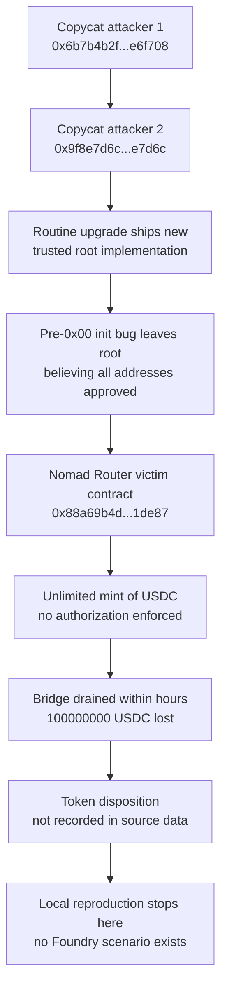

# Forensic Report — Nomad Bridge Free-For-All (`inc-0003`)

## 1. Case header

| Field | Value |
|---|---|
| Incident | Nomad Bridge Free-For-All (`inc-0003`, slug `nomad-bridge-free-for-all`) |
| Chain | Ethereum |
| Date | 2021-08-04 |
| Target | Nomad Bridge |
| Reported loss (USD) | $190,000,000 |
| Reported loss (asset) | 100,000,000 USDC |
| Native-asset loss | Not recorded in the source data |
| Recovery status | `recovered: false` |
| Attack vectors | Logic Error; Access Control |
| Classification | `retrospective-classification` over public records; severity `high`; top confidence 0.82 |
| Actors — attacker | Copycat attacker 1 — `0x6b7b4b2fc0e1e3a4c5d6e7f8091a2b3c4d5e6f708` |
| Actors — attacker | Copycat attacker 2 — `0x9f8e7d6c5b4a39281706f5e4d3c2b1a09f8e7d6c` |
| Actors — victim | Nomad Router — `0x88a69b4d6982e29a61e4db0dfb9ce2f3f6a1de87` |
| Transaction in record | `0x3f4e5d6c7b8a9f0e1d2c3b4a5968778695a4b3c2d1e0f9a8b7c6d5e4f3a2b1c0d` (single tx; no raw log in the registry) |
| Published reference | Nomad post-mortem — https://www.nomad.xyz/post-mortem |
| Local reproduction | None. `scenarioId: null`, `available: false`; no detector was executed. |
| Bible pattern | Uninitialized Proxy Exploit (family: Access Control) |
| Signal counts | observed 4, expected 2, notApplicable 0 |

## 2. Executive summary

On 2021-08-04 the Nomad Bridge on Ethereum was exploited for a reported 100,000,000 USDC (approximately $190,000,000), and the record states the funds were not recovered. The mechanism was a logic error combined with an access-control failure: a routine upgrade of the trusted root contract shipped with an uninitialised storage (pre-0x00) bug, which left the root contract believing every address had been approved, so anyone could mint unlimited tokens. Attackers copied the public proof-of-concept and drained the bridge within hours, and the registry lists two copycat attacker addresses plus the Nomad Router as the victim contract. This report is a retrospective classification over public records and the published post-mortem narrative, not a mainnet trace analysis, and no local Foundry reproduction exists for this incident, so the detection analysis is a Bible-signal mapping only. No claim here asserts that any specific transfer, sale, dispersion or extraction of the minted tokens occurred; the disposition of those tokens is not recorded in the source data.

## 3. Attack sequence

1. Nomad performed a routine upgrade, deploying a new trusted root implementation for the bridge.
2. The shipped implementation contained a pre-0x00 initialization bug — the storage region the root contract relied on was not initialised on deployment.
3. Because the approval state was never properly established, the root contract behaved as though every address had been approved (the published narrative states this directly).
4. With the approval check defeated, any caller could reach the privileged mint path and mint unlimited tokens (the root cause states this permitted anyone to mint unlimited tokens).
5. Attackers across the ecosystem rushed to copy the proof-of-concept and act on the same vector.
6. The bridge was drained within hours, producing the reported loss of 100,000,000 USDC (~$190,000,000). The registry records a single transaction reference and marks the incident as not recovered.
7. The record identifies two copycat attacker addresses and the Nomad Router as the victim contract, but it does not state where the minted tokens were transferred, sold, dispersed or extracted. Disposition of the minted tokens is not recorded.

### Attack flow

## 4. Evidence reconstruction

| Claim | Status | Basis |
|---|---|---|
| Incident is the Nomad Bridge Free-For-All on Ethereum, dated 2021-08-04 | Established (record) | Incident metadata fields `name`, `chain`, `date` in the registry |
| Reported loss is 100,000,000 USDC, approximately $190,000,000 | Established (record) | `lossAmount`, `lossAsset`, `lossUsd` fields; recovered: false |
| A native-asset (ETH) loss figure | Not recorded | The source data states no native-asset amount |
| Root cause was an uninitialised storage bug in an upgraded trusted root contract, allowing unlimited minting by anyone | Established (record) | Published `rootCause` statement; corroborated by `summary` |
| Attackers acted within hours and copied a public proof-of-concept | Established (record) | Published `summary` statement |
| Two copycat attacker addresses are associated with the incident | Established (record) | `actors` list, role `attacker` |
| Nomad Router is the victim contract | Established (record) | `actors` list, role `victim` |
| A single transaction `0x3f4e...1c0d` is referenced | Established (record) | `txs` array; also listed under `evidenceRefs` for both findings |
| Raw logs or decoded traces for that transaction | Not available | Classification note: "no raw log for this incident is in the registry" |
| Where the minted tokens were transferred, sold, dispersed or extracted | Not recorded | The source data does not state a disposition; no such movement is asserted here |
| The `initialize_on_live_contract` mechanism is named in the published narrative | Established (record, not on-chain) | Signal status `observed`; note states it is "a record-level statement, not a log observation" |
| A proxy implementation change accompanied the upgrade | Established (record, not on-chain) | Signal status `observed` for `proxy_implementation_change`; same record-level caveat |
| An ownership transfer followed by a drain, confirmed from logs | Not established | Signal status `expected` for `ownership_transfer_then_drain`; would require a full trace |
| **Local reproduction proves the uninitialized-proxy attack vector end to end** | **Proves nothing — no local reproduction exists** | `localDetection.available: false`, `scenarioId: null`, `detections: []`; note: "No local Foundry reproduction exists for this incident. No detector was executed; the detection analysis below is a Bible-signal mapping only." |
| **Local reproduction can prove extraction or loss quantification** | **Cannot prove — no local reproduction exists** | Same `localDetection` record; no Foundry scenario, no executed detector, no local evidence of any kind |

## 5. Detection analysis

**No Mayall detector fired on this incident.** `localDetection.available` is `false`, `scenarioId` is `null`, `source` is `null`, and `detections` is empty. The stated reason is recorded in the source data: "No local Foundry reproduction exists for this incident. No detector was executed; the detection analysis below is a Bible-signal mapping only." Accordingly, no detector confidence score, no detector evidence artifact and no local signal trace exists for this case, and none is claimed here.

What can be reported is the Bible-signal mapping carried by the classification, against the Bible pattern **Uninitialized Proxy Exploit** (family: Access Control), under method `retrospective-classification`:

- `initialize_on_live_contract` — status **observed**. Per the source data, "observed means the published narrative names the mechanism"; the note records that "The published narrative names this mechanism. It is a record-level statement, not a log observation." No on-chain observation is asserted.
- `proxy_implementation_change` — status **observed**. Same basis and same record-level caveat: "The published narrative names this mechanism. It is a record-level statement, not a log observation."
- `ownership_transfer_then_drain` — status **expected**. "Would be required to prove the pattern from a trace; no raw log for this incident is in the registry." This signal would be the decisive trace-level confirmation and it was not obtainable for this incident.
- `notApplicable` — no signal carries this status in this record (`signalCounts`: observed 4, expected 2, notApplicable 0).

Detector limitations, quoted verbatim from the source data:

- Logic Error detector: "Deliberately residual. It is the detector of last resort, so it fires when nothing else does and should be read as \"unexplained\", not \"proven\"."
- Access Control detector: "Sees the symptom (an authority changed, a privileged function was called) but not whether the caller was entitled to it."

Applied to this incident, both limitations are material. The Logic Error finding (confidence 0.82, severity medium) would have fired only as an unexplained residual signal, and it would not by itself have established that the bug was an uninitialised proxy. The Access Control finding (confidence 0.62, severity high) would have flagged the privileged mint call as a symptom, but on this record — where no raw log is in the registry and no trace was reconstructed — it cannot demonstrate that the caller was or was not entitled to mint. Both findings therefore rest on the published post-mortem narrative rather than on trace evidence.

## 6. Remediation

Controls are specified per attack vector and tied to the Bible pattern **Uninitialized Proxy Exploit**.

Logic Error (root cause: uninitialised storage after an upgrade)

- Enforce initializer-only semantics with a one-shot guard so a second initialization attempt reverts — this is the direct mitigation for the `initialize_on_live_contract` signal.
- Validate in CI that the implementation and its initialization function are deployed as a matched pair, and that a freshly deployed proxy reports the expected initialized state before any privileged path is enabled.
- Add an invariant test that asserts no privileged operation succeeds against a proxy whose initializer has never executed — this is the check that would have caught this vector pre-deployment.
- Prefer immutable-after-deploy initialization (constructor- or factory-set state) over inheritable uninitialized storage, so an upgrade cannot reintroduce a pre-0x00 read of unset slots.

Access Control (unauthorized caller reached the privileged mint path)

- Require an explicit, non-default approval/allowlist check that returns false for any address not explicitly approved, so an unset slot cannot read as "everyone approved" — this addresses the `proxy_implementation_change` and `initialize_on_live_contract` signals on the authorization side.
- Apply rate limits, per-address mint caps and a global issuance ceiling on mint functions, so an authorization failure degrades into a bounded loss rather than unlimited issuance.
- Add a guardian pause on the mint path and a timelock on implementation or administrator changes, limiting the window in which a faulty or hostile root is exploitable.
- Emit an explicit `Initialized` event from the initializer and monitor for the absence of that event on any live proxy, treating it as a critical alert — this is the on-chain form of the `initialize_on_live_contract` signal.

Monitoring and detection

- Log every call to the privileged mint path with caller, resulting supply delta and approval-state read, so a trace could later satisfy `ownership_transfer_then_drain`, which the current record could only mark as expected.
- Alert on issuance divergence between the bridge's internal accounting and actual token supply, and on post-upgrade contract state diffs.

## 7. Client action plan

**First 24 hours**

1. Confirm the exposed surface: identify every Nomad-rooted or Nomad-adjacent proxy in the client's deployed estate and record, for each, whether its initializer has executed and whether its approval state is explicitly populated. Treat any proxy that cannot show a completed initialization as live exposure.
2. Freeze upgrade and administrator operations on affected bridges and cross-chain routers, including implementation swaps, ownership changes and initializer calls, pending review.
3. Check whether the client's own bridge or router deployments use the same initialization pattern as the published root cause, and if so, disable or gate the privileged mint path behind a guardian pause.
4. Snapshot current on-chain state — storage of the root contracts, token supply, and authorized caller sets — before any remediation, so later comparison against `initialize_on_live_contract` and `proxy_implementation_change` behaviour is possible.
5. Confirm the reported loss position against client-side exposure records: the source data reports 100,000,000 USDC (~$190,000,000) with `recovered: false`; independently verify what the client actually held or owes against that figure.
6. Triage the registry's actor list — the two copycat attacker addresses and the Nomad Router victim address — against client transaction history and any exposure or counterparty records, without assuming any specific transfer path that the record does not state.

**First week**

7. Add a CI gate that fails any deploy where the implementation and initializer are mismatched, where the initializer can run more than once, or where a privileged function is callable on an uninitialized proxy.
8. Add the post-deploy state assertion to the release checklist: an `Initialized` event emitted, approval state non-empty, and a deliberate negative test proving an unapproved address is rejected by the mint path.
9. Introduce caps and monitoring on mint functions — per-address and global issuance ceilings, plus alerting on supply divergence between bridge accounting and token supply — so an authorization gap has a bounded blast radius.
10. Run a scoped reproduction exercise in Foundry against a mirror of the root-contract initialization pattern to confirm the client's own implementation is not vulnerable, and to give the team a detector-backed result where this incident has none.
11. Review upgrade governance end to end: who can change the implementation, what timelock applies, what guardian exists, and whether an initializer can be replayed on a live proxy.
12. Document the incident internally against the Uninitialized Proxy Exploit pattern, explicitly recording that the trace-level signal `ownership_transfer_then_drain` was never confirmed for this incident and that the classification rests on the published post-mortem.

**First month**

13. Extend the invariant suite to every proxy-based contract in the estate, with automated negative-path tests for each privileged function, and gate production promotion on those tests passing.
14. Introduce continuous monitoring for live proxies: alert on initializer events on already-deployed contracts, on approval-state changes, on implementation-address changes, and on any privileged call originating from an address that was never explicitly approved.
15. Establish a standing upgrade checklist requiring security review of every new implementation for initialization semantics, storage-slot layout changes and inherited-state assumptions before deployment.
16. Re-run the full portfolio exposure review across all chains, mapping every bridge or router dependency and its administrator set, and confirm that no client-held asset is exposed to the same root contract pattern.
17. Brief the client on residual uncertainty that the source data does not close: the disposition of the minted tokens, the full attacker set beyond the two listed addresses, and any additional affected protocols are all absent from the record and must be established from independent sources before exposure is declared final.