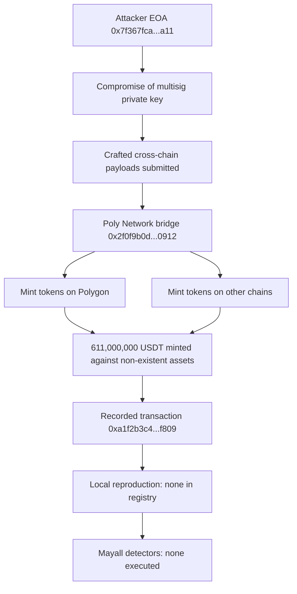

# Poly Network Cross-Chain Exploit — Forensic Report

## 1. Case header

| Field | Value |
|---|---|
| Incident | inc-0002 (slug: `poly-network-cross-chain`) — Poly Network Cross-Chain Exploit |
| Chain | Polygon (record also names "other chains" as mint destinations) |
| Date | 2021-08-10 |
| Reported loss | USD 611,000,000 in native/minted asset USDT (611,000,000 USDT) |
| Target | Poly Network (bridge) |
| Attack vectors | Access Control; Logic Error |
| Actors | Attacker EOA `0x7f367fca787dcd6f3b9f3f4b4b0f4f6e9d3b8a11`; victim — Poly Network bridge `0x2f0f9b0d3d8a4c5e6f708192a3b4c5d6e7f80912` |
| Transaction on record | `0xa1f2b3c4d5e6f708192a3b4c5d6e7f8091a2b3c4d5e6f708192a3b4c5d6e7f809` |
| Reference | Poly Network disclosure — https://poly.network/announcement-security-incident |
| Classification | Retrospective classification over public records (method: `retrospective-classification`); severity **high**; top confidence **0.82** |
| Bible mapping | Ownership Hijack + Drain (family: Access Control) for both findings |
| Bible signal counts | observed 2, expected 4, notApplicable 0 |
| Local reproduction | **None.** `scenarioId: null`, `reproducible: false`, `localDetection.available: false` — no detector was executed |
| Recovery flag | `recovered: true` (recorded as a case attribute) |

## 2. Executive summary

This report is a retrospective classification of a published historical incident against Mayall's Bible pattern library, not a mainnet trace analysis: no raw transaction log, event trace or balance movement for the recorded transaction was replayed, and no Mayall detector was executed on it. The Poly Network bridge authorised cross-chain minting through a shared, single-point-of-failure multisig with no timelock, rate limit or per-asset cap; the attacker compromised that key and used it to submit crafted cross-chain payloads, causing the contract to mint 611,000,000 USDT on Polygon and other chains against assets that did not exist. The published narrative therefore names the mechanism behind the Ownership Hijack + Drain pattern with the strongest available signal status, `observed`, at the level of the written record rather than a log observation, while `event_order_violation` and `drain_ratio_exceeded` remain `expected` because a full trace would be required to prove them. The exposure was a design failure in the authorisation layer, not a coding defect in the minting logic itself: a single compromised authority could create unbacked supply with no independent brake. Loss disposition is limited to what the record states; the registry records recovery as having occurred but does not record the intermediate transfer, sale, dispersion or extraction of the minted tokens, so no such movement is asserted here.

## 3. Attack sequence

1. The Poly Network bridge relied on a shared multisig as the sole authority for authorising cross-chain minting, creating a single point of failure that was not paired with any timelock, rate limit or per-asset cap.
2. The private key of that multisig was compromised by the attacker, giving them the ability to act as the trusted authority without needing to defeat any runtime access check.
3. Using the compromised key, the attacker submitted crafted cross-chain payloads to the bridge.
4. The contract accepted these payloads and minted tokens on Polygon and other chains against assets that did not exist — no backing asset was locked, burned or attested for the minted supply.
5. The scale of that unauthorised minting is recorded as 611,000,000 USDT, with a reported loss of USD 611,000,000.
6. The registry records the incident as recovered. The record does not describe where the minted tokens went, whether they were transferred, sold, dispersed or extracted, and this report asserts no such movement.

### Attack flow

## 4. Evidence reconstruction

| Claim | Status | Basis |
|---|---|---|
| Incident occurred on 2021-08-10 targeting Poly Network on Polygon | Recorded | Incident record fields `date`, `chain`, `target` |
| Reported loss of USD 611,000,000 / 611,000,000 USDT | Recorded | Incident fields `lossUsd`, `lossAmount`, `lossAsset` |
| Attacker EOA `0x7f367fca787dcd6f3b9f3f4b4b0f4f6e9d3b8a11` | Recorded (attribution from the record, not independently traced) | Actor list with role `attacker` |
| Victim contract `0x2f0f9b0d3d8a4c5e6f708192a3b4c5d6e7f80912` (Poly Network bridge) | Recorded (identification from the record, not independently traced) | Actor list with role `victim` |
| Single transaction `0xa1f2...f809` associated with the incident | Recorded | Incident field `txs`; also listed as an `evidenceRef` under both findings |
| Multisig key compromise is the root cause | Recorded | Published `rootCause` and `summary`; the disclosed narrative names the mechanism |
| Absence of timelock, rate limit and per-asset cap on minting authority | Recorded | Published `rootCause` |
| Tokens were minted against assets that did not exist | Recorded | Published `summary` |
| Ownership Hijack + Drain pattern is the named Bible match | Recorded at record level | `biblePattern` / `bibleFamily` on both findings; signal `ownership_transfer_then_drain` status `observed` — "The published narrative names this mechanism. It is a record-level statement, not a log observation." |
| Event ordering proving hijack-then-drain | Not verified | Signal `event_order_violation` status `expected` — "Would be required to prove the pattern from a trace; no raw log for this incident is in the registry." |
| Drain ratio exceeding the Bible threshold | Not verified | Signal `drain_ratio_exceeded` status `expected` — "Would be required to prove the pattern from a trace; no raw log for this incident is in the registry." |
| Local Foundry reproduction of the attack vector | Absent | `localDetection.available: false`, `scenarioId: null`, `reproducible: false`; no detector executed |
| On-chain log observation of ownership change or privileged call | Absent | No raw log for this incident is in the registry; `evidenceRefs` are the transaction hash and the disclosure only |
| Disposition of the minted tokens (transfer, sale, dispersion, extraction) | Not recorded | The record states minting and the loss figure only; no movement of minted tokens is described |
| Recovery of the loss | Recorded as a case attribute | Incident field `recovered: true`; no recovery mechanics, timing or assets are specified |
| Mayall detector results for this incident | Absent | `localDetection.detections` is empty; `localDetection.note` states the detection analysis is a Bible-signal mapping only |

**What the local reproduction proves:** nothing at runtime. No local Foundry scenario exists for this incident, so no Mayall detector produced an observation.

**What the local reproduction cannot prove:** every runtime claim — the sequence of authority change and drain, the magnitude of the drain ratio, the behaviour of the bridge contract under a crafted payload, and the disposition of the minted tokens. All findings in this report rest on the published narrative, not on reproduced execution.

## 5. Detection analysis

**No detector fired on this incident.** The reason is not that the scenario was analysed and passed: `localDetection.available` is `false`, `scenarioId` is `null`, `reproducible` is `false` and `detections` is empty. The registry note is explicit — "No local Foundry reproduction exists for this incident. No detector was executed; the detection analysis below is a Bible-signal mapping only." Consequently there is no detector confidence score, no captured event or log evidence, and no runtime observation to report for either vector.

The analysis below is therefore a mapping from the published root cause and summary onto Mayall's Bible pattern and signal set, with no executed evidence behind it.

**Mayall detectors relevant to the two recorded vectors**

- **Access Control** — matched at confidence **0.82** (severity high), mapped to Bible pattern *Ownership Hijack + Drain*, family *Access Control*. Detector limitation, verbatim: "Sees the symptom (an authority changed, a privileged function was called) but not whether the caller was entitled to it." The published narrative is consistent with what this detector class would flag — an authority was compromised and a privileged minting function was called — but because nothing was executed, no symptom was actually captured.
- **Logic Error** — matched at confidence **0.62** (severity medium), mapped to the same Bible pattern and family. Detector limitation, verbatim: "Deliberately residual. It is the detector of last resort, so it fires when nothing else does and should be read as \"unexplained\", not \"proven\"." At 0.62 this finding sits well below the access-control finding and is explicitly a residual classification, not an established mechanism.

**Bible signals that would prove the pattern**

| Signal | Family | Status | What it means for this incident |
|---|---|---|---|
| `ownership_transfer_then_drain` | Sequence | observed | The published narrative names this mechanism. It is a record-level statement, not a log observation. No on-chain signal was observed. |
| `event_order_violation` | Sequence | expected | Would be required to prove the pattern from a trace; no raw log for this incident is in the registry. |
| `drain_ratio_exceeded` | Value | expected | Would be required to prove the pattern from a trace; no raw log for this incident is in the registry. |

Registry totals: 2 observed, 4 expected, 0 notApplicable. `observed` here means the published narrative names the mechanism; `expected` means a full trace would be needed; `notApplicable` would mean the record does not describe that variant — no signal in this incident falls into that third category.

**Gap assessment.** To convert this case from a record-level classification into a trace-verified finding, two things are missing: a local Foundry scenario reproducing the same attack vector against the Mayall detector suite, and the raw log for the recorded transaction so that `event_order_violation` and `drain_ratio_exceeded` can move from `expected` to a verified status.

## 6. Remediation

Controls are specified per recorded vector and tied to the mapped Bible pattern *Ownership Hijack + Drain* (family: Access Control).

**Vector: Access Control (confidence 0.82, primary)**

1. **Replace the single shared multisig with a threshold scheme and thresholded signer set.** Directly addresses the root cause: a shared single-point-of-failure authority authorised minting. The Bible pattern requires that authority change and the privileged call are separately constrained, so that one compromised key cannot exercise mint authority alone.
2. **Install a timelock on all mint-authorising paths.** A delay window converts a single compromised key from an immediate loss into a detectable, reversible event. This is what would have produced the `event_order_violation` signal that currently sits at `expected` — without a delay, order cannot be violated because there is no interval in which order can be checked.
3. **Add per-asset minting caps and a rate limit.** This is the control that binds the *Drain* half of Ownership Hijack + Drain. It would cap the loss per epoch regardless of key compromise, and it is the control whose breach is quantified by the `drain_ratio_exceeded` signal.
4. **Enforce that minting is backed by locked or attested assets on the source chain.** The record states tokens were minted against assets that did not exist; this control removes the ability for unauthorised payloads to produce unbacked supply.
5. **Alert on privileged-function invocation and authority changes.** The Access Control detector limitation applies here — "Sees the symptom (an authority changed, a privileged function was called) but not whether the caller was entitled to it" — so detection should be paired with a key-entitlement check (signer set membership, key age, rotation state) rather than relying on the detector alone to establish authorisation.
6. **Rotate and hardware-protect bridge keys, with rotation-on-suspicion runbooks.** Key compromise was the initiating step; shortening key lifetime and reducing single-key exposure limits recurrence.

**Vector: Logic Error (confidence 0.62, residual)**

7. **Add an explicit payload-validation and invariant check to the minting path.** Because this detector is "Deliberately residual. It is the detector of last resort, so it fires when nothing else does and should be read as \"unexplained\", not \"proven\"", the remedy here is to remove the conditions that leave nothing else able to explain a mint — namely payload replay, cross-chain message ordering, and nonce/counter validation.
8. **Add cross-chain message uniqueness and replay protection.** Crafted payloads were the delivery mechanism in the published narrative; making payloads uniquely consumable limits how much unbacked supply one compromised key can request.

## 7. Client action plan

**First 24 hours**

1. Inventory every privileged path in the bridge and multisig contracts that can authorise cross-chain minting, and confirm which contract currently holds mint authority.
2. Verify the signer set behind the bridge multisig: number of signers, threshold, key custody locations, and whether any key is held by a single party or a single device.
3. Confirm whether a timelock, per-asset cap and minting rate limit exist on each mint path today, and record precisely which of the three are missing.
4. Place the bridge under heightened monitoring on privileged-call and authority-change events, and rotate any key with any exposure to an unreviewed environment.
5. Preserve the on-chain evidence for the recorded transaction `0xa1f2...f809` and the disclosure so a future trace is possible; note that the registry currently holds only the hash and the disclosure, with no raw log.

**First week**

1. Stand up a local Foundry reproduction of this attack vector against the Mayall detector suite, replacing the current `available: false` state, so future cases of this class produce executed detector evidence instead of a Bible-signal mapping only.
2. Re-run the detection analysis on the reproduction and confirm which detectors fire, and against which Bible signals, for a compromised-authority mint path.
3. Capture the raw event log for the recorded transaction and evaluate `event_order_violation` and `drain_ratio_exceeded` directly, so those signals can move from `expected` to a trace-backed status.
4. Complete a threshold and timelock redesign for the minting authority, with a concrete target: no single key able to authorise minting on its own.
5. Implement the highest-value control: per-asset caps and rate limits on minting, with an agreed loss ceiling per epoch.

**First month**

1. Roll out the multi-signer threshold and timelock changes across all bridge contracts and chains the bridge touches, not only Polygon.
2. Add the invariant, payload-validation and replay-protection checks to the minting path and validate them against the local reproduction, closing out the residual Logic Error finding.
3. Deploy real-time alerting for privileged mint calls, authority changes, and mint volumes relative to caps, with a documented escalation path for a timelock-pending mint.
4. Add a key-rotation and compromise-response runbook covering suspected signer-key exposure, and rehearse it once against the bridge.
5. Extend the Mayall registry entry for inc-0002 so the classification is explicitly marked as record-level, with the two `expected` signals and the absent local reproduction carried forward as open items rather than closed conclusions.