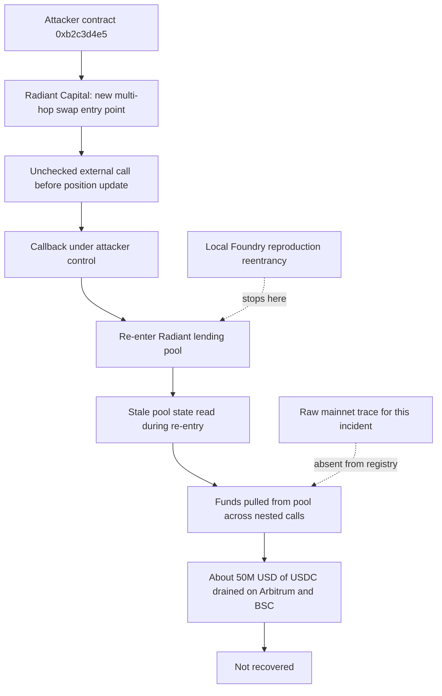

# Radiant Capital Drainer Reentrancy — Forensic Report

**Case ID:** inc-0013 | **Slug:** radiant-capital-drainer | **Report type:** Retrospective classification over public records

## 1. Case header

| Field | Value |
|---|---|
| Incident | Radiant Capital Drainer Reentrancy (`inc-0013`) |
| Chain | Arbitrum (drain spanned Arbitrum and BSC) |
| Date | 2023-10-16 |
| Reported loss | USD 50,000,000 in USDC (50000000 USDC) |
| Recovery | Not recovered (`recovered: false`) |
| Target | Radiant Capital |
| Exploit contract (attacker) | `0xb2c3d4e5f60718293a4b5c6d7e8f90a1b2c3d4e5` |
| Radiant lending pool (victim) | `0xc3d4e5f60718293a4b5c6d7e8f90a1b2c3d4e5f6` |
| Transaction of record | `0xb2c3d4e5f60718293a4b5c6d7e8f90a1b2c3d4e5f60718293a4b5c6d7e8f90` |
| Vectors | Reentrancy; Access Control |
| Classification | Reentrancy — "Classic Reentrancy" (confidence 0.90, severity critical); Access Control — "Ownership Hijack + Drain" (confidence 0.70, severity high) |
| Top classification confidence | 0.90 |
| Bible signal counts | observed 2 · expected 5 · notApplicable 0 |
| Local reproduction | Available — scenario `reentrancy`, artifact `artifacts/reentrancy.json`, lab route `/lab?scenario=reentrancy` |
| Reference | Radiant Capital post-mortem — https://medium.com/@RadiantCapital |

## 2. Executive summary

This report is a **retrospective classification over public records**, not a mainnet trace analysis: the facts below are drawn from the published root cause, the incident summary and the reference material, and no raw transaction log for this incident is held in the registry. The incident is recorded as a drain of roughly **$50,000,000 in USDC** across Arbitrum and BSC on 2023-10-16 against the Radiant Capital lending pool, with no recovery recorded. The published mechanism is that a newly added multi-hop swap function performed an **unchecked external call before updating the position**, opening a re-entrancy path into the lending pool; the attacker re-entered the pool through the swap callback and drained the funds. Classification is therefore led by **Classic Reentrancy** at 0.90 confidence, with **Ownership Hijack + Drain** retained as a secondary, lower-confidence access-control reading at 0.70. The Mayall detector suite, when run against the **local Foundry reproduction of the same attack vector** (`artifacts/reentrancy.json`), fires a single critical Reentrancy detection at 0.72 confidence — that detection describes the reproduction, not the historic transaction, and 5 of the 7 Bible signals remain `expected` because proving them would require a raw trace that does not exist here.

## 3. Attack sequence

1. **A new component enters the protocol.** A multi-hop swap function was newly added to the Radiant Capital protocol, changing the call surface available to the lending pool.
2. **State ordering is inverted.** In that new swap function, an external call is performed **before** the position is updated, so the callee regains control while the pool's own state still reflects the pre-call position.
3. **The attacker supplies a callback target.** The attacker drives the new swap entry point so that the swap's external call lands on a callback the attacker controls, opening a re-entrancy path back into the lending pool.
4. **Re-entry into the pool.** The attacker re-enters the Radiant lending pool through the swap callback before the original position update completes, so the pool's accounting is read against stale state.
5. **Funds are drained.** Nested calls let the attacker pull funds out of the pool across those re-entered paths, with the published summary recording roughly $50M drained across Arbitrum and BSC.
6. **Access-control symptom.** The record also carries a secondary access-control reading — an authority change followed by a privileged call and a drain — which the published narrative does not describe in step-level detail. The registry marks all three access-control Bible signals as `expected`, so this vector remains a classification hypothesis rather than a documented sequence step.
7. **No recovery.** The incident is recorded as not recovered.

> The above is reconstructed from the published root cause and summary. Step-level call ordering, the exact per-transaction amounts, and the disposition of the drained tokens are not recorded in the registry and are not asserted here.

### Attack flow

## 4. Evidence reconstruction

| Claim | Status | Basis |
|---|---|---|
| Loss of USD 50,000,000 in USDC | Supported | Incident record: `lossUsd` 50,000,000, `lossAmount` 50000000, `lossAsset` USDC; summary states roughly $50M drained |
| Drain occurred on 2023-10-16 against Radiant Capital on Arbitrum, spanning BSC | Supported | Incident record `date`, `chain`, `target`, and the summary's cross-chain statement |
| Attacker contract `0xb2c3d4e5f60718293a4b5c6d7e8f90a1b2c3d4e5` | Supported | Incident record actor list, role `attacker`, labelled "Exploit contract" |
| Victim lending pool `0xc3d4e5f60718293a4b5c6d7e8f90a1b2c3d4e5f6` | Supported | Incident record actor list, role `victim`, labelled "Radiant lending pool" |
| Root cause is an unchecked external call before position update in a new multi-hop swap | Supported | Incident `rootCause` field, quoted verbatim in the published record |
| Re-entry through the swap callback drained the pool | Supported | Incident `summary` field |
| Funds were not recovered | Supported | Incident record `recovered: false` |
| Transaction `0xb2c3d4e5f60718293a4b5c6d7e8f90a1b2c3d4e5f60718293a4b5c6d7e8f90` | Recorded, not analysed | Present in `txs` and cited as an evidence reference; no trace or log was executed against it in this report |
| Ownership transfer preceded a privileged drain | Not established | All three access-control Bible signals carry status `expected`; "no raw log for this incident is in the registry" |
| Where the drained tokens went after extraction | Not recorded | The record states a drain and non-recovery only; no transfer, sale, dispersion or extraction destination is described, so no disposition is asserted |
| The local detector suite confirms the historic transaction | Not claimed | `localDetection.note`: detections "describe the reproduction, not the historic mainnet transaction" |
| The local reproduction demonstrates nested re-entry before state update | Supported (local only) | Detector `det-reentrancy`, rationale describing re-entry of the same entry point before state update completes; evidence: "Root cause narrative references re-entran" |
| Recursive depth and value-drain-per-depth as mechanisms | Record-level only | Signals `recursive_depth_pattern` and `value_drain_per_depth` are status `observed` — the published narrative names the mechanism, "not a log observation" |
| Storage update delay and same-tx deposit/withdraw | Not proven | Signals `storage_update_delay` and `deposit_withdraw_same_tx` are status `expected`; a trace would be required |

**What the local reproduction proves:** that the reentrancy vector is mechanically reproducible in a controlled Foundry environment — the same contract entry point is re-entered before its state update completes, allowing funds to be pulled across nested calls.

**What the local reproduction cannot prove:** that the historic transaction on Arbitrum/BSC executed along that path, the depth of any historic recursion, the per-call value drain, the ordering of storage writes in the original deployment, or any access-control sequence. Detector results in this case are a vector-level reproduction of the same attack vector, not a re-enactment of the 2023-10-16 transaction.

## 5. Detection analysis

**One detector fired on the local scenario.**

| Detector | Vector | Severity | Confidence | Evidence |
|---|---|---|---|---|
| `det-reentrancy` — Reentrancy | reentrancy | critical | 0.72 | "Root cause narrative references re-entran" |

Rationale as recorded: *"The same contract entry point is re-entered before its state update completes, letting the attacker pull funds across nested calls."*

No access-control detector fired on the local reproduction. The access-control finding is a **record-level classification** derived from the published narrative (confidence 0.70, severity high), not the product of a local detector run. Because the reproduction scenario is `reentrancy`, the local artifact exercised the re-entrancy path only, so the access-control detector had no matching behaviour to fire on.

**Bible signal names that would prove the pattern** (statuses exactly as given in the registry):

- *Classic Reentrancy* — `recursive_depth_pattern` (**observed**), `value_drain_per_depth` (**observed**), `storage_update_delay` (**expected**), `deposit_withdraw_same_tx` (**expected**).
- *Ownership Hijack + Drain* — `ownership_transfer_then_drain` (**expected**), `event_order_violation` (**expected**), `drain_ratio_exceeded` (**expected**).

The two `observed` statuses mean the published narrative names these mechanisms; they are record-level statements, not log observations. The five `expected` statuses mean a full trace would be needed to prove them, and no raw log for this incident is in the registry. No signal carries `notApplicable` status.

**Detector limitations, quoted verbatim:**

- Reentrancy detector: *"Counts repetition, not causality. Two independent calls to the same function in one transaction are indistinguishable from a re-entrant loop without reading the state updates."*
- Access-control detector: *"Sees the symptom (an authority changed, a privileged function was called) but not whether the caller was entitled to it."*

These limitations bound the report in two ways: the 0.72 detector confidence cannot be promoted to a claim about the historic transaction, and the 0.70 access-control classification is a plausible reading of the record rather than a proven sequence.

## 6. Remediation

Controls are keyed to the two classified vectors and their Bible patterns.

**Reentrancy — "Classic Reentrancy"**

1. **Checks-Effects-Interactions on the swap path.** Perform the position update before the external call in the multi-hop swap function, so no callback can observe pre-update state. Directly targets `storage_update_delay` (expected) and `recursive_depth_pattern` (observed).
2. **Reentrancy guard on the swap and pool entry points.** A single `nonReentrant` mutex on the swap function and the lending-pool withdrawal paths blocks nested re-entry outright. Targets `recursive_depth_pattern` and `value_drain_per_depth` (both observed).
3. **Pull-payment settlement.** Replace push-based settlement through an attacker callback with pull-based claims from a per-claimant balance ledger, removing the callback-controlled external call from the withdrawal path.
4. **Trace-level invariant monitoring.** Detect nested calls to the same entry point within a single transaction, and alert on value drained per recursion depth, so `value_drain_per_depth` moves from expected to observable. Also close the detector's stated blind spot by inspecting state writes at the call boundary, since counting repetition alone cannot distinguish re-entry from two independent calls.
5. **Per-transaction and per-tx deposit/withdraw reconciliation.** Flag same-transaction deposit-and-withdraw sequences on the pool, which the `deposit_withdraw_same_tx` signal requires, as a regression test rather than a production invariant.

**Access control — "Ownership Hijack + Drain"**

6. **Two-step ownership and role handover.** Transfer of ownership or admin roles requires a claim step, and sensitive role changes emit and are gated on an observable event, so `ownership_transfer_then_drain` becomes detectable.
7. **Event ordering invariants.** Assert in tests that authority-change events precede any privileged call they authorise, and that privileged calls cannot occur in the same transaction as the authority change without a deliberate delay, addressing `event_order_violation`.
8. **Drain-ratio circuit breaker.** Cap value extracted relative to deposited or collateralised value within a transaction and across nested calls, enforcing `drain_ratio_exceeded` as a hard limit rather than an alert.
9. **Separate authority from execution.** Keep upgrade keys, ownership and withdrawal execution in distinct roles with multi-sig or timelock control, so a single authority change cannot authorise a drain.

## 7. Client action plan

**First 24 hours**

1. Freeze risk exposure: pause new multi-hop swap initiation and cap withdrawal limits on the affected lending-pool functions until checks-effects-interactions ordering and a reentrancy guard are verified on the new swap path.
2. Confirm the post-mortem and incident scope against the reference at https://medium.com/@RadiantCapital and reconcile the recorded 50,000,000 USDC loss figure, the two named actor addresses, and the single transaction of record against the client's own ledger of affected positions and counters.
3. Obtain and preserve the raw trace and event logs for `0xb2c3d4e5f60718293a4b5c6d7e8f90a1b2c3d4e5f60718293a4b5c6d7e8f90` on both Arbitrum and BSC. This is the gating dependency for converting the five `expected` Bible signals — `storage_update_delay`, `deposit_withdraw_same_tx`, `ownership_transfer_then_drain`, `event_order_violation`, `drain_ratio_exceeded` — from hypothesis to proof.
4. Establish the disposition record for the drained USDC: the public record states the funds were not recovered but does not record where the tokens went, so the client's own exchange and counterparty exposure picture must be reconstructed independently rather than assumed.

**First week**

5. Run the Mayall detector suite against the acquired trace and compare its output against the local reproduction result (`det-reentrancy`, confidence 0.72) to establish whether the historic transaction reproduces the same signal profile; record the delta explicitly, since the local run is a vector-level reproduction and not a transaction-level observation.
6. Audit every external call in the swap and lending-pool paths, ordering each call against the corresponding state update, and produce a pass/fail list of the checks-effects-interactions violations found.
7. Deploy the reentrancy guard and the pull-payment settlement pattern behind a feature flag on the affected functions, with the nested-call and per-depth value-drain monitors live in alert-only mode.
8. Run the access-control detector across the upgrade and role-management surface, and test the two-step ownership handover, event-ordering invariants and drain-ratio circuit breaker against it, noting the detector's stated limitation that it cannot tell an entitled caller from an illegitimate one.

**First month**

9. Convert the alert-only monitors into enforced limits: drain-ratio ceiling, per-transaction withdrawal caps, and a nesting-depth limit on pool entry points, each tied to the Bible signal it enforces.
10. Add permanent regression tests that assert state updates precede external calls on every swap path, and that re-entering the pool entry point inside a nested call reverts.
11. Add the re-entrancy and access-control scenarios to the standing Mayall lab and CI rotation (`/lab?scenario=reentrancy`) so every contract change is scored against the reproduction before deployment, and track the `det-reentrancy` confidence as a release-gate metric.
12. Produce a board-level close-out note reconciling the final loss figure, the recovery status, and the residual risk on the unproven access-control vector, explicitly recording which Bible signals remain `expected` because the trace was unavailable, and schedule a trace-retrieval follow-up for any incident where raw logs cannot be obtained.