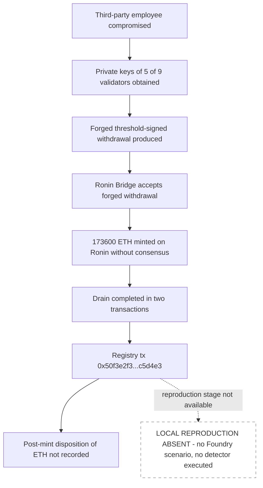

# Ronin Bridge Drain — Forensic Report

## 1. Case header

| Field | Value |
|---|---|
| Incident ID | inc-0001 |
| Slug | ronin-bridge-drain |
| Incident | Ronin Bridge Drain |
| Chain | Ethereum |
| Date | 2022-03-23 |
| Reported loss (USD) | $625,000,000 |
| Reported loss (native asset) | 173,600 ETH |
| Recovered | No (`recovered: false`) |
| Target | Ronin Bridge |
| Actors | `0xa0f1f7c6d0b9c8b5b3a2f4b0c9d8e7f6a5b4c3d2` — Forged withdrawal recipient (attacker); `0x00000000219ab540356cbb839cbe05303d7705fa` — Ronin Bridge (victim) |
| Attack vectors | access-control, signature-replay |
| Classification method | Retrospective classification over public records |
| Severity | high |
| Top confidence | 0.82 |
| Local reproduction | None exists (`scenarioId: null`, `reproducible: false`); no detector was executed |
| Registry transaction | `0x50f3e2f3c8a1b3d9e7f6a5b4c3d2e1f0a9b8c7d6e5f4a3b2c1d0e9f8a7b6c5d4e3` |
| Reference | Sky Mavis post-mortem — https://ronin.brIDGE/security-disclosure |

## 2. Executive summary

On 2022-03-23 the Ronin Bridge on Ethereum was drained of 173,600 ETH, a reported value of $625,000,000, through a withdrawal that the bridge accepted without successful validator consensus. The published root cause is a two-part compromise: attackers obtained the private keys of five of the nine Ronin bridge validators via a compromised third-party employee, then used those five keys to produce a forged threshold-signed withdrawal that the bridge treated as valid. The mechanism is classified under two vectors — access control (confidence 0.82, Bible pattern *Ownership Hijack + Drain*) and signature replay (confidence 0.76, Bible pattern *Signature Replay Attack*). This report is a retrospective classification over public records, not a mainnet trace analysis: no raw logs or transaction trace are held in the registry for this incident, so the sequence below rests on the published narrative rather than on observed event ordering. No local Foundry reproduction of this incident exists and no Mayall detector was executed, so every signal statement in this report is a Bible-signal mapping, not a detector observation.

## 3. Attack sequence

1. A third-party employee of the operation was compromised, providing the attackers with a path to the private keys of five of the nine Ronin bridge validators.
2. With five of nine validator keys under their control, the attackers produced a forged withdrawal carrying a threshold signature that the bridge accepted.
3. That accepted forged withdrawal allowed the attackers to mint 173,600 ETH on Ronin without any successful validator consensus.
4. The drain completed in two transactions, with173,600 ETH reported lost at a value of $625,000,000.
5. The registry holds a single transaction reference for this incident, `0x50f3e2f3c8a1b3d9e7f6a5b4c3d2e1f0a9b8c7d6e5f4a3b2c1d0e9f8a7b6c5d4e3`; the second transaction is not identified in the record.
6. The record states that tokens were minted. Where the minted ETH subsequently went — whether it was transferred, sold, dispersed or otherwise extracted — is not recorded and is not asserted here.

### Attack flow

## 4. Evidence reconstruction

| Claim | Status | Basis |
|---|---|---|
| Private keys of five of the nine Ronin bridge validators were obtained via a compromised third-party employee | Established by the published record | Incident `summary`; reference "Sky Mavis post-mortem" |
| The attackers forged a withdrawal signature that the bridge accepted | Established by the published record | Incident `summary` |
| 173,600 ETH was minted on Ronin without successful validator consensus | Established by the published record | Incident `rootCause` |
| The drain occurred in two transactions | Established by the published record | Incident `summary` |
| Reported loss of $625,000,000 | Established by the published record | `lossUsd` / `lossAmount` / `lossAsset` in the incident record |
| Attacker address `0xa0f1f7c6d0b9c8b5b3a2f4b0c9d8e7f6a5b4c3d2` and victim address `0x00000000219ab540356cbb839cbe05303d7705fa` | Established by the published record | Incident `actors` |
| Transaction `0x50f3e2f3...c5d4e3` is associated with the incident | Established as a registry reference | Incident `txs`; cited in both findings' `evidenceRefs` |
| Funds were recovered | Not recovered | `recovered: false` |
| On-chain event order violated a trusted sequence (e.g. authority change preceding the privileged call) | Not established | `event_order_violation` status `expected` — no raw log for this incident is in the registry |
| Drain ratio measurable against baseline balance | Not established | `drain_ratio_exceeded` status `expected` — no raw log for this incident is in the registry |
| The second of the two draining transactions | Absent from the registry | Only one transaction hash is recorded |
| Disposition of the minted ETH (transfer, sale, dispersion, extraction) | Absent from the record | The record states only that tokens were minted; no further movement is described |
| A local Foundry reproduction of the attack vector | Does not exist | `localDetection.available: false`, `scenarioId: null`, `reproducible: false`, both findings' `reproduction: null` |
| What the local reproduction proves | Nothing — there is no local reproduction | No detector was executed (`localDetection.detections` is empty) |
| What a local reproduction would be required to prove but cannot here | That a key-compromise-plus-forged-signature path re-derives the forged-withdrawal acceptance, and the event ordering and drain-ratio signals marked `expected` | No scenario, no detector run, no trace available for this incident |

## 5. Detection analysis

**No detector fired.** The detection record for this incident is empty: `localDetection.available` is `false`, `scenarioId` is `null`, `source` is `null`, `detections` is an empty array, and the incident note states that no local Foundry reproduction exists for this incident, that no detector was executed, and that the detection analysis is a Bible-signal mapping only. Both classification findings carry `reproduction: null`, so there is no local scenario to which any detector result could be attached. Any statement below about detector behaviour is therefore a mapping of the published narrative onto the Bible signal set, not a report of executed detector output.

**Bible signal mapping (signal counts: observed 2, expected 2, notApplicable 2).**

| Vector | Bible pattern | Signal | Status | Basis for the status |
|---|---|---|---|---|
| access-control | Ownership Hijack + Drain | `ownership_transfer_then_drain` | observed | The published narrative names this mechanism; it is a record-level statement, not a log observation |
| access-control | Ownership Hijack + Drain | `event_order_violation` | expected | Would be required to prove the pattern from a trace; no raw log for this incident is in the registry |
| access-control | Ownership Hijack + Drain | `drain_ratio_exceeded` | expected | Would be required to prove the pattern from a trace; no raw log for this incident is in the registry |
| signature-replay | Signature Replay Attack | `eip712_replay_detected` | observed | The published narrative names this mechanism; it is a record-level statement, not a log observation |
| signature-replay | Signature Replay Attack | `nonce_gap_detected` | notApplicable | The published record does not describe the variant this signal belongs to (pattern: Signature Replay Attack) |
| signature-replay | Signature Replay Attack | `permit_used_before_owner_approval` | notApplicable | The published record does not describe the variant this signal belongs to (pattern: Signature Replay Attack) |

The two signals that would prove these patterns from first principles are `ownership_transfer_then_drain` and `eip712_replay_detected`, both of which the published narrative names; the two `expected` signals (`event_order_violation`, `drain_ratio_exceeded`) would each need a raw trace, which the registry does not hold for this incident. No signal is claimed to have been observed on-chain.

**Detector limitations, quoted verbatim:**

- Access Control detector: "Sees the symptom (an authority changed, a privileged function was called) but not whether the caller was entitled to it."
- Signature Replay detector: "No Mayall detector covers Signature Replay; this classification rests on the public record alone."

## 6. Remediation

Controls below are tied to the Bible patterns that this incident was classified under.

**Access control — Ownership Hijack + Drain**

1. Move bridge validator signing keys off any machine reachable by third-party staff; isolate them on dedicated hardware signers with no general-purpose access path.
2. Raise the effective signing threshold so that no sub-majority key set can authorise a withdrawal, and require a supermajority of validators for outbound value.
3. Rotate validator keys on a fixed schedule and immediately after any personnel or vendor change, and treat the 2022-03-23 key compromise as the trigger point for the current key set.
4. Enforce privileged-function authorisation in the bridge contract itself — a withdrawal must be checked against an explicit, current validator set and a per-withdrawal nonce, not merely against a supplied signature.
5. Add an independent guardian / pause path that can halt withdrawals on a quorum threshold, so a compromised key set cannot complete a drain before human review.
6. Monitor for the `ownership_transfer_then_drain` signature in the `event_order_violation` and `drain_ratio_exceeded` forms — the sequence of an authority or signer-set change immediately preceding a large privileged withdrawal, and any single withdrawal that exceeds the baseline balance by a large ratio — and alert out-of-band on both.

**Signature replay — Signature Replay Attack**

7. Bind every withdrawal signature to the EIP-712 domain (chain ID and verifying contract) so a signature cannot be replayed on another chain or against another contract.
8. Enforce strictly monotonic, per-signer, per-withdrawal nonces consumed at verification time, so a forged or replayed signature cannot be presented twice.
9. Attach an expiry deadline to withdrawal signatures so a signature that is not executed within its validity window is void.
10. Include the intended destination and value in the signed payload so a valid signature cannot be redirected to a different recipient.
11. Verify that the signer set encoded in the signature matches the current authorised signer set at execution time, and alert on `eip712_replay_detected`-type conditions (a signature valid across domain, nonce or signer-set changes).

## 7. Client action plan

**First 24 hours**

1. Freeze bridge operations: enable the pause or guardian mechanism and suspend outbound withdrawals and validator-set changes pending key review.
2. Assume the validator key set is compromised. Revoke and re-issue all five affected validator keys, and rotate the remaining four proactively; verify each new key is generated and stored on an isolated hardware signer.
3. Confirm the full inventory of every system, vendor and employee with access to validator keys, bridge operations or signing infrastructure, and place each under access control appropriate to key custody.
4. Reconcile the current bridge balance against the reported 173,600 ETH loss and document what has and has not been recovered; the record states the funds were not recovered, so treat any recovery claim as requiring its own evidence.
5. Identify and preserve all available transaction-level and log-level material for the incident — including the second of the two draining transactions, which is not in the current registry record — so that a trace-based re-classification becomes possible.

**First week**

6. Raise the withdrawal signing threshold and rebuild the signer set under the new keys, with the supermajority requirement in place before any withdrawal is re-enabled.
7. Implement and test the EIP-712 domain separation, per-signer nonce consumption, expiry deadline and destination binding controls on every withdrawal path, including any batch or emergency path.
8. Build and register a local Foundry reproduction of the same attack vector — key compromise followed by a forged threshold-signed withdrawal — so that the `expected` signals (`event_order_violation`, `drain_ratio_exceeded`) can be exercised end to end; none exists today.
9. Deploy detection for the `ownership_transfer_then_drain` pattern in both its sequence and value forms, with alerts routed to an out-of-band channel independent of the bridge operators' accounts.
10. Review all other bridges, custodians and cross-chain contracts in the same estate for the same key-custody and threshold weaknesses, since the same failure mode is repeatable wherever a majority of keys can be reached.

**First month**

11. Complete an independent review of the key-management model — hardware custody, split knowledge, signing ceremonies, personnel offboarding — and close the findings with a named owner and date.
12. Re-run the retrospective classification for this incident against any trace material recovered in step 5, and move `event_order_violation` and `drain_ratio_exceeded` from `expected` to a trace-backed status or record explicitly that the trace is unobtainable.
13. Extend detector coverage to the Signature Replay family, which no Mayall detector currently covers, so that this vector is testable rather than record-only.
14. Put key compromise, signer-set change, withdrawal pause and guardian activation into a rehearsed incident-response runbook with named on-call owners and a stated time-to-contain target.
15. Publish an updated security disclosure aligned with the current key set and threshold configuration, and report the final loss and recovery position to stakeholders once steps 4 and 12 are closed.

---