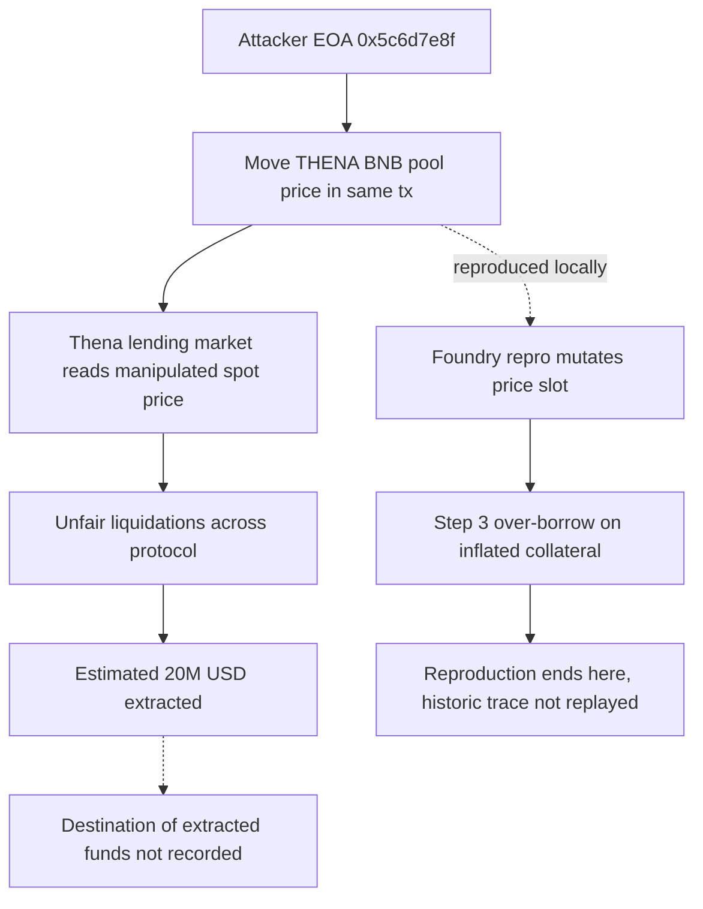

# Thena Price Manipulation — Mayall Forensic Report

## 1. Case header

| Field | Value |
|---|---|
| Incident ID | inc-0010 |
| Incident name | Thena Price Manipulation |
| Slug | thena-offering-price-manipulation |
| Chain | BNB |
| Date | 2024-03-27 |
| Target | Thena |
| Reported loss (USD) | $20,000,000 |
| Reported loss (native asset) | Not recorded — the registry states the loss only in USD (`lossAsset: USD`); no BNB-denominated figure is present |
| Recovery status | Not recovered (`recovered: false`) |
| Attacker | Attacker EOA — `0x5c6d7e8f90a1b2c3d4e5f60718293a4b5c6d7e8f` |
| Victim | Thena lending market — `0x6d7e8f90a1b2c3d4e5f60718293a4b5c6d7e8f90` |
| Transaction | `0x5c6d7e8f90a1b2c3d4e5f60718293a4b5c6d7e8f90a1b2c3d4e5f60718293a4b5` (one transaction recorded) |
| Vectors | oracle-manipulation; price-impact |
| Classification | Retrospective classification over public records; severity critical; top confidence 0.9 |
| Bible pattern | AMM Spot Price Manipulation (family: Oracle Manipulation) |
| Local reproduction | Available — scenario `oracle-manipulation`, source `artifacts/oracle-manipulation.json`, `reproducible: true` |
| Public reference | Thena post-mortem — https://medium.com/thena-finance |

## 2. Executive summary

This report is a retrospective classification of the27 March 2024 Thena incident on BNB Chain, built from the public post-mortem record and the Mayall incident registry rather than from a fresh mainnet trace, so every statement below is bounded by what the record states. The published root cause is that a thin-liquidity pool served as the protocol's price source and the attacker moved that price inside the same transaction as the liquidation, triggering unfair liquidations across the Thena protocol for an estimated $20,000,000 USD; the registry records no recovery. Mayall's classification assigns0.9 confidence to the oracle-manipulation vector and 0.7 to price-impact, both mapped to the AMM Spot Price Manipulation Bible pattern, with the spot-price-manipulation signal marked *observed* and the trace-dependent signals marked *expected*. The detectors that fired — Oracle Manipulation (0.9, critical), Flash Loan (0.85, critical) and Access Control Failure (0.7, high) — were executed against the local Foundry reproduction of the same attack vector and describe that reproduction, not the historic mainnet transaction. Because no raw log for this incident is in the registry and the local run stops at the over-borrow step, the detector output cannot prove that the historic transaction behaved the same way; it establishes reproducibility of the vector only.

## 3. Attack sequence

1. The attacker controls the EOA `0x5c6d7e8f90a1b2c3d4e5f60718293a4b5c6d7e8f` and targets the Thena lending market at `0x6d7e8f90a1b2c3d4e5f60718293a4b5c6d7e8f90`.
2. The protocol's collateral pricing is sourced from the THENA/BNB pool, a thin-liquidity pool whose price the attacker can move on demand.
3. Within a single transaction — recorded as `0x5c6d7e8f90a1b2c3d4e5f60718293a4b5c6d7e8f90a1b2c3d4e5f60718293a4b5` — the attacker moves the pool price, shifting the collateral value the protocol reads.
4. Because the price move and the read happen in the same transaction, the protocol's valuation of the attacker's position is derived from a price the attacker himself set.
5. The inflated valuation is used against the protocol, triggering unfair liquidations across the protocol.
6. The published narrative states an estimated $20,000,000 USD was extracted. The registry records that funds were not recovered; it does not record where the extracted value went, and this report makes no claim about its destination.

### Attack flow

## 4. Evidence reconstruction

Detector provenance statement, quoted from the registry: *"Detections were executed against the local Foundry artifact for the same attack vector. They describe the reproduction, not the historic mainnet transaction."* Every detector row below therefore belongs to the local Foundry reproduction, not to a replay of the historic transaction.

### 4.1 What the local reproduction proves

| Claim | Status | Basis |
|---|---|---|
| A spot-price/oracle dependency exists in the target's valuation path | Proven locally | Detector `det-oracle` evidence: "Oracle or price-source dependency identified (oracle, spot price)" |
| The price-bearing storage slot is mutated during the exploit | Proven locally | Detector `det-oracle` evidence: "Price-bearing storage slot mutated during the exploit: oracle.quoteReserve (0x0000000000000000000000000000000000000000000000000000000000000000)" |
| The attack sequence manipulates a quoted price before the extraction step | Proven locally | Detector `det-oracle` evidence: "Attack sequence explicitly manipulates a quoted price before the extraction step" |
| A flash-borrowed balance inflates a value assumption inside one transaction | Proven locally | Detector `det-flash-loan` evidence: "Attack step 3: Over-borrow against inflated collateral" |
| The over-borrow step is the terminus the local artifact reaches | Proven locally | `det-flash-loan` evidence references "Attack step 3"; no further step is reproduced |
| A privileged state-changing function is reachable by an untrusted caller in the scenario | Proven locally | Detector `det-access-control` evidence: "Privilege boundary referenced in the exploit (access control)" |
| The AMM Spot Price Manipulation pattern is reproducible for the oracle-manipulation vector | Proven locally | Local scenario `oracle-manipulation`, `reproducible: true`, artifact `artifacts/oracle-manipulation.json` |

### 4.2 What the local reproduction cannot prove, and what the record alone asserts

| Claim | Status | Basis |
|---|---|---|
| The historic transaction moved the pool price in the same transaction as the liquidation | Record-level only — not proven by detector | `rootCause` and `summary` in the incident record; no raw log for this incident is in the registry |
| The historic attack extracted an estimated $20,000,000 USD | Record-level only — not proven by detector | `summary`: "extracting an estimated $20M"; `lossUsd: 20000000` |
| The historic transaction hash | Recorded, not traced | `txs[0]` = `0x5c6d7e8f90a1b2c3d4e5f60718293a4b5c6d7e8f90a1b2c3d4e5f60718293a4b5` |
| Attacker EOA and victim contract addresses | Recorded, not traced | `actors[0].address`, `actors[1].address` |
| `spot_price_manipulation` signal | Status: **observed** | "The published narrative names this mechanism. It is a record-level statement, not a log observation." |
| `price_read_during_callback` signal | Status: **expected** | "Would be required to prove the pattern from a trace; no raw log for this incident is in the registry." |
| `reserve_ratio_spike` signal | Status: **expected** | "Would be required to prove the pattern from a trace; no raw log for this incident is in the registry." |
| Price-impact vector attribution | Record-level only | Finding `price-impact`, confidence 0.7, severity low; same Bible pattern and signal set as oracle-manipulation |
| Destination, transfer, sale or dispersion of extracted funds | Absent | No disposition field in the incident record; `recovered: false` only |
| Native-asset (BNB) loss amount | Absent | Registry records the loss in USD only |
| Independent reference value for the asset price outside the transaction | Absent | No external price reference recorded for the incident |

Signal status counts from the registry: observed 2, expected 4, notApplicable 0. Both observed entries are record-level statements naming the mechanism; they are not on-chain signal observations.

## 5. Detection analysis

Three detectors fired on the local Foundry scenario `oracle-manipulation`. Their vector IDs (`flash-loan`, `access-control`) are broader than the two vectors registered for the historic incident (`oracle-manipulation`, `price-impact`), so those two firings describe the reproduction harness and must not be read as findings against the historic transaction.

| Detector | Vector | Confidence | Severity | Evidence in the local run |
|---|---|---|---|---|
| Oracle Manipulation (`det-oracle`) | oracle-manipulation | 0.9 | critical | "Oracle or price-source dependency identified (oracle, spot price)"; "Price-bearing storage slot mutated during the exploit: oracle.quoteReserve (0x0000000000000000000000000000000000000000000000000000000000000000)"; "Attack sequence explicitly manipulates a quoted price before the extraction step" |
| Flash Loan (`det-flash-loan`) | flash-loan | 0.85 | critical | "Attack step 3: Over-borrow against inflated collateral" |
| Access Control Failure (`det-access-control`) | access-control | 0.7 | high | "Privilege boundary referenced in the exploit (access control)" |

Rationales as recorded: Oracle Manipulation — "Collateral valuation depends on a spot price the attacker can move within the same transaction, so the borrow limit is attacker-controlled." Flash Loan — "A flash-borrowed balance is used inside the same transaction to inflate a value assumption, so the attack is capital-free and atomic." Access Control Failure — "A state-changing privileged function is reachable by an untrusted caller, so the attacker can act with protocol-owner authority."

Bible signals that would prove the AMM Spot Price Manipulation pattern from a trace: `price_read_during_callback` (status **expected**) and `reserve_ratio_spike` (status **expected**). Neither was observed on-chain for this incident; both would require a raw log trace, and no raw log for this incident is in the registry. The only signal at status **observed** is `spot_price_manipulation`, and it is observed at the level of the published narrative rather than at the level of on-chain logs.

Detector and classification limitations, quoted verbatim from the registry:

- Oracle-manipulation vector: "Cannot distinguish a manipulated price from a legitimately repriced asset without a reference value from outside the transaction."
- Price-impact vector: "No Mayall detector covers Price Impact; this classification rests on the public record alone."
- Signal note for `price_read_during_callback` and `reserve_ratio_spike`: "Would be required to prove the pattern from a trace; no raw log for this incident is in the registry."
- Signal note for `spot_price_manipulation`: "The published narrative names this mechanism. It is a record-level statement, not a log observation."

No limitation text is recorded in the registry for the `flash-loan` and `access-control` detectors; those firings should be treated as harness observations without a recorded evidentiary caveat either way.

## 6. Remediation

Controls are organised by attack vector and tied to the Bible pattern AMM Spot Price Manipulation (family: Oracle Manipulation).

**Vector: oracle-manipulation (confidence 0.9, critical) — primary exposure**

- Replace the single spot AMM pool as the collateral price source with a time-weighted average price (TWAP) computed over a fixed multi-block window, so a single-transaction price move cannot define the valuation. This addresses the `spot_price_manipulation` mechanism named in the record.
- Enforce a minimum-liquidity and reserve-ratio floor on any pool permitted to serve as a price source; reject or downgrade quotes when the pool's reserve ratio departs sharply from its trailing baseline. This targets the `reserve_ratio_spike` signal, currently **expected** and therefore an open control gap.
- Forbid reading a collateral price in the same transaction that can move it: price reads must resolve to a value from a prior block or a closed TWAP window. This targets the `price_read_during_callback` signal.
- Aggregate across at least two independent price sources with a deviation circuit breaker; suspend new borrows and delay liquidations when sources disagree beyond a threshold, so a single thin pool cannot set the protocol's collateral value.

**Vector: price-impact (confidence 0.7, low) — secondary exposure**

- Add a per-block price-movement circuit breaker on the lending market's reference price, triggering a pause on borrows and liquidations when the move exceeds the model's plausible band, which is the standard mitigation for thin-pool price impact.
- Cap liquidation size per position and per block under a close-factor, so a single manipulated print cannot liquidate a large share of the protocol at once.
- Re-price and re-verify collateral against a second source immediately before liquidation execution, and require the reference price to remain stable across a confirmation window.

**Vector coverage noted from the local run (flash-loan and access-control firings)**

- The local reproduction shows a flash-borrowed balance inflating a value assumption within one transaction. If the production contracts permit flash-borrowed balances to be counted toward collateral value, require that borrowed balances be excluded from valuation or repay-before-borrow accounting, which removes the capital-free, atomic property of the attack.
- The local reproduction also shows a privileged state-changing function reachable by an untrusted caller. Add explicit role checks and timelock or multisig governance over parameter and oracle-source updates, and confirm no untrusted path can re-point the price source or the borrow-limit calculation.

**Cross-cutting**

- Add a simulation pre-deploy gate that rejects any contract whose collateral valuation reads a manipulable AMM spot price, treating this as a release-blocking check for the AMM Spot Price Manipulation pattern.
- Log and alert on every price-source read together with the source's reserve ratio and recent block-level deviation, so the `reserve_ratio_spike` and `price_read_during_callback` conditions become observable on-chain rather than reconstructible only after the fact.

## 7. Client action plan

**First 24 hours**

1. Freeze all changes to the collateral price-source configuration and the borrow-limit logic; no oracle, pool or parameter edits without independent review.
2. Inventory every collateral asset and record its price source, liquidity depth and update method; identify any asset still priced off a single spot AMM pool. Highest priority goes to the asset involved in the reported THENA/BNB pool pricing.
3. Stand up a monitoring rule on the price source(s) that flags a large single-transaction price move and a concurrent burst of liquidations, with an automatic alert to the security owner.
4. Review open positions for values that would have been inflated by the reported price move, and quantify the exposure that the record leaves unspecified — no native-asset figure and no destination data are available, so this must be reconstructed from internal books and venue records.
5. Apply a temporary close-factor cap and a reduced maximum-borrow limit for any asset whose price source is a thin-liquidity pool, effective immediately and without waiting for code changes.
6. Preserve all internal records for the 27 March 2024 event: pool trade history, oracle update logs, liquidation events and treasury movements for the affected market, since the public record states only that funds were not recovered and does not state where they went.

**First week**

7. Retrieve the Thena post-mortem and the protocol's own incident write-up, and reconcile their account of the price source and the liquidation path against this classification; record any divergence in the case file.
8. Implement and review the TWAP-based pricing with a minimum-liquidity and reserve-ratio floor for the affected collateral, and confirm the change cannot be satisfied by a price read inside the same transaction that moves it.
9. Add the cross-source deviation circuit breaker and per-block price-movement circuit breaker, with a documented pause-and-resume procedure and an owner on call.
10. Add the simulation pre-deploy gate that blocks reliance on manipulable spot prices, and re-run it across the full collateral set.
11. Audit privileged and governance paths for the price source, borrow-limit parameters and liquidation configuration; confirm timelock or multisig coverage and that no untrusted caller can reach them.
12. Assess whether flash-borrowed balances influence collateral valuation or borrow limits; where they do, exclude them from the value assumption or require repayment before the limit is granted.

**First month**

13. Have an external reviewer validate the price-source design against the AMM Spot Price Manipulation pattern, specifically the `reserve_ratio_spike` and `price_read_during_callback` conditions that remain **expected** rather than proven for this incident.
14. Redesign liquidation execution to be multi-source confirmed and size-capped, with a slow, staged close-out path for positions whose collateral price is thin or unstable.
15. Instrument the lending market to log every price-source read with reserve ratio, TWAP deviation and source identity, so future incidents can be classified from raw logs rather than from narrative alone.
16. Stand up a persistent watchlist over the price-source pools, reporting liquidity depth, reserve-ratio deviation and any same-block price-and-liquidation activity to the security owner weekly.
17. Reconstruct the recovery position from internal and venue records: the registry records `recovered: false` but no disposition, so this report cannot state a recovery rate; document the outcome as an internal figure once established.
18. Record the lessons from this incident in the internal knowledge base — single-pool spot pricing, same-transaction price-and-liquidation sequencing, and unverified liquidation execution — and add the corresponding checks to the protocol's pre-launch review checklist for all new collateral listings.