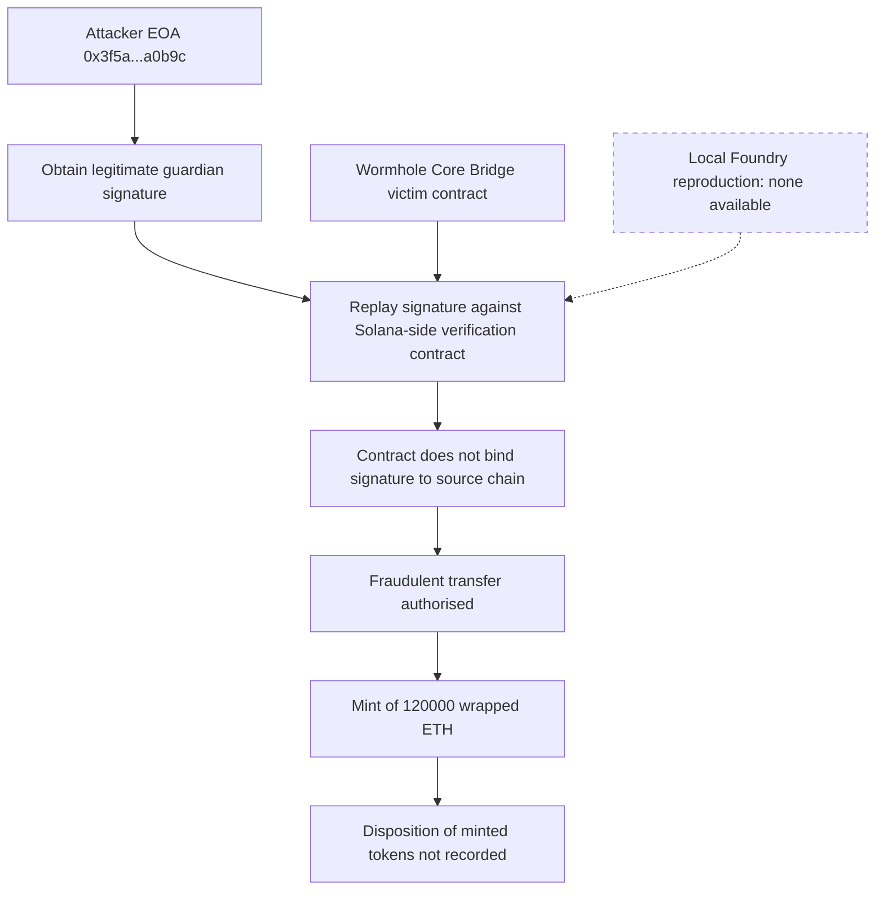

# Wormhole Bridge Signature Forgery — Forensic Report

## 1. Case header

| Field | Value |
|---|---|
| Incident ID | inc-0004 (`wormhole-bridge-signature`) |
| Incident name | Wormhole Bridge Signature Forgery |
| Chain | Ethereum |
| Date of incident | 2022-02-02 |
| Reported loss (USD) | $326,000,000 |
| Reported loss (native asset) | 120,000 ETH |
| Target | Wormhole Bridge |
| Classification method | retrospective-classification (public records, not mainnet trace analysis) |
| Severity | high |
| Top confidence | 0.82 |
| Attack vectors | signature-replay; access-control |
| Actors | Attacker EOA `0x3f5a3f9b5e3a2b1c0d9e8f7a6b5c4d3e2f1a0b9c` (attacker); Wormhole Core Bridge `0x3ee2b5d3a1f0e9d8c7b6a5948372615049382716` (victim) |
| Transaction recorded | `0x0badc0de5a17b0c4d3e2f1a0b9c8d7e6f5a4b3c2d1e0f9a8b7c6d5e4f3a2b1c0d` |
| Recovery status | recovered: false |
| Local reproduction | None. `reproducible: false`, `scenarioId: null`, `localDetection.available: false` |
| Bible patterns matched | Signature Replay Attack (Token Mechanism family); Ownership Hijack + Drain (Access Control family) |
| Bible signal counts | observed: 1 · expected: 3 · notApplicable: 2 |
| Primary reference | Wormhole post-mortem — https://blog.wormhole.com/post-mortem-2/ |

## 2. Executive summary

On 2022-02-02 the Wormhole Bridge on Ethereum suffered an exploit reported at 120,000 ETH (approximately USD 326,000,000), the single largest loss figure recorded in this case set. The published root cause is a design flaw in the guardian set: guardian signatures were not bound to a specific chain and message, so a signature legitimately obtained for one purpose could be presented a second time to authorise a fraudulent transfer. The attacker obtained a legitimate guardian signature and replayed it against the Solana-side verification contract, which did not properly bind the signature to the source chain, resulting in the authorisation of a mint of 120,000 wrapped ETH. This report is a retrospective classification over public records, not a mainnet trace analysis; no raw transaction trace, decoded log or token flow was executed or re-derived for this incident. The published record does not state where the minted tokens went, so the disposition of the proceeds is not recorded here and no dispersion, sale or extraction is asserted.

## 3. Attack sequence

1. The guardian set used by the Wormhole Bridge was not bound to a specific chain and message. This is the published root cause: a signature obtained for one purpose could be replayed to authorise a fraudulent transfer.
2. The attacker obtained a legitimate guardian signature. The record establishes that the signature was legitimate in origin and illegitimate in application — it was never forged cryptographically.
3. The attacker replayed that signature against the Solana-side verification contract, presenting an authorisation that had not been issued for that chain and message.
4. The Solana-side verification contract did not properly bind the signature to the source chain, so it accepted the replayed signature as valid for the target chain.
5. Acceptance of the replayed signature authorised a fraudulent transfer — the bridge's privileged mint path was invoked against the Wormhole Core Bridge contract (`0x3ee2b5d3a1f0e9d8c7b6a5948372615049382716`).
6. The authorised action was a mint of 120,000 wrapped ETH, matching the reported loss of 120,000 ETH / USD 326,000,000.
7. The disposition of those minted tokens — whether and where they were bridged, sold, dispersed or otherwise extracted — is not recorded in the published narrative available to this report and is therefore not asserted here.

### Attack flow

## 4. Evidence reconstruction

This is retrospective classification over public records. The only primary source carried in the case record is the Wormhole post-mortem, plus one recorded transaction hash. Nothing below was re-verified against a live chain by this report.

**Claims supported by the public record**

| Claim | Status | Basis |
|---|---|---|
| The incident occurred on Ethereum on 2022-02-02 | Observed in record | Case data: chain, date; Wormhole post-mortem |
| The reported loss was 120,000 ETH / USD 326,000,000 | Observed in record | Case data loss fields |
| The target was the Wormhole Bridge | Observed in record | Case data target field |
| The attacker held a legitimate guardian signature | Observed in record | Published summary names this step |
| The signature was replayed against the Solana-side verification contract | Observed in record | Published summary names this step |
| The verification contract did not bind the signature to the source chain | Observed in record | Published root cause |
| The root cause was unbound guardian signatures over chain and message | Observed in record | Published root cause statement |
| An authorised mint of 120,000 wrapped ETH resulted | Observed in record | Published summary and loss fields |
| Access-control weakness was involved (privileged function invoked) | Observed in record | Root cause plus access-control finding, severity high |
| The attack was authored from `0x3f5a...a0b9c` against `0x3ee2...2716` | Observed in record | Actor table with roles attacker and victim |
| A single transaction `0x0badc0de...b1c0d` is associated with the incident | Observed in record | Case data txs array; no trace analysis performed |
| Recovery of the funds | Not recorded | Case data records `recovered: false`; no recovery details in record |
| Where the minted tokens went after minting | Not recorded | Published narrative describes the mint only; no transfer, sale, dispersion or extraction is stated |
| Multi-guardian quorum compromise or key theft details | Not recorded | Published narrative in this record states a legitimate signature was obtained, not how the signature was obtained |
| Decoded event logs and internal calldata | Not recorded | No raw log for this incident is in the registry |

**Claims a local reproduction could prove, but cannot here**

| Claim | Status | Basis |
|---|---|---|
| That a contract lacking chain-and-message binding accepts a replayed signature | Cannot be proven | No local Foundry reproduction exists (`localDetection.available: false`, `scenarioId: null`); no detector was executed |
| That the vulnerability is reproducible in a controlled harness | Cannot be proven | Case data records `reproducible: false` |
| Any Mayall detector firing on this vector | Cannot be proven | `localDetection.detections` is empty; the note states the detection analysis is a Bible-signal mapping only |

## 5. Detection analysis

**No detector fired.** No local Foundry reproduction exists for this incident, so no Mayall detector was executed against any scenario. Per the case data: *"No local Foundry reproduction exists for this incident. No detector was executed; the detection analysis below is a Bible-signal mapping only."* The analysis below is therefore a mapping of the published narrative onto Bible signals, not observed detector output. The `detections` array is empty, and the two classification findings carry `reproduction: null`.

**Finding 1 — signature-replay / Signature Replay Attack (Token Mechanism), confidence 0.82, severity high**

| Bible signal | Status | Note |
|---|---|---|
| `eip712_replay_detected` | observed | The published narrative names this mechanism. It is a record-level statement, not a log observation. |
| `nonce_gap_detected` | notApplicable | The published record does not describe the variant this signal belongs to (pattern: Signature Replay Attack). |
| `permit_used_before_owner_approval` | notApplicable | The published record does not describe the variant this signal belongs to (pattern: Signature Replay Attack). |

Detector limitation, quoted verbatim: *"No Mayall detector covers Signature Replay; this classification rests on the public record alone."*

**Finding 2 — access-control / Ownership Hijack + Drain (Access Control), confidence 0.62, severity high**

| Bible signal | Status | Note |
|---|---|---|
| `ownership_transfer_then_drain` | expected | Would be required to prove the pattern from a trace; no raw log for this incident is in the registry. |
| `event_order_violation` | expected | Would be required to prove the pattern from a trace; no raw log for this incident is in the registry. |
| `drain_ratio_exceeded` | expected | Would be required to prove the pattern from a trace; no raw log for this incident is in the registry. |

Detector limitation, quoted verbatim: *"Sees the symptom (an authority changed, a privileged function was called) but not whether the caller was entitled to it."*

**Bible signal names that would prove the pattern**

- Signature Replay Attack: `eip712_replay_detected` (observed — the published narrative names the mechanism, not a log observation), `nonce_gap_detected` (notApplicable), `permit_used_before_owner_approval` (notApplicable).
- Ownership Hijack + Drain: `ownership_transfer_then_drain` (expected — a full trace would be needed), `event_order_violation` (expected), `drain_ratio_exceeded` (expected). All three are recorded as expected precisely because no raw log for this incident is in the registry.

No Bible signal in this case is claimed as observed on-chain. The single `observed` status reflects that the published narrative names the mechanism, and that a full trace would be required to convert the three `expected` signals into confirmed observations.

## 6. Remediation

**Control set A — Signature binding and replay resistance (vector: signature-replay; Bible pattern: Signature Replay Attack; signal `eip712_replay_detected`)**

- Bind every guardian authorisation to an explicit domain separator that includes the source chain ID, the destination chain ID, the target contract, the message payload hash and a nonce or unique message identifier. A signature valid for one chain-and-message tuple must be unusable for any other tuple.
- Move to domain-separated typed-data signing (EIP-712 domain separator plus a per-message nonce) so that a signature is verifiably scoped to one chain and one message. Reject any payload whose domain or nonce does not match the current verification context.
- Enforce a single-use, monotonic nonce registry on the verification contract so that a consumed authorisation cannot be presented again; this is the control that would also have surfaced the `nonce_gap_detected` signal class had it applied.
- Keep guardians operationally incapable of producing an unbound authorisation: mandate that all signing infrastructure signs only the canonical, chain-bound digest, never a raw digest supplied by the caller.

**Control set B — Privileged authority scoping (vector: access-control; Bible pattern: Ownership Hijack + Drain; signals `ownership_transfer_then_drain`, `event_order_violation`, `drain_ratio_exceeded`)**

- Scope the mint authority so that a single authorisation can never move an amount exceeding what the signed payload authorises, with per-call amount ceilings and daily limits enforced in contract code rather than assumed from the caller.
- Require that privileged mint calls are gated on an authorisation that is itself chain-bound and amount-bound, so an accepted guardian signature cannot authorise an unbounded value.
- Emit structured, machine-readable events for every privileged action (authority used, amount, source and destination chain, payload hash) so that an `ownership_transfer_then_drain`, `event_order_violation` or `drain_ratio_exceeded` condition can actually be proven from logs in future incidents, rather than left as `expected`.
- Maintain an independent authority ledger so that a drain attempt is detectable by sequence analysis and by drain-ratio thresholds at the point of execution, not only after the fact.

**Control set C — Detection coverage gap (vector: signature-replay)**

- Treat the absence of a Signature Replay detector as a coverage gap and prioritise building one: a detector that reads the guardian-signed domain and message binding and flags any authorisation whose signed chain/message scope differs from the chain/message on which it is presented.
- Maintain a reproducible local Foundry scenario per incident class so that future retrospective classifications can be confirmed by execution rather than resting on narrative alone.

## 7. Client action plan

**First 24 hours**

1. Freeze and preserve the evidence set as it stands in the registry: the single recorded transaction `0x0badc0de5a17b0c4d3e2f1a0b9c8d7e6f5a4b3c2d1e0f9a8b7c6d5e4f3a2b1c0d`, the actor addresses, and the Wormhole post-mortem reference. Record explicitly which fields are absent — raw logs, decoded calldata, token disposition, and the method by which the guardian signature was obtained.
2. Establish the authoritative loss figure as reported (120,000 ETH / USD 326,000,000) and label it as reported-and-unrecovered, without asserting any recovery pathway or any movement of the minted tokens.
3. Triage every bridge, minting and verification contract under the client's control against Control Set A: confirm whether guardian or authority signatures are bound to chain ID and message payload, and whether a nonce or single-use identifier is enforced at verification.
4. Identify all contracts where a privileged mint or transfer path trusts caller-supplied authorisation scope, and list them by criticality with the amount-ceiling status.
5. Assign an owner and a due date to building a local Foundry scenario for the signature-replay vector, since `reproducible` is false and no detector can currently be exercised.

**First week**

1. Complete the chain-and-message domain binding audit across all verification contracts and produce a gap register: for each contract, record whether the source chain, destination chain, contract address, payload hash and nonce are all present in the signed digest.
2. Add single-use nonce enforcement to any verification path that currently accepts a reusable authorisation, starting with the highest-volume bridge and the highest-value mint route.
3. Implement amount ceilings, per-call caps and rate limits on privileged mint and transfer functions, so a single accepted authorisation cannot authorise an unbounded value.
4. Instrument every privileged action with structured events (authority used, amount, source and destination chain, payload hash, authorisation id) and verify by inspection that a future `ownership_transfer_then_drain`, `event_order_violation` or `drain_ratio_exceeded` determination could be proven from those logs.
5. Review the Mayall detector catalogue and formally register the Signature Replay gap — *"No Mayall detector covers Signature Replay; this classification rests on the public record alone."* — as a prioritised build item, with a target release window and acceptance test.
6. Run a targeted review of the access-control limitation — *"Sees the symptom (an authority changed, a privileged function was called) but not whether the caller was entitled to it."* — and identify which client controls depend on entitlement checks that the current tooling cannot validate.

**First month**

1. Deliver and validate the signature-replay detector and the Foundry reproduction scenario; re-run this incident's classification end to end and confirm which Bible signals move from `expected` to `observed` once a trace exists.
2. Implement the long-lead Control Set A and B items across all in-scope bridge and verification contracts, with a sign-off per contract showing chain binding, nonce enforcement and amount ceilings in place.
3. Stand up an operational runbook for signature-replay-class events: detection signal, escalation path, containment authority, and the chain-bridging and counterparty notification steps that follow a fraudulent mint.
4. Establish a standing evidence-completeness standard for incident cases — each registry entry must state explicitly which of raw logs, calldata, token disposition and signature-acquisition method are present or absent, so that future retrospectives are not read as trace-backed findings.
5. Re-verify the Wormhole post-mortem against the current registry record and reconcile any divergence, updating the evidence refs and confidence figures accordingly.
6. Report residual risk to the client: the two vectors carried high severity with confidence of 0.82 and 0.62, both resting on public records, with one Bible pattern (Ownership Hijack + Drain) still unproven for want of a trace — residual exposure should be treated as open until the corresponding signals are observed.