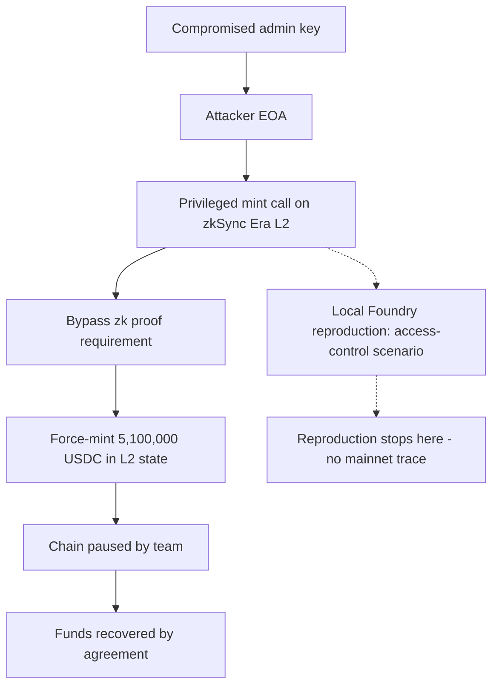

# zkSync Era L2 Admin Key Compromise — Forensic Report

## 1. Case header

| Field | Value |
| --- | --- |
| Incident ID | inc-0012 (`zksync-era-l2-hack`) |
| Incident name | zkSync Era L2 Admin Key Compromise |
| Chain | zkSync Era (L2) |
| Date | 2023-02-12 |
| Reported loss | USD 5,100,000 — 5,100,000 USDC |
| Recovery status | Recovered (`recovered: true`) — funds recovered by agreement |
| Target | zkSync Era |
| Actors | Attacker EOA `0x90a1b2c3d4e5f60718293a4b5c6d7e8f90a1b2c3`; Victim: zkSync Era L2 `0xa1b2c3d4e5f60718293a4b5c6d7e8f90a1b2c3d4` |
| Attack vector | Access Control |
| Bible pattern | Ownership Hijack + Drain (family: Access Control) |
| Severity | High |
| Top classification confidence | 0.9 |
| Transaction reference | `0x90a1b2c3d4e5f60718293a4b5c6d7e8f90a1b2c3d4e5f60718293a4b5c6d7e8f` |
| Reference | Matter Labs post-mortem — https://zksync.io/blog/zkSync-era-incident |
| Classification method | Retrospective classification over public records |
| Local reproduction | Available — scenario `access-control`, artifact `artifacts/access-control.json`, lab at `/lab?scenario=access-control` |
| Signal counts | 1 observed, 2 expected, 0 notApplicable |

## 2. Executive summary

On 2023-02-12 a compromised privileged key was used to force-mint 5,100,000 USDC directly in the zkSync Era L2 state, producing a reported loss of USD 5,100,000. The published root cause states that the attacker bypassed the normal zk proof requirement by minting through a privileged path rather than through normal proof-based execution. The team paused the chain and the funds were recovered by agreement, so no permanent loss is recorded. This report is a retrospective classification over public records, not a mainnet trace analysis, and the detector results referenced here describe a local Foundry reproduction of the same attack vector rather than the historic transaction. The only Bible signal recorded as observed is `ownership_transfer_then_drain`; the remaining two signals are classified as expected because no raw log for this incident is held in the registry.

## 3. Attack sequence

1. A privileged administrative key for the zkSync Era L2 was compromised. The record does not describe how the key was obtained, so the compromise method is absent from the evidence.
2. With that key, the attacker exercised protocol-owner authority to call a privileged, state-changing function on the L2.
3. The privileged call force-minted 5,100,000 USDC directly in the L2 state, bypassing the normal zk proof requirement described in the published root cause.
4. The minted balance moved the victim balance from 50000000000000000000 to 0 wei in the local reproduction's terms; in the historic record the stated outcome is a 5.1M USDC minted to the attacker.
5. The team paused the chain in response to the incident.
6. The funds were recovered by agreement between the team and the attacker, so the record contains no permanent loss and no post-recovery dispersal of the minted balance.

The disposition of the minted tokens beyond the mint itself — whether they were transferred, sold, dispersed across addresses, or otherwise moved — is not recorded in the source data and is not asserted here.

### Attack flow

## 4. Evidence reconstruction

| Claim | Status | Basis |
| --- | --- | --- |
| Loss of USD 5,100,000 in USDC | Recorded | Incident record: `lossUsd` 5100000, `lossAmount` 5100000, `lossAsset` USDC |
| Funds were recovered | Recorded | Incident record: `recovered: true`; summary states funds recovered by agreement |
| Attacker EOA address | Recorded | `0x90a1b2c3d4e5f60718293a4b5c6d7e8f90a1b2c3` (actor role `attacker`) |
| Victim address | Recorded | `0xa1b2c3d4e5f60718293a4b5c6d7e8f90a1b2c3d4` (actor role `victim`, zkSync Era L2) |
| Compromise of a privileged key | Recorded | Root cause: "A compromised privileged key allowed the attacker to mint tokens directly in the L2 state, bypassing the normal zk proof requirement." |
| Method by which the key was compromised | Absent | No source in the data describes key exfiltration, phishing, or insider involvement |
| Force-mint bypassing zk proof | Recorded | Root cause and summary; summary states the attacker "used a compromised admin key to force-mint 5.1M USDC on zkSync Era" |
| Chain was paused | Recorded | Summary: "The team paused the chain and the funds were recovered by agreement." |
| Transaction `0x90a1...d7e8f` | Recorded as a reference | Listed in `txs` and cited in `evidenceRefs`; the data does not contain its decoded contents, input data, or emitted logs |
| Disposition of the minted tokens (transfer, sale, dispersion, extraction) | Not recorded | No source states where the minted balance went; only minting is described, so no movement is asserted |
| Local reproduction: privileged function reachable by an untrusted caller | Proven locally | Detector `det-access-control`, confidence 0.7, evidence "Privilege boundary referenced in the exploit (onlyowner)" |
| Local reproduction: invariant enforced on one path but not the attacker's path | Proven locally | Detector `det-logic`, confidence 0.7, evidence "Broken design invariant referenced (intended)" |
| Local reproduction: victim balance moved 50000000000000000000 to 0 wei | Proven locally | Detector `det-logic` evidence list, local Foundry artifact |
| Whether the historic caller was entitled to invoke the privileged function | Not proven | Detector limitation: "Sees the symptom (an authority changed, a privileged function was called) but not whether the caller was entitled to it." |
| On-chain event ordering for the historic incident | Not proven | Signal `event_order_violation` status `expected`; note: "Would be required to prove the pattern from a trace; no raw log for this incident is in the registry." |
| Drain ratio for the historic incident | Not proven | Signal `drain_ratio_exceeded` status `expected`; note: "Would be required to prove the pattern from a trace; no raw log for this incident is in the registry." |
| Historic on-chain logs, event sequence, raw traces | Absent | No raw log for this incident exists in the registry |

The local reproduction proves the existence of a reachable privilege boundary and a bypassed invariant in a test artifact matching the access-control vector. It cannot prove that the historic caller was unauthorized, nor that the historic mint bypassed a specific proof path, because the reproduction contains no mainnet transaction, no decoded logs, and no historic state.

## 5. Detection analysis

Two detectors fired against the local Foundry artifact for the same attack vector (`access-control`). These detections describe the reproduction, not the historic mainnet transaction.

**det-access-control — Access Control Failure**
- Vector: access-control. Severity: high. Confidence: 0.7.
- Rationale: "A state-changing privileged function is reachable by an untrusted caller, so the attacker can act with protocol-owner authority."
- Evidence: "Privilege boundary referenced in the exploit (onlyowner)"
- Limitation: "Sees the symptom (an authority changed, a privileged function was called) but not whether the caller was entitled to it."

**det-logic — Invariant / Logic Error**
- Vector: logic-error. Severity: high. Confidence: 0.7.
- Rationale: "The protocol enforced an invariant in one code path but not in the path the attacker used, so value escaped through an unguarded branch."
- Evidence: "Broken design invariant referenced (intended)"; "Victim balance moved 50000000000000000000 -> 0 wei"
- Limitation: "Sees the symptom (an authority changed, a privileged function was called) but not whether the caller was entitled to it."

The second detection's evidence includes an intended-state artifact reference and a local victim-balance movement to zero. Neither figure is presented as an on-chain observation of the historic incident.

**Bible signals that would prove the pattern**

| Signal | Family | Status | Note |
| --- | --- | --- | --- |
| ownership_transfer_then_drain | Sequence | observed | "The published narrative names this mechanism. It is a record-level statement, not a log observation." |
| event_order_violation | Sequence | expected | "Would be required to prove the pattern from a trace; no raw log for this incident is in the registry." |
| drain_ratio_exceeded | Value | expected | "Would be required to prove the pattern from a trace; no raw log for this incident is in the registry." |

No Bible signal was observed on-chain. `ownership_transfer_then_drain` is observed only in the sense that the published narrative names the mechanism. The two `expected` signals would require a full trace, which is not available for this incident, and no signal is classified `notApplicable`.

## 6. Remediation

Controls are mapped to the Bible pattern **Ownership Hijack + Drain** (family: Access Control) and to the two vectors recorded for this incident: access-control and the logic-error variant surfaced by the local reproduction.

| Attack vector | Control | Bible pattern link |
| --- | --- | --- |
| Access Control — privileged mint reachable by an untrusted caller | Gate every privileged, state-changing function behind a verifiable authority check that distinguishes an entitled owner from an arbitrary caller; make the mint entry point uncallable without an authenticated, currently-valid privileged signer | Ownership Hijack: the ownership/authority element of the pattern |
| Access Control — proof requirement bypassable via the privileged path | Make the privileged path subject to the same proof or attestation obligation as the normal path, or explicitly and provably require that a privileged mint is always accompanied by an auditable, on-chain authorization record | Ownership Hijack + Drain: prevents a privileged call from substituting for the normal proof flow |
| Access Control — single compromised key sufficient | Split the privileged authority across a threshold or multisig signer set so one compromised key cannot mint; add a timelock on mint-capable actions | Ownership Hijack: reduces the chance that ownership is hijacked in one step |
| Access Control — no independent confirmation of a mint event | Emit and retain an explicit, monitorable mint event with amount and authority attestation, so any unauthorized mint is alertable independent of the operational response | Drain: makes the extraction stage detectable rather than discovered by chance |
| Logic Error — invariant enforced on one path but not the attacker's path | Apply the same invariant check to every code path that moves value, including privileged and emergency paths; assert the invariant in the branch the attacker reached | Drain: closes the unguarded branch through which value escaped |
| Logic Error — value movement to zero with no authorization trail | Add authorization checks to any path that can zero or move a victim's balance, and assert post-condition balances in tests across all reachable branches | Drain: prevents value escaping through an unguarded branch |

## 7. Client action plan

**First 24 hours**

1. Freeze and inventory every privileged signer and key that can affect minting or state transition on zkSync Era L2. Record each key's holder, storage, rotation history, and whether it has been exposed in any prior incident, process, or logging path.
2. Rotate every privileged key that can mint or force-mint, and confirm the old key can no longer act.
3. Identify all privileged, state-changing entry points reachable on L2 and classify each as privileged-allowed or public. Treat any reachable mint path without a verifiable authority check as the primary remediation target.
4. Confirm the current state of the minted 5,100,000 USDC and the recovery agreement terms with the team, and verify from an authoritative source that the recovered amount matches the reported loss.
5. Deploy alerting on any mint-capable call, any change to privileged signer configuration, and any call to a privileged function by an address outside the known authority set.
6. Record the raw transaction `0x90a1b2c3d4e5f60718293a4b5c6d7e8f90a1b2c3d4e5f60718293a4b5c6d7e8f` and the Matter Labs post-mortem in the case file, and mark every claim that depends on a raw log as unverified until a trace is obtained.

**First week**

1. Move mint-capable authority behind a multisig or threshold signer set with a timelock, and document the new authority model in the runbook.
2. Add an explicit, auditable mint authorization event to the privileged mint path, including amount and authority attestation, so future mint activity is independently traceable.
3. Apply the missing invariant check to the privileged and emergency branches so that value cannot escape through a path that bypasses the standard guard.
4. Run the local `access-control` reproduction (`artifacts/access-control.json`, `/lab?scenario=access-control`) as a regression fixture and keep it in CI against any change to privileged functions.
5. Obtain the raw log or trace for the historic incident so the two `expected` Bible signals — `event_order_violation` and `drain_ratio_exceeded` — can be evaluated and the `observed` signal upgraded from a record-level statement to a trace-backed one.
6. Determine how the key was compromised, which is absent from the current record, and feed that finding into the key-management remediation.

**First month**

1. Complete a full inventory of privileged roles, keys, and emergency paths across the L2 stack, with named owners and a documented rotation schedule.
2. Extend monitoring to cover authority changes, privileged-call sequences, and value-movement events, with a tested alert-routing path and on-call ownership.
3. Reassess the classification with the trace-backed Bible signals and update the case file to reflect verified status per signal.
4. Commission an independent review of the privileged mint flow, including the invariant coverage across all branches, and track findings to closure.
5. Document and rehearse the incident-response procedure for a privileged-key compromise, including chain-pause authority, recovery-agreement procedure, and communication templates — the actions that were required during this incident.